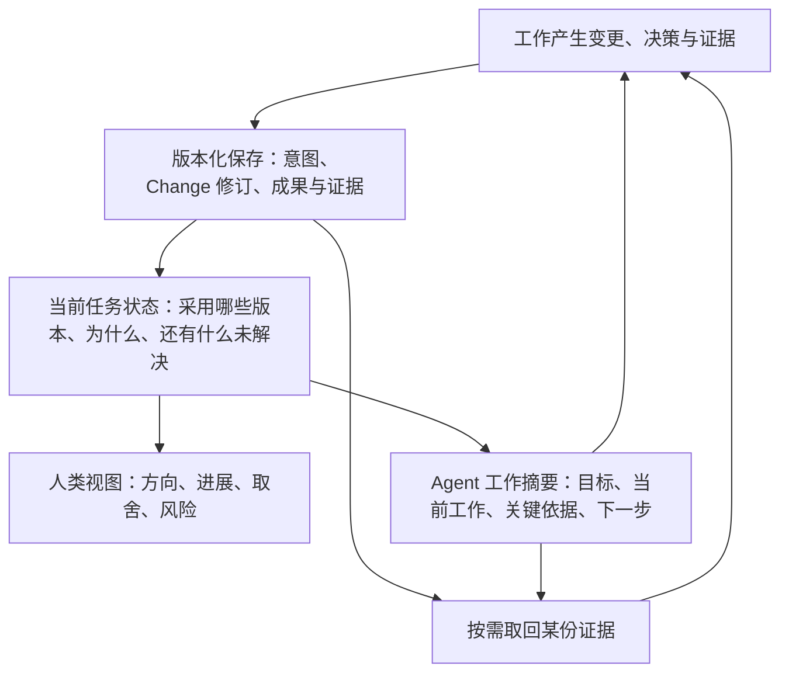

# 长程复杂任务状态管理：设计 v0.1

这是一份供逐版讨论的初步设计。它落实用户提供的[设计假设](../change-graph-task-state-design-hypothesis.md)及2026-10-10关于复杂任务、JJ、摘要和版本依赖的修订意见。它提出系统应该怎样工作，不声称方法有效、创新成立或已经实现。[近邻核验](neighbor-review.md)保存外部研究依据及其局限。

## 先看使用效果

一项开发工作经历多条路线研究、MVP、需求变化、暂停和返工。即使聊天经过多次压缩，接手者仍能理解：现在要实现什么，为什么采用当前路线，哪些成果可以接着用，哪些问题欠着，以及下一步该做什么。

日常推进以摘要为主。需要细节时才定向取回证据，避免每次接手都重读全部代码、日志和历史。工作变化写入任务状态；聊天负责讨论和行动，不作为唯一的事实存放处。

## 系统保存的是工作，而非聊天流水

推荐围绕稳定的 Change 组织工作。“研究 A 路线能否满足吞吐要求”是一个 Change；它从假设发展到原型和测试，再被暂停或重新启用，始终可以识别为同一项工作。与JJ的类比限于稳定身份和修订历史，工作语义由本设计定义。

同一目标下补充证据、修改实现、纠正结论，产生该 Change 的新 Revision；具有可独立取舍的目标或替代路线时，建立新的 Change。第一版由 Agent 提议边界，在审阅时修正，不把每次工具调用建成节点。大 Change 可拆成有独立结果的子工作，并保留来源关系。

每个 Change 的摘要应把工作讲清楚：试图解决什么，已有成果与结论是什么，凭什么相信，以及还有什么问题。失败记录说明失败条件和证据；成功记录也保留限制与技术债。链接指向具体版本的文件、测试或观察，不能只指向不断变化的“最新文件”。

未选择不等于失败，暂停不等于失效。路线优先级、结论是否可靠、工作是否完成分别表达，不能塞进一个“成功/失败”状态。

## 一个现状，多个被保留的方向

任务有一个供人和 Agent 共同使用的当前状态：有效目标和约束、正在采用的路线、可用成果、未解决问题与下一步。它引用具体 Change Revision 和证据版本，不复制整份历史。

Change Graph 保存修订、分支、决策与依赖。原始成果和观察保存于证据文件。当前状态是对这些记录的明确选择和概括；其一致性可以按引用校验，但不假设任意聊天都能自动重建成权威状态。

图中的循环是工作迭代，不是每轮重复生成全部资料。人类视图与 Agent 摘要注明所依据的同一个任务状态版本，避免一边显示已经换路线，另一边仍执行旧计划。

## 前提更新后，旧推理怎样处理

用户所说的版本管理是本设计的核心：意图、关键条件、Change 修订、证据和任务现状均保留版本。结论引用它实际使用的前提版本，不能用“现在的条件”悄悄替换当时的依据。

前提更新时，沿已记录的依赖找到受影响结论，将其标为需要重新判断。随后由 Agent 做定向推导或验证：仍适用的结论确认到新前提；不再适用的结论修订；缺少证据的继续保留为未决。旧版本留下来解释历史，不再直接作为新条件下已确认的依据。

更新并不意味着所有后续成果都错了。优先级变化可能只改变下一步安排；吞吐目标变化可能影响路线判断，却不影响此前发现的接口缺陷。依赖缺漏时不能声称已完整传播，摘要需要暴露未检查范围。

证据中的事实与它对当前任务的适用性也要分开：旧版本测试通过仍是历史事实，但不能自动证明新版本通过。

## Context 压缩与恢复怎样发生

每次重要变化或准备压缩前，先保存尚未记录的决定、成果、失败经验和未完成事项，再形成与当前任务版本对应的工作摘要。保存未成功就不能声称已经形成恢复点；继续使用现有 Context，明确指出尚未保存的部分。

恢复时先读当前摘要，获得目标、正在推进的 Change、有效约束、重要理由、未决问题和下一步。默认不重新审查全部原文件。暂缓工作的细节留在对应 Change；摘要保留其存在和重新考虑它的触发条件，使其不会被当成已废弃而遗忘。

只有摘要不足以决定下一步、与新观察矛盾、依据发生版本变化，或行动必须操作具体文件时，才取回有关片段。所需原文件若缺失或版本无法确认，标明证据缺口，不编造可信度。读取后只有形成新信息或发现摘要错误，才修订摘要。

摘要不是固定长度地截断。当当前必要约束装不下时，应收窄本轮工作、分步读取，并保留缺口提示；不能静默删除约束。具体选择策略和摘要可靠性需要实验验证，本版不伪造可信度分数。

## 并行工作怎样汇入共同现状

多个 Agent 可以从同一个任务状态版本出发，分别推进 A/B/C。各自产生 Change Revision 和证据，不能凭自己完成就自动改写全局采用路线。协调者依据结果与用户授权的意图更新共同现状。

发布现状时一起记录目标版本、采用的修订、决策和摘要，并检查出发版本是否仍是当前版本。若其间别人更新了现状，先合并与复核受影响内容，再发布新版本；不能让后写入者静默覆盖前者。实现应保证这一组记录原子发布，具体存储技术留待实现规格。

进入不可撤销行动前，还要检查所依赖的关键版本是否变化。以上是设计要求，当前没有并发控制或行动拦截器。

## 用 A/B/C 检查设计含义

这是用户提出的情境推演，用于解释设计行为，不是实验或真实执行证据。

三个方向同时研究，各自保留成果。比较后优先 A，共同现状记录选择理由；B/C 保留为尚有价值的备选，不写成已证伪。

负责人要求优先 B，产生新的任务状态版本。A 记录暂停位置、可复用成果与遗留问题；B 从自己的最新修订接续。此时不用把 A 的实现整体撤销，也不因组织优先级变化重跑所有测试。

B 的 MVP 暴露限制时，记录具体失败条件、证据和仍可用的部分。决定回到 A 后，取回 A 的工作摘要，检查它依赖的需求与环境版本是否已经变化，只重新判断受影响的部分，然后形成新的 A 修订并继续。

在任意一步压缩 Context，恢复者都应从当前摘要知道：为什么正在做这个方向、其他方向为何暂停、哪些结果有依据、还欠什么。恢复工作不等于回滚现实环境；数据库写入、部署等外部效果必须单独核对。

## 第一版怎样验证，下一版改什么

先在一个真实复杂开发任务中手工维护这套状态，不开发数据库或自动调度器。选用任务必须有相互依赖的工作、持续修订和足够长的执行过程，并实际经历多次 Context 压缩。路线切换与需求变化应记录其真实来源；人为注入时明确标为受控干预。

检查恢复后是否误用旧条件、重复已完成探索、漏掉暂缓工作、丢失遗留问题，以及能否完成符合当前意图的下一步。恢复 Context 和额外取证均计入维护负担。设计推演通过不等于这些行为已经改善。

后续正式效果实验需要公平对照：同一任务和相同资源下，至少比较可溯源的普通摘要与本设计，避免只比较“有状态”和“没有状态”。本版没有冻结任务、模型、次数或评分器，也没有实验授权。

最脆弱的假设是 Agent 能维护有用的摘要和依赖，而不会造成比原问题更大的遗漏或成本。因此第一版保留定向证据核查和明显的未决标记，并记录维护错误；不能把依赖图完整当成前提。

v0.2 优先依据完整任务观察，修订 Change 的实际边界、哪些变化触发重判断、哪些证据值得进入摘要。这三项会影响方法有效性；不先增加数据库、自动失效传播或图界面。

## 逐版讨论与保存

本文件作为 v0.1 基线保留。讨论中的新建议先记录为提议，达成修订后形成独立的 v0.2 文档，说明相对前版改了什么、为什么改以及依据。旧版保留，入口明确指向当前讨论版；Git 提交保存每次正式交付。

设计版本与运行中的任务版本不同：前者记录我们怎样修改系统方案，后者记录未来系统怎样保存实际工作。新一轮聊天或 Context 压缩后，先读项目入口和当前设计版，即可接着迭代，不必重建本轮讨论。

本版由助手整理；用户已授权初步设计和逐版迭代，未批准实现或效果结论。技能操作记录采用本文和 Git，遵循项目规定，不写全局技能日志。
