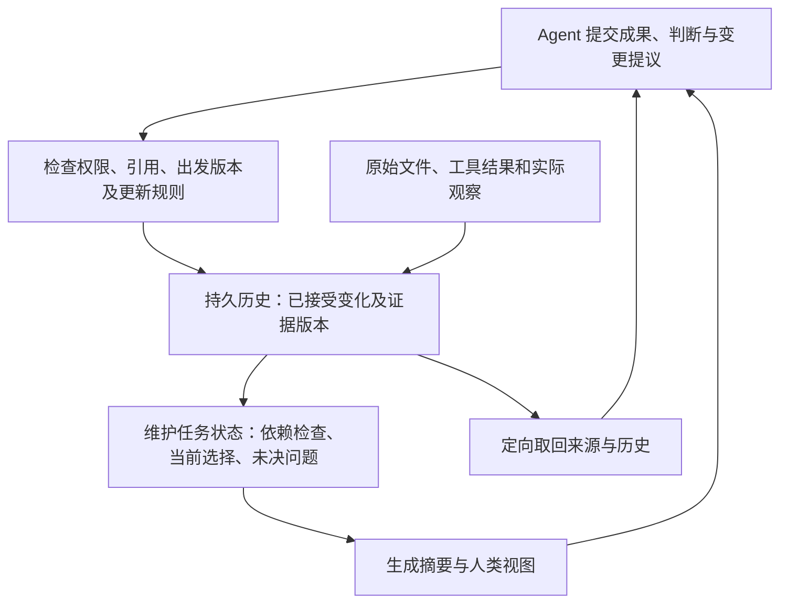

# 长程复杂任务状态管理：设计 v0.2

本版吸取用户指定的[数据库韧性设计对话](database-resilience-discussion.md)，在[v0.1](design-v0.1.md)基础上补充历史恢复、状态写入和依赖管理。v0.1保留；本版为当前讨论草案，不是已批准实现或已证实的新贡献。新增内容源于设计推理，尚无任务运行证据。

2026-10-10全文补查：先前接口只返回五轮，不能证明完整对话。本次读完用户复制的七轮文本，补回“先维护任务事实，再派生各类视图”和“追问已有先例”的前两轮。下面明确这一起点；本次是来源纠错与设计澄清，版本仍为v0.2，修改过程由Git保留。

## 我们要得到什么

一项复杂开发任务经过多个 Agent 探索、MVP、路线切换、技术债和需求变化后，即使 Context 多次压缩、运行中断或当前状态文件损坏，也能恢复到一个有依据的现状并继续工作。

这次修订的关键是：状态不能只靠某份文档被维护得足够认真。系统要保留它为什么成为现在这样，限制哪些更新能生效，能找出受变化影响的结论，并从保存记录恢复状态。

日常仍读摘要，细节按需取回。可靠性不是靠反复重读所有文件来获得。

维护对象是任务事实、工作尝试及其有依据的关系，Context只是按当前工作需要生成的一种视图。人类展示和轨迹评估也从这些记录生长。因而改进展示、摘要策略或分析方法时，不应要求重新执行原任务；但新指标只有在所需证据当时已经保存时才能补算，未记录的信息不能事后假装恢复。事件溯源或数据库可靠性本身也不等于本项目创新。

## 少量机制怎样协同

底层保存发生过的工作和已接受的变化，上层据此维护当前任务状态，再向人和 Agent 提供不同视图。Change 仍是有连续身份的工作尝试；一次修订对应明确的目标前提、成果和判断。路线选择只是当前采用哪些修订，不删除其他方向。

这些是职责，不要求六个服务或六套数据库。第一轮验证可由人工与文件承担；自动化实现必须落实下面的约束。

## 为什么保留一份历史账本

权威历史记录实际收到的证据、被接受的提议、选择和修订；已经记录的过去不覆盖，错误通过后续更正表达。成果文件按明确版本引用并保留必要内容，不能只保存可能失效的路径或哈希。是否保存完整工具轨迹由恢复和取证需要决定，不把每条日志都提升为核心状态。

当前状态可以损坏或被删除，但这些不可重建的记录仍在。恢复时按固定更新规则应用历史中已经接受的变化，得到对应版本的现状。重放不重新请求模型推理，也不重新执行测试、部署、消息发送等外部动作。

模型新生成的判断不是确定性计算；其已接受结果必须保存，恢复时使用已保存结果。重放一致只证明记录被正确应用，不证明判断真实。规则升级需要版本和迁移记录，不能用新规则悄悄改写旧决策。

## Agent 的判断怎样进入系统

“工具返回三项测试失败”与“Agent 认为连接池是根因”分开保存。后者是 assertion（断言：主体提出、可能正确也可能错误的判断）。可靠的历史可以证明它曾被提出，不能因此证明它的内容为真。

Agent 提交变化提议，确定性程序检查权限、版本、引用和状态转换条件，再写入已接受事件。程序能拒绝缺少依据或引用错误的提交，不能仅凭格式合法自动认定复杂判断正确。结论的证据支持、人工确认或尚未验证范围要明确保留。

用户选择 B 是组织决策，不等于技术上证明 B 更好。一次测试失败也不能自动把整条路线判为不可用；结果对哪个判断构成反证，需要对应试验范围和已记录的判断。

## 版本依赖真正做什么

结论与选择引用它所依据的具体前提版本。条件更新后，沿已知依赖自动标记受影响结果为 dirty（待重判断：前提改变，旧结果不能未经检查继续使用），并将复核需要纳入当前工作摘要。

能由固定规则计算的状态增量更新；需要工程判断的结论交给 Agent 或人定向复核，再保存新的判断结果。记录、传播和重新判断是三件事，不能把它们都交给一句“模型自己想想”。

来源、支持、矛盾、取代和必要依赖不能混用。一个判断有多个支持证据，某个支持失效不一定推翻结论；相关资料变化也不一定触发所有下游工作。第一版语义规则优先区分必要前提与一般支持，规则不明确时标为未决。

已知依赖传播可由系统执行，依赖提取的完整性仍需检验。遗漏关系是系统可能失败的原因，不以图已生成为正确性证明。尚未重判的关键依据不能在新视图里显示成已经确认。

## 时间、分支和并行

保留条件在哪个版本或时段适用，以及系统何时收到并记录它；未知时间不补造。恢复某次决策的历史视角时，只使用截至当时已经记录的信息，避免拿后来才知道的失败评价当时的选择。

A/B/C 可以并行演化，并可选择性复用其他方向的成果。复用记录具体修订及条件，不能因为存在合并关系就自动认为语义或实现兼容。暂停与失败分别表达，回到 A 后检查变化影响，不恢复整套旧世界。

多个提交以出发任务版本核对。版本过期时重新审查受影响的提议；发布已接受变更和新任务版本必须保持一致。重复提交不能重复登记同一变化。

外部动作与状态写入之间仍可能存在崩溃窗口。动作请求和实际结果分别留痕；结果未知时先查询或核对，不盲目重试。只有外部工具支持时才能依靠幂等键防止重复副作用，不能声称本设计已经保证所有操作只执行一次。

## 摘要与视图仍然是工作入口

Agent View 与 Human View 是 projection（投影：从已保存状态生成的用途不同的阅读结果）。普通视图可删除后重新生成；生成口径要标明任务版本。摘要中若出现未保存的新判断，应先提交为判断记录，不能让视图成为唯一来源。

新摘要不必与旧摘要逐字相同。若要研究当时模型实际看到了什么，必须另存当时发送的视图、生成版本和取回记录；历史状态不等于当时全部认知。

压缩前保存新成果、已接受决定、遗留问题和下一步，再形成恢复摘要。恢复时默认读摘要，只在证据变化、矛盾、细节不足或具体操作需要时定向取证。必要内容装不下时收窄当前工作并暴露缺口，不静默丢弃约束。

## 不把它长成超级数据模型

每项机制必须对应实际失败：历史用于防止不可恢复的丢失；写入边界防止越权或过期覆盖；证据与判断分离防止把猜测当真；依赖检查防止沿用旧结论；视图生成防止把全部历史重塞进 Context。

语义图、存储产品、轨迹格式和可视化工具都不是当前必须选定的实现。优先复用统一的工作修订、判断、证据和关系；不为每个专业名词建立一套独立机制。但“假设”和“正式采用决定”即使共享表示，也必须保留不同效力，不能为精简抹平语义。

## 本版怎样接受检验

仍以真实长程复杂开发任务为主要验证对象，实际经历多次压缩和持续修订。先手工记录完整工作，再验证恢复与维护行为；简单测试只能核查局部规则，不能代表系统价值。

检查正常压缩后的继续推进、暂停后恢复、前提变化后的定向复核，以及并行提交冲突。另检查当前状态丢失后能否从历史恢复；模拟重放不能再次执行外部动作；错误判断应可被更正并保留其历史。故障注入标明人为设置。

效果实验至少需要同资源的可溯源普通摘要基线，不能只与完全没有记忆的 Agent 比较。检查任务质量、遗漏与重复探索、维护错误、额外取证和状态维护成本。尚未选择冻结任务、模型、次数和评分器；没有实现或实验授权。

## 相对 v0.1 的变化与下一版

保留 Change 身份、非线性路线、版本前提、摘要优先和按需证据；新增不可覆盖历史、受控写入、可恢复现状、判断与观测分离、可执行依赖检查及历史时点。v0.1 的人工维护路径仍可用于原型，不能据此声称这些运行机制已经存在。

这次修订来自新引入的对话，尚未完成 v0.1 所建议的真实任务观察。对话提及六项工作的机制与缺陷继续待原文核验；整体组合不等于研究创新已经成立。

下一版最需要解决两件事：原文与代码究竟支持哪些机制判断；必要依赖、支持证据和已接受决定怎样形成不误伤成果的更新规则。将观察或核验依据与修改理由一起记录，保留本版并形成 v0.3。当前接手入口为项目 README → 本文 → 按需读取讨论来源与近邻核验。

责任为助手整理、用户审阅设计；技能操作留痕使用本文、来源记录和 Git，不写项目外全局日志。
