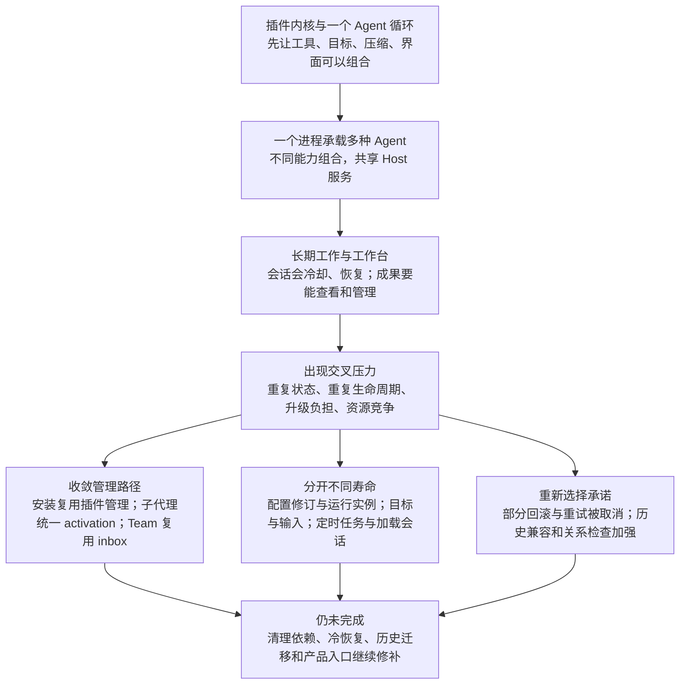

# DSH 深度演化分析：能力扩展之后，系统如何重新划分责任

DSH 的发展有一条比版本号更值得关注的线索：**插件化让新能力很快出现；当这些能力同时运行、跨会话共享、需要重启恢复时，原本局部合理的设计开始争夺同一份状态和同一段生命周期。后续许多重构，都在重新决定谁拥有状态、谁执行动作、谁承担恢复，以及哪些承诺值得保留。**

这是本文依据多个子系统提出的解释，不是开发团队公开宣称的统一路线图。它能解释插件、预设、子代理、Team、Office 和持久化的一批变化；不能把所有 UI 修补、协议适配和产品取舍都归到这一个原因。

本文承接[全项目历史与八条工作线](dsh-project-history.md)，侧重解释发展动力。版本全图仍见[交互图](dsh-project-history.html)。材料固定到 2026-10-15 的 `86a402200d95fecef4529d969836f1fe13c6cb0d`；本轮分析日期为 2026-10-18，没有把该快照冒称为今日最新状态。末尾列出版本化证据和未解决问题。

## 先看整个工程怎样改变了问题的难度

图中箭头是本文对发展压力的归纳，不能当成每个 PR 的直接因果边。几个阶段重叠发生。尤其不能把 9 月写下的设计名，直接放进 9 月的已发布能力中。

## 1. 早期的核心选择，解决了扩展问题，也留下了后面的难题

在 `0.1.0-rc.7` 的历史快照中，微内核设计已经很明确：一个具体的 Agent 循环，通过 Cordis 事件扩展，工具、压缩、目标、持久化和 UI 都可作为插件加入。它没有另建一套中间件调度器，而是区分会变换数据的事件、需要按顺序等待的检查点、需要等待所有监听者的持久化检查点和普通通知。[E1]

这里真正被复用的是**注册、派发、作用域与资源释放**。新功能不用反复修改中心循环，这是能力迅速组合起来的基础。但“能把插件挂进去”只回答了接入问题，并没有回答多个插件一起工作时的完整语义。例如，日志监听器可以正常卸载，仍可能卸载得过早，错过另一个插件清理时追加的最后一条结果。

这一点在 10 月的清理依赖审查中变得具体：服务释放会等待消费者，不代表它使用的其他监听器或底层资源在等待期间仍然存活。兄弟清理动作并发开始后，某个资源可能已经关闭。审查涉及最终会话事件、定时消息、凭据提交和 SSH 进程，不是单个 Session bug。[E2]

所以不能将早期“由框架获得 HMR 和 disposal”理解成“框架已经解决所有跨插件生命周期”。前者提供机制，后者还需要业务明确谁必须活到谁结束。这个差距是整个工程后续复杂性的一个来源。审查仍标为 proposed；发布说明中的个别修复不能替代整项审查验收。

## 2. 从一种 Agent 到多种 Agent，真正改变的是共享边界

早期一个进程的配置决定所有会话的工具、角色和提示。要同时运行极简 Agent 和完整编码 Agent，就需要不同进程。第一代按会话预设利用已有作用域，把一组插件挂到一个 Agent 上；当时明确拒绝新增一层注册体系，也拒绝为了组合而把所有会话改成子进程。[E3]

这一改变很有价值，但它不是把配置文件搬个位置就结束了。历史记录留下了一串具体后果：

- 子代理注册服务被移入会话内部后，Host 的跨会话查询找不到它，Web 启动等待无法完成。
- 预设卸载会触发配置写回，曾有把原预设截成空列表的危险；“配置输入”和“运行树的持久化目标”必须分开。
- 预设身份加进类型后，存储后端却没有全部写入，恢复时仍会丢失。
- 对象可以正确释放，但 Host 没有释放它们的时机，每次接触新会话就保留更多对象。记录据测量判断，问题在生命周期管理，而非对象图无法被回收。

这些问题连在一起表明：**局部组件正确，不足以保证组合后的系统正确。**一个新能力改变了状态的归属，所有跨越这个边界的读者、写者、存储和测试都需要重新检查。测试如果恰好关闭了受影响的 Host 服务，还会把问题遮住。[E3]

后来的声明式预设进一步收敛：预设不再维护独立的目录发现、编辑和配置来源，而是使用普通配置。与此同时，新出现的必要机制是“保留仍被使用的旧修订”：编辑定义后，新 Agent 可以用新版，运行中的 Agent 和它的子代理继续使用已绑定修订，最后一个使用者结束后才释放旧树。[E4]

这不是简单从“独立”转向“共享”。它把共享粒度从整个进程或单个会话调整为**一个仍被引用的配置修订**。更需要注意其边界：旧的可执行修订只保存在当前进程；重启后，记录的预设身份按当前配置解析。因此，运行中修订保留并不等于跨重启恢复原始执行环境。

## 3. 公开使用之后，历史数据成为不能随实现一起重写的约束

会话格式变化最能说明公开发行给工程带来的新负担。v0 已经发给用户后，新的写入结构不能再把旧 JSONL 当成可丢弃的开发数据。历史格式的读法、转换规则、原文件和当前格式的写入约束，开始分别承担责任。[E5]

一个真实 Session 暴露了整份转换模型的问题。设计记录报告：116 MB 输入在旧方案中耗尽 16 GB Node 进程；压缩块展开成约 914 万逻辑事件，再折叠到约 7.3 万当前事件，多套中间表示与拷贝同时存在。这些数字是作者记录，本文未复测。它们的分析价值是指出**失败不只在某个慢函数，而在每个接口都要求交付完整中间结果**。只优化解压仍无法消除后面各阶段的整份数组和拷贝。[E5]

后续方案改成每个 Session 独立的有状态迁移阶段，增量把数据送到下一阶段；仅保存原始代际和最终当前代际，不把每个中间格式都落盘。这里的组合能力来自共同的流式协议及结束顺序，也来自明确限制：转换中不能任意更改历史意义。

例如，历史上被忽略的上传标记，不能仅因换了版本头就变成有效水位；已记录的旧事件不能被当前校验器按新语义误判。另一方面，当前 V4 又必须检查工具调用和结果、步骤顺序、压缩归属等跨事件关系，不能只检查每条记录长得像合法 JSON。[E5、E6]

这条线也有一次重要的非线性：主线在 8 月 25 日合入标为 streaming format migration 的 PR，又在当天合入撤回；9 月 6 日再合入 streaming stages 实现。**证据只支持“有一次早期尝试被撤回，随后出现新的流式方案”，不支持两次实现相同，也不支持第一次撤回由上述内存故障导致。**没有取得第一轮完整审阅理由，必须留下空白。[H1]

这比“V2、V3、V4 依次升级”更贴近实际：格式承诺在增长，内部实现经过反复，旧数据又限制了修复能在哪里进行。

## 4. 多项简化都在减少重复管理，但它们付出的代价不同

### 插件加载：少了一项保证，更多检查回到调用者

事务式配置重载曾尝试在候选失败时保留旧插件代际。它要求 Loader 负责候选导入、生命周期结束、回滚、配置身份和写入，导致 vendored 实现与固定上游越来越不同。9 月的撤回决定因此放弃自动回滚，允许应用失败后留下部分生效的插件树。[E7]

这不是“同样可靠，只是代码更少”。应用启动、预设装载、目录选择和 Web 启动都要自行确认实际激活结果；等待加载函数返回，不再等于可用。失败后恢复主要依靠后续有效修改。撤回还保留两项已有必要修补，并避开较大合并中的无关功能。

所以它同时包含三个开发动作：撤回一项承诺、保留独立有效的成果、迁移调用者的义务。用“撤销那个 Change”一句话不能充分表达。

### 子代理：合并生命周期，不强行统一能力

原来一次性本地执行、可继续会话、前台等待和后台 Job 分别承担创建、取消、结果与清理。统一 activation 后，工作流仍可以等待结果，模型委派仍可以立即获得子任务身份，但都使用同一个创建和完成管理入口。[E8]

外部后端也纳入共同管理，却没有因此获得多轮续接能力，也不伪造一个本地 Session。名册记录“这个子任务是谁”，结果由接收者保存；它没有顺手成为另一份执行状态总表。完成通知可能与子代理已发送的回答重复，设计明确接受这个成本，以避免再建一套交付账本或依赖模型一定主动汇报。

这是较强的“基本机制组合”实例：共同机制只统一确实共同的生命周期；能力差异仍然存在。

### Team：保留成员与任务，降低消息交付承诺

`0.1.7-rc.2` 的旧版本记录描述了 Lead 日志中的发送意图、刷盘、目标确认、按目标重试和去重；`0.2.1-alpha.2` 的新版本改为直接进入目标 inbox。新发送返回接纳身份或失败，不再额外保存未接纳意图、不再负责重启后的 Team 重试，也不对显式重发去重。[E9、E10]

旧记录仍能读，但尚未到达目标的旧待发消息不再投递。名单和任务板保留。作者给出的理由包含“实验功能没有稳定性承诺”，这是取舍成立的重要条件。如果是已经承诺可靠送达的生产消息系统，相同删除就可能不可接受。

因此不能把 Team 简化描述成纯粹去重，也不能把旧设计判为毫无价值。旧机制确实提供了更强承诺；团队后来认为维护代价不值得。它是**在功能承诺与维护成本之间重新选择**。

## 5. 另一条同样重要的趋势，是让持久工作脱离当前执行实例

Goal 的变化非常直接：目标修改需要在重启、分叉后保留，即使对应消息尚未进入模型上下文；inbox 却会因排队、编辑、接纳或取消而改变。于是目标改为自己的持久事件，驱动下一轮执行的组件另行负责投递提示。目标服务不再管理输入队列。[E11]

定时任务又走得更远。只附着在已加载 Agent 上的计时器，无法发现冷会话中的待办任务。新设计让 Host 独立保存任务，查看和删除任务不必激活会话，到期后才恢复目标会话并排入消息。[E12]

这两处看似都在“独立状态”，实际存储选择相反：Goal 继续复用 Session 日志，避免新的原子性边界；Schedule 离开 Session 日志作为当前任务权威，获得跨冷会话的发现能力。**因此，不能从 DSH 推导所有状态都应进同一事件库，也不能推导每个域都应有独立数据库。关键是读写和恢复发生在什么生命周期中。**

独立 Schedule 存储也带来代价。消息进入 Session 并刷盘，与任务更新下一次时间是两个存储动作；没有共享事务或持久幂等协议，就存在崩溃重复窗口。交付回执只能证明 inbox 收到，不能证明模型完成任务。旧 Session 内的提醒记录也不会自动导入新任务域，需要显式重建。[E12]

这说明“历史可读、当前任务还在、能够恢复执行”是三种不同承诺。工程不断拆开它们，是为了能够逐项承担，而非笼统声称 durable。

## 6. 工作台和远程执行把隐含问题变成了用户实际遇到的问题

右侧从工具详情面板变为通用工作区，并非只是界面变漂亮。旧文件链接交给 Host 的操作系统打开，远程浏览器无法看到文件；单一详情槽也无法容纳文件、任务和差异。这使文件地址、授权读取、资源内容和展示容器必须分开。可注册的侧栏让这些能力共享一个入口，但每种内容仍有自己的读取与生命周期。[E13]

Office 更进一步暴露共享资源问题：预览、后台预热和显式检查可能要转换同一份文件。只缓存最终 PDF，不会限制排队中的大文件和并发读取，也无法处理一个用户取消而另一用户仍在等待。新方案统一转换队列、延后读取、按内容复用，单独管理每个读者的取消，并给前台工作优先权。[E14]

这与子代理合并管理路径相呼应，但不能因此强行抽成同一个业务操作。Office 的核心约束是共享计算与资源容量；子代理还涉及执行授权、父子身份和消息投递。相同的是避免两个管理者竞争同一件工作，不同的是必须保留的规则。

远程执行则揭示了另一种“部分保留”。E2B 试验已经证明文件工具、终端等可复用同一个文件系统和进程接口；后来 Node PTC 需要与普通输出独立的双向控制流，现有适配需要额外传输工程，还存在输出保留的内存负担。团队删除了这个后端，却保留通用接口及其异步语义；SSH 用现有认证和独立通道承担远程能力，Harness 状态与凭据仍留在本地。[E15]

这不是“E2B 被证伪”，而是某一集成的边际维护成本超出当时选择。被淘汰的是供应实现，已验证的接口成果继续使用。相反，侧栏为了拥有可重放、可撤销的布局状态，选择维护自己的布局引擎，而没有采用评估过的通用库。[E13] 这一反例提醒我们：DSH 并非一律倾向复用；它在维护成本与必须掌握的语义之间取舍。

## 7. 怎样评价这段发展，而不把它写成成功叙事

我认为 DSH 最值得借鉴的是：它经常把“不再承担什么”写清楚。非事务 Loader 不假装回滚；Team 不再假装有可靠 outbox；Schedule 不宣称跨库恰好一次；旧预设修订不宣称跨进程重建。这样做缩小了机制必须保证的范围，也让调用者知道必须补什么。

但边界清楚不等于用户成本已经消失。旧待发 Team 消息可能失去执行，旧提醒需要重建，失败配置可能部分生效，新的默认入口又可能使已有能力更难发现。只有结合用户需求与升级体验，才能判断这些取舍是否值得；本文没有运行用户实验，不能给出“整体更优秀”的结论。

另一方面，维护成本也可能被转移。取消 Loader 回滚后，多个消费者增加激活审查；移除独立消息账本后，可靠送达需求若再次出现，就会要求新协议。应看整个调用链所需的规则，而不只看被删除的包数或接口数。

目前可以提出一个跨线解释：**DSH 正在选择性地分配可靠性。对已发布历史加强兼容与验证，对可修复配置允许部分失败，对实验协作降低消息保证，对运行中工作保留必要资源到真正结束。**这比“越来越简单”或“越来越可靠”准确，因为它说明可靠性加在哪里、撤在哪里，以及谁承担后果。

## 8. 对我们的研究，这个工程提供了什么

现在无需急着把每一项变化映射成 `derive / relate / select`。这次全景深化已经给出了更严格的检验对象：

| 实际变化 | 工作历史若只写一句状态，会漏掉什么 |
|---|---|
| 撤回事务加载，保留两个修补并改消费者 | 撤回的具体保证、保留范围、被转移的义务 |
| 预设定义更新，运行实例继续使用旧修订 | 同时有效的版本及不同适用范围；重启后的不同保证 |
| Team 删除 outbox，保留名单和任务板 | 部分替代、旧历史的可读性、被取消的执行承诺 |
| Goal 与 Schedule 分别调整状态归属 | 为什么一个留在日志，一个另设存储；新增一致性成本 |
| E2B 后端移除，执行接口保留给 SSH 等使用 | 试验产物的部分复用；删除实现不等于推翻问题或接口 |
| 迁移方案合入、撤回、再次实现 | 同名方案不等于同一版本；未知的撤回原因不能补写 |
| Office 统一转换，侧栏却选择自建 | 复用与自建各自的成立条件，避免事后归纳成单一口号 |

这些是工作状态机制应能保存和解释的变化，不是要求为每一行新增一个元操作。下一步比较候选机制时，应问：**同一套规则能否保留变更范围、适用条件、实际结果和仍未完成的义务，同时让接手者读懂当前工作？**如果靠每个案例暗加解释才能做到，说明复杂性藏到了调用者；如果全部塞入自然语言但无法查找、更新和校验，也没有证明机制有效。

DSH 本身已经以设计记录、版本历史和代码提供了很强的文档基线。本文的分析正是用这些资料完成的。这既说明它适合研究，也限制我们的主张：不能因为 Change Graph 画得清楚就宣布胜出，必须检验维护这些跨版本关系是否更可靠、更省力。SWE-Milestone 仍是唯一已锚定的实验 benchmark，本轮没有启动模型实验或冻结核心设计。

## 证据与阅读边界

本轮在既有全量目录上复读跨工作线的 Problem、Decision、Alternatives、Consequences，并对下列五份关键历史正文作版本对读：早期微内核与预设、旧 Team、后来的声明式预设与直接 inbox。Git 主线日期另外核查。作者记录中的测试和测量均未独立重跑。下列快照链接用于核对正文，不表示文件名日期就是合入日期。

| 编号 | 来源和本轮实际用途 |
|---|---|
| E1 | [rc.7 微内核事件设计](https://github.com/deepseek-ai/deepseek-harness/blob/99f6f02fecdb7dff40c3fbc9470f5907c29f74ca/.agents/notes/implemented/architecture/2026-06-11-microkernel-event-taxonomy.md)：早期扩展机制；本地 blob `6cacbc30f29c863de0f8ddfa4df7251a64bc80ca` |
| E2 | [截止快照的清理依赖审查](https://github.com/deepseek-ai/deepseek-harness/blob/86a402200d95fecef4529d969836f1fe13c6cb0d/.agents/notes/proposed/architecture/2026-10-09-cordis-cleanup-dependency-lifetimes.md)：跨域未完成问题，不作为修复已完成证据 |
| E3 | [rc.7 按会话预设](https://github.com/deepseek-ai/deepseek-harness/blob/99f6f02fecdb7dff40c3fbc9470f5907c29f74ca/.agents/notes/implemented/architecture/2026-08-03-per-session-agent-presets.md)：当时的边界与失败记录；blob `5a82f0220058c10892b819a83499c817aa9be6ad` |
| E4 | [rc.2 声明式预设](https://github.com/deepseek-ai/deepseek-harness/blob/477b4f420553e8a52c2fbccc464d7561b239c443/.agents/notes/implemented/architecture/2026-09-18-declarative-agent-presets.md)：修订保留与重启边界；blob `bf900bc4dc99f12af4624d14a6ec5497adaa1993` |
| E5 | [截止快照的迁移设计](https://github.com/deepseek-ai/deepseek-harness/blob/86a402200d95fecef4529d969836f1fe13c6cb0d/.agents/notes/implemented/architecture/2026-08-31-released-session-format-migrations.md)：完整接口问题、性能记录与转换协议，不据文件日期倒推全部内容 |
| E6 | [原生 V4 关系验证](https://github.com/deepseek-ai/deepseek-harness/blob/86a402200d95fecef4529d969836f1fe13c6cb0d/.agents/notes/implemented/architecture/2026-09-17-native-v4-read-validation.md)：单条有效与关系有效的区别 |
| E7 | [非事务 Loader](https://github.com/deepseek-ai/deepseek-harness/blob/86a402200d95fecef4529d969836f1fe13c6cb0d/.agents/notes/implemented/simplification/2026-09-09-nontransactional-loader.md)：撤回范围、保留修补、消费者义务 |
| E8 | [统一 activation](https://github.com/deepseek-ai/deepseek-harness/blob/86a402200d95fecef4529d969836f1fe13c6cb0d/.agents/notes/implemented/simplification/2026-09-17-unified-subagent-activations.md)：公共管理与不同后端能力；[10月6日合入](https://github.com/deepseek-ai/deepseek-harness/commit/bf1c4e01ba7088b3cb0aeb36caa702965eb5f6ec) |
| E9 | [0.1.7-rc.2 Team](https://github.com/deepseek-ai/deepseek-harness/blob/477b4f420553e8a52c2fbccc464d7561b239c443/.agents/notes/implemented/feature/2026-08-05-agent-teams.md)：旧刷盘、确认与重试承诺；blob `6333e511ba1e71823cfa55c27ba46b2665d1ef15` |
| E10 | [0.2.1-alpha.2 直接 inbox](https://github.com/deepseek-ai/deepseek-harness/blob/d743267388641bc76f17c45ce8b4c231aed1d32c/.agents/notes/implemented/simplification/2026-09-26-team-direct-inbox.md)：新限制；blob `58d18d0ecfef4d292cfbb8cbf3e4c449b1fa1d6d`；[10月8日主线合入](https://github.com/deepseek-ai/deepseek-harness/commit/ea0980dab432263a9d1cd2b8e4998a1d6e6e6ae7) |
| E11 | [Goal 持久事件](https://github.com/deepseek-ai/deepseek-harness/blob/86a402200d95fecef4529d969836f1fe13c6cb0d/.agents/notes/implemented/architecture/2026-07-31-goal-owned-durable-events.md)：目标状态与模型输入解耦 |
| E12 | [Host 定时任务存储](https://github.com/deepseek-ai/deepseek-harness/blob/86a402200d95fecef4529d969836f1fe13c6cb0d/.agents/notes/implemented/architecture/2026-09-16-host-schedule-storage.md)：冷会话发现、两存储边界、旧任务不自动导入 |
| E13 | [侧栏工作区](https://github.com/deepseek-ai/deepseek-harness/blob/86a402200d95fecef4529d969836f1fe13c6cb0d/.agents/notes/implemented/feature/2026-09-04-right-sidebar-docking-infrastructure.md)：实际用户问题及选择自建的反例；本轮阅读问题、结构、布局与替代方案，未审计所有交互实现 |
| E14 | [共享 Office 转换](https://github.com/deepseek-ai/deepseek-harness/blob/86a402200d95fecef4529d969836f1fe13c6cb0d/.agents/notes/implemented/architecture/2026-09-15-bounded-office-conversion.md)：读者、共享任务与资源边界 |
| E15 | [E2B 移除](https://github.com/deepseek-ai/deepseek-harness/blob/86a402200d95fecef4529d969836f1fe13c6cb0d/.agents/notes/implemented/simplification/2026-09-11-remove-e2b-providers.md)、[SSH 执行](https://github.com/deepseek-ai/deepseek-harness/blob/86a402200d95fecef4529d969836f1fe13c6cb0d/.agents/notes/implemented/architecture/2026-09-11-posix-ssh-runtime.md)：移除供应实现、保留接口与远程需求 |
| H1 | [8月25日合入](https://github.com/deepseek-ai/deepseek-harness/commit/3fefcdbe3f83a309f05075b9e9f05450509318ed)、[当天撤回合入](https://github.com/deepseek-ai/deepseek-harness/commit/a1781cc4a81bf14551ed0d6e0ee618d14fd9b823)、[9月6日合入](https://github.com/deepseek-ai/deepseek-harness/commit/80306f51a6f36e26c71bcf0be5621af6b8ad8e65)：本地 Git 主线元数据核实；首次撤回原因未取得 |

标为 tag 的链接已按本地 `all-version-refs.json` 固定映射到提交，并有上述内容哈希；证据核验记录保存于本地分析批次。在线页面本轮抓取失败，正文来自此前已获取并校验的 Git 对象；不声称重新在线逐链接读取成功。部分大代码对象未在过滤克隆中，代码 diff 检查没有完整覆盖；本文结论以版本化设计正文和主线元数据为基础。

尚需深入核验的三个问题：第一次迁移撤回为何发生；各项简化转移给调用者的总维护成本是否下降；用户历史与可执行任务在升级时的损失是否符合实际产品承诺。它们会影响机制评价，不能被“设计清楚”代替。
