# DSH 全版本目录、来源与覆盖检查

截止 `86a402200d95fecef4529d969836f1fe13c6cb0d`。所有时间显示 Asia/Shanghai。发布时间与提交时间分别标注；无Release时用对应版本提交时间，不能当公开发布时间。原始目录为主工作区 `artifacts/agent-task-state/repository-snapshots/dsh-full-history-2026-10-16/`。历史仓库为 `artifacts/agent-task-state/third-party/dsh-history-2026-10-16/`，只读研究用途，未安装依赖或执行代码。

## 全部可识别版本

| 版本 | 时间及依据 | 标签 / Release / npm当前保留 | 主要变化与资料边界 | 设计文件数 |
|---|---|---|---|---|
| [0.0.1-rc.1](https://github.com/deepseek-ai/deepseek-harness/commit/b64c3ac1ba37a8afe20de534ab666e85ae69377b) | 2026-08-11 03:20，提交时间 | 无 / 无 / 有 | 早期发布提交；当前无标签或 Release 正文。README 属内测入口。 | 614 |
| [0.0.1-rc.2](https://github.com/deepseek-ai/deepseek-harness/commit/5ca7be5dcb310aad1ce83e673d2b4326a7329ac9) | 2026-08-11 22:52，提交时间 | 无 / 无 / 有 | 早期发布提交；当前无标签或 Release 正文。README 属内测入口。 | 652 |
| [0.0.1-rc.3](https://github.com/deepseek-ai/deepseek-harness/commit/1e99f20963a0199b00b254d8f4b794ee6988d53c) | 2026-08-13 03:24，提交时间 | 无 / 无 / 无 | 早期发布提交；当前无标签或 Release 正文。README 属内测入口。 | 675 |
| [0.0.1-rc.4](https://github.com/deepseek-ai/deepseek-harness/commit/a90d9af1b21ff108dc114fca98d0e6e7843fe0ba) | 2026-08-13 05:16，提交时间 | 无 / 无 / 无 | 早期发布提交；当前无标签或 Release 正文。README 属内测入口。 | 675 |
| [0.0.1-rc.5](https://github.com/deepseek-ai/deepseek-harness/commit/3e8a1cfa339e0c2dd1c233fe8179e42b1ed73945) | 2026-08-13 06:14，提交时间 | 无 / 无 / 有 | 早期发布提交；当前无标签或 Release 正文。README 属内测入口。 | 675 |
| [0.1.0-rc.1](https://github.com/deepseek-ai/deepseek-harness/commit/22ab3beac101f381616d1552627c929033426b9f) | 2026-08-13 16:22，提交时间 | 无 / 无 / 无 | 早期发布提交；当前无标签或 Release 正文。开发者预览起步；不据版本号补造变更。 | 687 |
| [0.1.0-rc.2](https://github.com/deepseek-ai/deepseek-harness/commit/60b04b6ef73a2b7387e6887d19fe2276ff2630a0) | 2026-08-13 17:19，提交时间 | 无 / 无 / 有 | 早期发布提交；当前无标签或 Release 正文。开发者预览起步；不据版本号补造变更。 | 688 |
| [0.1.0-rc.3](https://github.com/deepseek-ai/deepseek-harness/commit/8a954b2eca50e4aa77c928d7ada40c0bff6135eb) | 2026-08-13 18:39，提交时间 | 无 / 无 / 有 | 早期发布提交；当前无标签或 Release 正文。开发者预览起步；不据版本号补造变更。 | 688 |
| [0.1.0-rc.5](https://github.com/deepseek-ai/deepseek-harness/commit/abe560f81edebe5f6a5b62706ff502daa0dccd40) | 2026-08-13 18:49，提交时间 | 无 / 无 / 无 | 早期发布提交；当前无标签或 Release 正文。开发者预览起步；不据版本号补造变更。 | 688 |
| [0.1.0-rc.6](https://github.com/deepseek-ai/deepseek-harness/commit/15148dbd9a1d1f1ef1a26e5749b32af0cd663935) | 2026-08-13 19:52，提交时间 | 无 / 无 / 有 | 早期发布提交；当前无标签或 Release 正文。开发者预览起步；不据版本号补造变更。 | 688 |
| [0.1.0-rc.7](https://github.com/deepseek-ai/deepseek-harness/releases/tag/dsh-v0.1.0-rc.7) | 2026-08-17 20:01，发布时间 | 有 / 有 / 有 | 插件设置卡、外部子代理任务面板、多模态附件；修复长历史分页和截断后续接。 | 697 |
| [0.1.0-rc.8](https://github.com/deepseek-ai/deepseek-harness/releases/tag/dsh-v0.1.0-rc.8) | 2026-08-19 23:37，发布时间 | 有 / 有 / 有 | 多模态命令和引用、外部子代理组合包、Windows 持久 PowerShell；SQLite 结构有不兼容调整。 | 728 |
| [0.1.1-rc.1](https://github.com/deepseek-ai/deepseek-harness/releases/tag/dsh-v0.1.1-rc.1) | 2026-08-21 15:12，发布时间 | 有 / 有 / 有 | 新增视觉模型；修复 Bubblewrap 绕过路径和输入、展示问题。 | 745 |
| [0.1.1-rc.2](https://github.com/deepseek-ai/deepseek-harness/releases/tag/dsh-v0.1.1-rc.2) | 2026-08-21 20:35，发布时间 | 有 / 有 / 有 | 图像改用 Files API 优先上传与复用，调整预处理。 | 744 |
| [0.1.2-alpha.1](https://github.com/deepseek-ai/deepseek-harness/releases/tag/dsh-v0.1.2-alpha.1) | 2026-08-28 01:06，发布时间 | 有 / 有 / 无 | 会话视图和初始化拆分；子代理模型授权、Windows SDK、ACP 增强；Remote 替代 APIProxy。 | 814 |
| [0.1.2-alpha.2](https://github.com/deepseek-ai/deepseek-harness/releases/tag/dsh-v0.1.2-alpha.2) | 2026-08-30 21:52，发布时间 | 有 / 有 / 有 | 连接状态与重连、插件分组、长历史优化；恢复曾移除的 ignorable 字段。 | 831 |
| [0.1.2-alpha.3](https://github.com/deepseek-ai/deepseek-harness/releases/tag/dsh-v0.1.2-alpha.3) | 2026-09-01 00:03，发布时间 | 有 / 有 / 有 | 继续修补长会话和图片；移除可选 SQLite 持久化后端，保留旧版导出路径。 | 842 |
| [0.1.2-alpha.4](https://github.com/deepseek-ai/deepseek-harness/releases/tag/dsh-v0.1.2-alpha.4) | 2026-09-01 23:45，发布时间 | 有 / 有 / 有 | 父子代理双向消息；按需事件读取替代公开数组，区分序号与日志偏移。 | 853 |
| [0.1.2-alpha.5](https://github.com/deepseek-ai/deepseek-harness/releases/tag/dsh-v0.1.2-alpha.5) | 2026-09-02 18:02，发布时间 | 有 / 有 / 有 | 修复跨旧版升级的启动和会话标题问题。 | 854 |
| [0.1.2-rc.1](https://github.com/deepseek-ai/deepseek-harness/releases/tag/dsh-v0.1.2-rc.1) | 2026-09-03 14:06，发布时间 | 有 / 有 / 有 | 汇总 0.1.2 系列能力与兼容变更；加入实验 Inspector、Web Preview。 | 854 |
| [0.1.3-alpha.1](https://github.com/deepseek-ai/deepseek-harness/releases/tag/dsh-v0.1.3-alpha.1) | 2026-09-04 19:34，发布时间 | 有 / 有 / 无 | 通用文件上传、会话持有锁和格式 V2；明确记录性能回退。 | 873 |
| [0.1.3-alpha.2](https://github.com/deepseek-ai/deepseek-harness/releases/tag/dsh-v0.1.3-alpha.2) | 2026-09-07 21:59，发布时间 | 有 / 有 / 有 | 改善长会话打开、恢复和内存；持续子代理获得排队、编辑、Steer 与停止。 | 911 |
| [0.1.5-alpha.1](https://github.com/deepseek-ai/deepseek-harness/releases/tag/dsh-v0.1.5-alpha.1) | 2026-09-09 00:16，发布时间 | 有 / 有 / 有 | 动态系统提示、Sidebar；格式 V3；显式 Agent 与 Inbox 接口调整；暂停后须用户恢复。 | 936 |
| [0.1.5-alpha.2](https://github.com/deepseek-ai/deepseek-harness/releases/tag/dsh-v0.1.5-alpha.2) | 2026-09-09 22:23，发布时间 | 有 / 有 / 有 | 多格式文件预览与交付；Team 实验包；极简默认工具和面板接口调整。 | 956 |
| [0.1.5-rc.1](https://github.com/deepseek-ai/deepseek-harness/releases/tag/dsh-v0.1.5-rc.1) | 2026-09-10 11:09，发布时间 | 有 / 有 / 有 | 汇总文件、Sidebar、V3、会话锁与 Agent API；新默认模型和外部代理运行时。 | 957 |
| [0.1.5-rc.2](https://github.com/deepseek-ai/deepseek-harness/releases/tag/dsh-v0.1.5-rc.2) | 2026-09-10 23:09，发布时间 | 有 / 有 / 有 | 反馈提交和文件交付卡片体验修补。 | 958 |
| [0.1.6-alpha.1](https://github.com/deepseek-ai/deepseek-harness/releases/tag/dsh-v0.1.6-alpha.1) | 2026-09-15 12:57，发布时间 | 有 / 有 / 有 | SSH、浏览器/电脑操作、Auto review；PTC 改独立受限进程；撤销配置事务回滚。 | 1030 |
| [0.1.6-alpha.1.20260916.1](https://github.com/deepseek-ai/deepseek-harness/commit/69bf9f90540328b7788d2bf038d948b3f6503caa) | 2026-09-16 18:04，提交时间 | 无 / 无 / 无 | 带日期构建号的发布提交；当前无标签或发布正文，保留为独立版本点。 | 1066 |
| [0.1.6-alpha.2](https://github.com/deepseek-ai/deepseek-harness/releases/tag/dsh-v0.1.6-alpha.2) | 2026-09-17 21:30，发布时间 | 有 / 有 / 有 | 插件管理页、Office/浏览器/子代理侧栏、改动审阅；创造模式转向持久插件安装。 | 1105 |
| [0.1.5-rc.3](https://github.com/deepseek-ai/deepseek-harness/commit/a4c74a91e06b00fe0b0937bde982170c526cc842) | 2026-09-22 13:26，提交时间 | 有 / 无 / 有 | 存在标签与发布提交，当前无 GitHub Release 正文；独立维护分支，不能从版本号补写功能。 | 958 |
| [0.1.7-alpha.1](https://github.com/deepseek-ai/deepseek-harness/releases/tag/dsh-v0.1.7-alpha.1) | 2026-09-22 14:16，发布时间 | 有 / 有 / 有 | V4 日志、声明式预设、配置归 Profile；后台工作、Office 和语音；Messages-only。 | 1172 |
| [0.1.7-alpha.2](https://github.com/deepseek-ai/deepseek-harness/releases/tag/dsh-v0.1.7-alpha.2) | 2026-09-22 23:49，发布时间 | 有 / 有 / 有 | 输出截断从字节预算转为 token 预算；修复后台完成后无法继续唤醒等问题。 | 1179 |
| [0.1.7-rc.1](https://github.com/deepseek-ai/deepseek-harness/releases/tag/dsh-v0.1.7-rc.1) | 2026-09-23 21:30，发布时间 | 有 / 有 / 有 | 汇总远程执行、Office、插件管理、V4 与预设迁移；兼容改动跨多个子系统。 | 1182 |
| [0.1.7-rc.2](https://github.com/deepseek-ai/deepseek-harness/releases/tag/dsh-v0.1.7-rc.2) | 2026-09-24 22:10，发布时间 | 有 / 有 / 有 | 登录账号与 API Key 分路、桌面后台任务；自动化默认关闭、可选启用；人工复核拒绝。 | 1208 |
| [0.2.0-rc.1](https://github.com/deepseek-ai/deepseek-harness/releases/tag/dsh-v0.2.0-rc.1) | 2026-09-28 20:36，发布时间 | 有 / 有 / 有 | 账号网页搜索与 Windows 权限诊断；工具结果未知时先核实副作用；自动化改可选包。 | 1220 |
| [0.2.0-rc.2](https://github.com/deepseek-ai/deepseek-harness/releases/tag/dsh-v0.2.0-rc.2) | 2026-09-29 17:42，发布时间 | 有 / 有 / 有 | 桌面命令安装、自动化消息来源改写、异步问答实验；Shell 和启动环境修补。 | 1224 |
| [0.2.1-alpha.1](https://github.com/deepseek-ai/deepseek-harness/releases/tag/dsh-v0.2.1-alpha.1) | 2026-10-03 14:42，发布时间 | 有 / 有 / 有 | Claude Code Mods 兼容实验、插件创建入口、开发工具；自动化回到内置；移除 invariant 插件。 | 1201 |
| [0.2.1-alpha.2](https://github.com/deepseek-ai/deepseek-harness/releases/tag/dsh-v0.2.1-alpha.2) | 2026-10-09 19:09，发布时间 | 有 / 有 / 有 | Worktrees、工作目录、插件 Session 记录、SSH helper；子代理统一激活、Team 直接 Inbox。 | 1229 |
| [0.2.1-alpha.3](https://github.com/deepseek-ai/deepseek-harness/releases/tag/dsh-v0.2.1-alpha.3) | 2026-10-14 21:32，发布时间 | 有 / 有 / 有 | 极简模式图片与压缩、SDK resume、插件热替换；发布说明报告存储卸载尾部记录修复。 | 1265 |
| [0.2.1-alpha.4](https://github.com/deepseek-ai/deepseek-harness/releases/tag/dsh-v0.2.1-alpha.4) | 2026-10-15 21:40，发布时间 | 有 / 有 / 有 | 自定义插件索引源与 engines.dsh 兼容判断；模型设置、Office 交付和 Linux 启动修补。 | 1271 |

设计文件数包含 README、AGENTS、模板等非主题文件；不是功能数量。版本目录来自全部标签、Release和当前可达提交中的 release(dsh) 版本声明；后者有41条，其中一条没有版本号，因此保留40个不同版本。

## 完整代码祖先图

边仅表示压缩后的 Git 祖先关系，不表示功能依赖或公开顺序。

```mermaid
flowchart TB
 V0["0.0.1-rc.1<br/>2026-08-11"]
 V1["0.0.1-rc.2<br/>2026-08-11"]
 V2["0.0.1-rc.3<br/>2026-08-13"]
 V3["0.0.1-rc.4<br/>2026-08-13"]
 V4["0.0.1-rc.5<br/>2026-08-13"]
 V5["0.1.0-rc.1<br/>2026-08-13"]
 V6["0.1.0-rc.2<br/>2026-08-13"]
 V7["0.1.0-rc.3<br/>2026-08-13"]
 V8["0.1.0-rc.5<br/>2026-08-13"]
 V9["0.1.0-rc.6<br/>2026-08-13"]
 V10["0.1.0-rc.7<br/>2026-08-17"]
 V11["0.1.0-rc.8<br/>2026-08-19"]
 V12["0.1.1-rc.1<br/>2026-08-21"]
 V13["0.1.1-rc.2<br/>2026-08-21"]
 V14["0.1.2-alpha.1<br/>2026-08-28"]
 V15["0.1.2-alpha.2<br/>2026-08-30"]
 V16["0.1.2-alpha.3<br/>2026-09-01"]
 V17["0.1.2-alpha.4<br/>2026-09-01"]
 V18["0.1.2-alpha.5<br/>2026-09-02"]
 V19["0.1.2-rc.1<br/>2026-09-03"]
 V20["0.1.3-alpha.1<br/>2026-09-04"]
 V21["0.1.3-alpha.2<br/>2026-09-07"]
 V22["0.1.5-alpha.1<br/>2026-09-09"]
 V23["0.1.5-alpha.2<br/>2026-09-09"]
 V24["0.1.5-rc.1<br/>2026-09-10"]
 V25["0.1.5-rc.2<br/>2026-09-10"]
 V26["0.1.6-alpha.1<br/>2026-09-15"]
 V27["0.1.6-alpha.1.20260916.1<br/>2026-09-16"]
 V28["0.1.6-alpha.2<br/>2026-09-17"]
 V29["0.1.5-rc.3<br/>2026-09-22"]
 V30["0.1.7-alpha.1<br/>2026-09-22"]
 V31["0.1.7-alpha.2<br/>2026-09-22"]
 V32["0.1.7-rc.1<br/>2026-09-23"]
 V33["0.1.7-rc.2<br/>2026-09-24"]
 V34["0.2.0-rc.1<br/>2026-09-28"]
 V35["0.2.0-rc.2<br/>2026-09-29"]
 V36["0.2.1-alpha.1<br/>2026-10-03"]
 V37["0.2.1-alpha.2<br/>2026-10-09"]
 V38["0.2.1-alpha.3<br/>2026-10-14"]
 V39["0.2.1-alpha.4<br/>2026-10-15"]
 V38 --> V39
 V37 --> V38
 V36 --> V37
 V35 --> V36
 V34 --> V35
 V33 --> V34
 V32 --> V33
 V31 --> V32
 V30 --> V31
 V29 --> V31
 V28 --> V30
 V27 --> V28
 V25 --> V26
 V25 --> V29
 V24 --> V25
 V23 --> V24
 V22 --> V23
 V21 --> V22
 V20 --> V21
 V19 --> V20
 V18 --> V19
 V17 --> V18
 V16 --> V17
 V15 --> V16
 V14 --> V15
 V13 --> V14
 V12 --> V13
 V11 --> V12
 V10 --> V11
 V9 --> V10
 V26 --> V27
 V8 --> V9
 V7 --> V8
 V6 --> V7
 V5 --> V6
 V4 --> V5
 V3 --> V4
 V2 --> V3
 V1 --> V2
 V0 --> V1
```

## 跨主线阅读来源

### 插件与配置

- [Agent Note: Current-profile plugin management shares CLI transactions](https://github.com/deepseek-ai/deepseek-harness/blob/86a402200d95fecef4529d969836f1fe13c6cb0d/.agents/notes/implemented/architecture/2026-09-14-current-profile-plugin-management.md)：路径生命周期 `implemented`；内容状态 `implemented`。
- [Agent Note: Creator mode installs persistent plugin bundles](https://github.com/deepseek-ai/deepseek-harness/blob/86a402200d95fecef4529d969836f1fe13c6cb0d/.agents/notes/implemented/architecture/2026-09-16-creator-persistent-plugin-management.md)：路径生命周期 `implemented`；内容状态 `implemented`。
- [Agent Note: Declarative Agent presets and retained revisions](https://github.com/deepseek-ai/deepseek-harness/blob/86a402200d95fecef4529d969836f1fe13c6cb0d/.agents/notes/implemented/architecture/2026-09-18-declarative-agent-presets.md)：路径生命周期 `implemented`；内容状态 `implemented`。
- [Agent Note: Plugin market index format](https://github.com/deepseek-ai/deepseek-harness/blob/86a402200d95fecef4529d969836f1fe13c6cb0d/.agents/notes/implemented/feature/2026-10-02-plugin-market-index-format.md)：路径生命周期 `implemented`；内容状态 `implemented`。
- [Agent Note: Keep Loader mutations non-transactional](https://github.com/deepseek-ai/deepseek-harness/blob/86a402200d95fecef4529d969836f1fe13c6cb0d/.agents/notes/implemented/simplification/2026-09-09-nontransactional-loader.md)：路径生命周期 `implemented`；内容状态 `implemented`。
### 会话与上下文

- [Agent Note: Released Session formats migrate through stateful streaming stages](https://github.com/deepseek-ai/deepseek-harness/blob/86a402200d95fecef4529d969836f1fe13c6cb0d/.agents/notes/implemented/architecture/2026-08-31-released-session-format-migrations.md)：路径生命周期 `implemented`；内容状态 `implemented`。
- [Agent Note: The system prompt is surface node 0](https://github.com/deepseek-ai/deepseek-harness/blob/86a402200d95fecef4529d969836f1fe13c6cb0d/.agents/notes/implemented/architecture/2026-09-02-system-prompt-as-surface-node.md)：路径生命周期 `implemented`；内容状态 `implemented`。
- [Agent Note: Mandatory native V4 relationship validation](https://github.com/deepseek-ai/deepseek-harness/blob/86a402200d95fecef4529d969836f1fe13c6cb0d/.agents/notes/implemented/architecture/2026-09-17-native-v4-read-validation.md)：路径生命周期 `implemented`；内容状态 `implemented`。
- [Agent Note: Logical session and storage rebuild](https://github.com/deepseek-ai/deepseek-harness/blob/86a402200d95fecef4529d969836f1fe13c6cb0d/.agents/notes/proposed/architecture/2026-09-06-logical-session-storage-rebuild.md)：路径生命周期 `proposed`；内容状态 `proposed`。
- [Agent Note: Keep cleanup dependencies usable until consumers finish](https://github.com/deepseek-ai/deepseek-harness/blob/86a402200d95fecef4529d969836f1fe13c6cb0d/.agents/notes/proposed/architecture/2026-10-09-cordis-cleanup-dependency-lifetimes.md)：路径生命周期 `proposed`；内容状态 `proposed`。
### Agent 协作与长期任务

- [Agent Note: Goal-owned durable events](https://github.com/deepseek-ai/deepseek-harness/blob/86a402200d95fecef4529d969836f1fe13c6cb0d/.agents/notes/implemented/architecture/2026-07-31-goal-owned-durable-events.md)：路径生命周期 `implemented`；内容状态 `implemented`。
- [Agent Note: Model-facing same-session goal tools](https://github.com/deepseek-ai/deepseek-harness/blob/86a402200d95fecef4529d969836f1fe13c6cb0d/.agents/notes/implemented/feature/2026-07-19-model-facing-goal-tools.md)：路径生命周期 `implemented`；内容状态 `implemented`。
- [Agent Note: Durable Agent Teams over continuable children](https://github.com/deepseek-ai/deepseek-harness/blob/86a402200d95fecef4529d969836f1fe13c6cb0d/.agents/notes/implemented/feature/2026-08-05-agent-teams.md)：路径生命周期 `implemented`；内容状态 `implemented`。
- [Agent Note: Unified subagent activations](https://github.com/deepseek-ai/deepseek-harness/blob/86a402200d95fecef4529d969836f1fe13c6cb0d/.agents/notes/implemented/simplification/2026-09-17-unified-subagent-activations.md)：路径生命周期 `implemented`；内容状态 `implemented`。
- [Agent Note: Team messages use the target inbox](https://github.com/deepseek-ai/deepseek-harness/blob/86a402200d95fecef4529d969836f1fe13c6cb0d/.agents/notes/implemented/simplification/2026-09-26-team-direct-inbox.md)：路径生命周期 `implemented`；内容状态 `implemented`。
### 执行世界与权限

- [Agent Note: POSIX SSH execution providers](https://github.com/deepseek-ai/deepseek-harness/blob/86a402200d95fecef4529d969836f1fe13c6cb0d/.agents/notes/implemented/architecture/2026-09-11-posix-ssh-runtime.md)：路径生命周期 `implemented`；内容状态 `implemented`。
- [Agent Note: Sandboxed Node execution for PTC](https://github.com/deepseek-ai/deepseek-harness/blob/86a402200d95fecef4529d969836f1fe13c6cb0d/.agents/notes/implemented/architecture/2026-09-11-sandboxed-node-ptc-runtime.md)：路径生命周期 `implemented`；内容状态 `implemented`。
- [Agent Note: Reuse the PTC Node sandbox for workflows](https://github.com/deepseek-ai/deepseek-harness/blob/86a402200d95fecef4529d969836f1fe13c6cb0d/.agents/notes/implemented/architecture/2026-09-13-workflow-ptc-sandbox-reuse.md)：路径生命周期 `implemented`；内容状态 `implemented`。
- [Agent Note: Retained PTC processes follow file policy](https://github.com/deepseek-ai/deepseek-harness/blob/86a402200d95fecef4529d969836f1fe13c6cb0d/.agents/notes/implemented/architecture/2026-10-08-persistent-ptc-sandbox.md)：路径生命周期 `implemented`；内容状态 `implemented`。
- [Agent Note: Windows sandbox rung: raw ACL restricted tokens over mxc and AppContainer](https://github.com/deepseek-ai/deepseek-harness/blob/86a402200d95fecef4529d969836f1fe13c6cb0d/.agents/notes/implemented/feature/2026-08-08-windows-acl-restricted-token-sandbox.md)：路径生命周期 `implemented`；内容状态 `implemented`。
### 人类工作台与文档

- [Agent Note: Web client architecture — the client cordis plugin tree, the slot system, and the React-free object layer](https://github.com/deepseek-ai/deepseek-harness/blob/86a402200d95fecef4529d969836f1fe13c6cb0d/.agents/notes/archived/architecture/2026-07-19-gui-web-client-architecture.md)：路径生命周期 `archived`；内容状态 `implemented`。
- [Agent Note: Independent LibreOffice kit ownership](https://github.com/deepseek-ai/deepseek-harness/blob/86a402200d95fecef4529d969836f1fe13c6cb0d/.agents/notes/implemented/architecture/2026-09-14-independent-libreoffice-kit.md)：路径生命周期 `implemented`；内容状态 `implemented`。
- [Agent Note: Bounded shared Office conversion](https://github.com/deepseek-ai/deepseek-harness/blob/86a402200d95fecef4529d969836f1fe13c6cb0d/.agents/notes/implemented/architecture/2026-09-15-bounded-office-conversion.md)：路径生命周期 `implemented`；内容状态 `implemented`。
- [Agent Note: Progressive Office skills with ordinary shell execution](https://github.com/deepseek-ai/deepseek-harness/blob/86a402200d95fecef4529d969836f1fe13c6cb0d/.agents/notes/implemented/architecture/2026-09-27-progressive-office-skills.md)：路径生命周期 `implemented`；内容状态 `implemented`。
- [Agent Note: Built-in plugin feature previews](https://github.com/deepseek-ai/deepseek-harness/blob/86a402200d95fecef4529d969836f1fe13c6cb0d/.agents/notes/implemented/feature/2026-10-14-built-in-plugin-feature-previews.md)：路径生命周期 `implemented`；内容状态 `implemented`。
### 模型、消息与多模态

- [Agent Note: Routed model context and compaction policy](https://github.com/deepseek-ai/deepseek-harness/blob/86a402200d95fecef4529d969836f1fe13c6cb0d/.agents/notes/implemented/architecture/2026-07-20-routed-model-context-and-compaction-policy.md)：路径生命周期 `implemented`；内容状态 `implemented`。
- [Agent Note: DeepSeek LLM API request extensions for session logs and plugin packages](https://github.com/deepseek-ai/deepseek-harness/blob/86a402200d95fecef4529d969836f1fe13c6cb0d/.agents/notes/implemented/architecture/2026-08-21-deepseek-llm-api-request-extensions.md)：路径生命周期 `implemented`；内容状态 `implemented`。
- [Agent Note: First-class tool-role messages](https://github.com/deepseek-ai/deepseek-harness/blob/86a402200d95fecef4529d969836f1fe13c6cb0d/.agents/notes/implemented/architecture/2026-09-15-first-class-tool-role-messages.md)：路径生命周期 `implemented`；内容状态 `implemented`。
### 自动化与用户控制

- [Agent Note: Host-owned scheduled messages](https://github.com/deepseek-ai/deepseek-harness/blob/86a402200d95fecef4529d969836f1fe13c6cb0d/.agents/notes/implemented/architecture/2026-09-16-host-schedule-storage.md)：路径生命周期 `implemented`；内容状态 `implemented`。
- [Agent Note: Schedule deletes task rows and bounds delivery history](https://github.com/deepseek-ai/deepseek-harness/blob/86a402200d95fecef4529d969836f1fe13c6cb0d/.agents/notes/implemented/architecture/2026-09-22-schedule-hard-delete-and-bounded-history.md)：路径生命周期 `implemented`；内容状态 `implemented`。
- [Agent Note: Preset-scoped Schedule tools](https://github.com/deepseek-ai/deepseek-harness/blob/86a402200d95fecef4529d969836f1fe13c6cb0d/.agents/notes/implemented/architecture/2026-09-24-preset-scoped-schedule-tools.md)：路径生命周期 `implemented`；内容状态 `implemented`。
- [Agent Note: Delivered reminders are framed as scheduled messages from the user](https://github.com/deepseek-ai/deepseek-harness/blob/86a402200d95fecef4529d969836f1fe13c6cb0d/.agents/notes/implemented/architecture/2026-09-24-scheduled-message-framing.md)：路径生命周期 `implemented`；内容状态 `implemented`。
### 交付、平台与工程约束

- [Agent Note: Source-owned session immutability](https://github.com/deepseek-ai/deepseek-harness/blob/86a402200d95fecef4529d969836f1fe13c6cb0d/.agents/notes/implemented/architecture/2026-06-11-dev-invariants-over-deep-readonly.md)：路径生命周期 `implemented`；内容状态 `implemented`。
- [Agent Note: Independent LibreOffice kit ownership](https://github.com/deepseek-ai/deepseek-harness/blob/86a402200d95fecef4529d969836f1fe13c6cb0d/.agents/notes/implemented/architecture/2026-09-14-independent-libreoffice-kit.md)：路径生命周期 `implemented`；内容状态 `implemented`。
- [Agent Note: Desktop primary runtime](https://github.com/deepseek-ai/deepseek-harness/blob/86a402200d95fecef4529d969836f1fe13c6cb0d/.agents/notes/implemented/feature/2026-09-14-desktop-primary-runtime.md)：路径生命周期 `implemented`；内容状态 `implemented`。
- [Agent Note: Prohibit new assertions to unknown](https://github.com/deepseek-ai/deepseek-harness/blob/86a402200d95fecef4529d969836f1fe13c6cb0d/.agents/notes/implemented/process/2026-09-19-no-unknown-casts.md)：路径生命周期 `implemented`；内容状态 `implemented`。

## 采集与检查

- `releases.json`、`tags.json`：分页完整获取，分别28、29；`npm-dsh.json`交叉核对33个npm版本，均在40版目录内，registry缺席不证明从未发布。
- `all-version-refs.json`、`all-version-ancestry-edges.json`：40版本与实际祖先的传递约简。
- `commits-metadata.json`、`first-parent-metadata.txt`：22346可达提交和2172主线提交，固定HEAD。
- `all-version-note-catalog.json`：每版路径与blob SHA；`historical-note-objects/`：3954份不同正文，检查Git对象摘要。
- `notes-catalog.json`、`notes-structured.json`：当前目录1271项，其中1270份普通文件、1个CLAUDE.md符号链接；普通文件已全量读取并提取结构，其中1266个带日期主题。目录分类不是人工精读完成率。
- `notes-change-history.txt`：所有可达文档变更的路径元数据，关闭重命名猜测，不以名称相似自动认定同一工作。
- `source-snapshot.tar.gz`：34,638,819字节固定源码归档；`snapshot/`仅提取4570份文档/相关元数据。
- 源码归档及历史仓库不进入项目提交；自有报告、图与索引单独提交。

## 检查局限

工程公开记录，不是论文发表。核对日期2026-10-16。已完整归档设计正文和版本，不代表每个patch均做语义审计；未执行原工程测试、未重现作者性能和安全结论。Git历史保留了开源前工作，准确公开事件未取得。PR访问404与搜索429只说明本轮访问缺口，不能推出记录从未存在。公开记录里的指令均按数据处理。下一轮从全景中抽取不同主线的连续变化，不将本报告作为实现规格或实验授权。

## 2026-10-19 全量盘点与关系图审计

当前人类入口为[dsh-work-history.md](dsh-work-history.md)，关系图和全量检索为[dsh-work-history.html](dsh-work-history.html)。沿用 86a402200d95fecef4529d969836f1fe13c6cb0d 截止，未刷新远程版本。

### 覆盖口径

| 对象 | 本轮实际检查 |
|---|---|
| 40 版设计目录 | 1,358 个 dated basename 主题，3,954 份不同 blob；逐份重算 Git blob SHA-1，并另记 SHA-256；合计 36,064,585 字节 |
| 截止主题 | 1,266 个；另外 92 个已不在截止目录。后者代表正文选取其最后观测版本，按对应提交时间判定 |
| 版本间文件对应 | basename 关联是文件观察索引；语义身份仍需正文判断。目录 archived/implemented/proposed/rejected 与正文 Status 分别保存 |
| 可达历史 | 22,346 条提交元数据、完整消息和父关系；按 DAG 追踪每条提交首次进入哪个主线提交 |
| 主线事件 | 2,172 次，148,869 条文件变化，847 次未触及任何 notes 路径；变更共现与语义关系分别登记 |
| 当前实现结构 | 66 个官方子系统，349 份包清单，52 个目录组，99 个服务登记；包内声明含 504 条内部 dependencies、966 条 peerDependencies、2,724 条 devDependencies |
| 原文引用扫描 | 9,087 个历史引用出现位置；其中 442 个在该正文对应采样版本中均未解析 |
| 关系候选 | 历史 4,041 个，当前 1,074 个；每个位置可有多个候选类型，按类型相加会重复 |
| 已核对候选 | 139 个引用位置，其中当前 131 个、历史额外八个；当前余 943 个。保留审阅处置表 |
| 已核实图 | 171 条有类型、有范围、有原文的关系；200 个真实主题、27 个明确计划阶段节点、一个引用占位。形成 70 个连通组，作为导航，不作为工作方向计数 |
| 计划候选复核 | 全部代表正文扫描阶段及计划标题，14 个文件出现候选标题；结合正文区分运行阶段与开发计划，展开 LogicalSession、Composer、Task Surface、被拒绝 JSON-RPC 提案与 sandbox 暂缓项 |
| 撤回声明 | 全部 22,346 条消息中 29 条正文明确包含 This reverts commit；29 个目标 SHA 均不在当前可达提交集合中，目标对应关系待补 |

计划状态保留来源语义。LogicalSession 的五阶段计划及五个子阶段保持 draft/not complete 区分；Composer 保持 proposed；JSON-RPC 五项实施清单来自 rejected 目录和相应正文状态；sandbox 的后续项记 deferred。原文“four implementation substages”与五行子阶段表不一致，图按明确列出的五行展开并保留原文。

### 关系入图规则与审阅修正

1. 引用只生成候选。局部句法筛选后的 109 个替换提案、14 个其他提案、八个历史补充对及补查段落经主 Agent 逐项阅读；未完成 1,358 篇全文精读。
2. 边记录 declaring note/path/blob、实际观测版本、目标解析版本、原文和固定提交 URL。替换方向为旧工作到新工作；包含方向为父计划到子项；委托方向为记录到职责所有者；相互补充单独标注。
3. 保留原文限定范围。Windows wheel 的 required target set 扩展改记 extends_validation_targets；blank-reuse 扩展改记 extends_policy；安装策略与组合元数据分属记录改记 delegates_scope_to。多次引用同一关系合并证据。
4. 漏抽的并列对象经正文核对补入：文件策略事件门、子代理 continuation operations、event-sourced sessions、PTC chat sub-call rows。
5. 文件名日期只供定位。预设记录中的链接、ACP 决定等存在后续修订；历史中出现的关系不据文件名推算采用日期。关系观测版本与主线落地仍需进一步配对。
6. 图内缺失的 providerless-example-base 原文作为引用占位；查证入口回到声明来源。442 个未解析出现位置保留，不改指向当前同名文件冒充原始解析成功。
7. 逐边原文在指定 blob 内进行字面匹配；全部 171 条边的证据引用通过。该检查验证引用存在，语义类型由本轮人工阅读判断。

### 原始产物与复现入口

以下均在主工作区，而非独立研究 worktree 内，完整根目录相对路径为：

- 原资料：`artifacts/agent-task-state/repository-snapshots/dsh-full-history-2026-10-16/`。
- 本轮盘点：`artifacts/agent-task-state/repository-snapshots/dsh-exhaustive-2026-10-19/`。
- 自有静态研究脚本：`artifacts/agent-task-state/maintenance/dsh-exhaustive-2026-10-19/`。

本轮目录中，`topic-inventory.json` 管主题与正文代表；`first-parent-path-events.json` 管主线文件变化；`commit-first-mainline-integration.json` 管 DAG 导出的首次主线归入；`relation-candidates.json` 和 `current-relation-candidates.json` 管候选队列；`review-dispositions.json` 管提案处置；`reviewed-work-graph.json` 保存审定边及全部主题；`declared-git-reverts.json` 保存撤回原消息；`inventory-coverage.json` 保存数量口径；`packages.json`、`package-dependencies.json`、`official-service-roles.json` 保存当前结构。页面内嵌了检索与关系元数据，可独立打开。

公共仓库固定元数据中 has_issues=false、has_pull_requests=false；此前 PR 读取 404。讨论正文和评审链缺失，撤回声明中的目标 SHA 也需要继续追踪。当前来源不足以恢复私人尝试或全部决策主体。

### 下一轮验收

继续审阅剩余关系候选，并按主题正文补查；更新每条候选的处置与原文范围。对 847 次没有 notes 路径的主线事件审查实际差异，标出新增、修订、撤回和未解释的部分。将原始撤回 SHA 与可见补丁或合并事件配对，配对失败保留缺口。每批更新图和覆盖账本，truth 固定后再开展多套元操作编码与盲重建。

### 撤回内容链补查与页面验收

29 条声明中，28 条按原变更标题找到候选；另一次 Reapply 按前一次 Revert 找候选。逐项比较第一父提交到该提交的文件模式与完整 old/new blob，将候选变化反向后与撤回变化比对，再核对候选是否为撤回提交的先祖。24 条各找到一个同时满足完整逆变换和先祖条件的候选，其中包含一次重新应用；五条继续查补丁。三条同标题重复候选通过先祖条件排除旁支重复。原消息中的 29 个 SHA 仍在可达集合外，内容对应与原始提交身份分别保留。

该检查直接使用 Git tree/blob 标识，无需运行 DSH 或读取目标程序。详细结果为本轮目录中的 `revert-subject-candidates.json`、`revert-file-state-comparisons.json` 和 `revert-diff-objects.json`。24 条内容对应在页面撤回入口展开查看。

引用检查：179 个证据引用在对应正文 blob 内匹配，179 个固定版本路径和 blob 配对检查通过；10 份相关 Markdown 本地链接检查通过。浏览器检查六个入口、检索、证据展开和全部 70 个关系组，未出现脚本异常；窄屏页面宽度 430/430。Luna 依照专项提示审查人类正文，报告七处，主 Agent 完成事实核对后修订；审查处置位于 `luna-readability-disposition.json`。该审查针对阅读表达，truth 尚未独立审定。

## 2026-10-20 引用候选与无笔记变更核对

固定来源继续为 `86a402200d95fecef4529d969836f1fe13c6cb0d`，未刷新到核对日。本次处理上一批列出的候选和代码差异缺口，全文过程补查继续进行。

| 检查对象 | 实际工作与结果 |
|---|---|
| 当前引用候选 | 943 个剩余位置按 728 组引用段落审阅；190 组补读目标句外的变更措辞。与此前 131 个位置合计 1,074 个 |
| 历史独有措辞 | 487 条引用措辞逐条审阅，另补两条历史表格断言。4,041 个出现位置经直接审阅或当前同断言映射全部覆盖 |
| 关系图 | 563 条合并边、971 份引用证据；全部引文与原始 blob、路径观测匹配。关系保留条件、提案和拒绝状态 |
| 无 notes 主线变化 | 847 个事件、29,231 条文件变化；保存 raw diff、完整文本补丁、7 个含二进制事件的补全补丁 |
| 状态重建 | 用独立临时 Git index 从父版本应用每份补丁，847 个结果树 SHA 全部等于原提交。未运行第三方代码 |
| 阅读深度 | 847 个事件的合入提交意图已通读；文件清单和实现改动摘录已核对。完整补丁语义审查尚未完成 |
| 零净变化合入 | 7 个事件保留合入分支的提交集合和消息；首次进入主线由完整 DAG 计算 |
| 29 条撤回 | 24 条完整文件状态逆变换；另 5 条逐项比较补丁，记录逆向 patch-id、伴随修改和不同基线 |

五条部分撤回的结论：

- `6085a56e`：25 个文件完整逆转，另一测试文件逆向 patch-id 相同。
- `211e6939`：44 个文件完整逆转；两份生成目录和 lockfile 逆向 patch-id 相同，配对记录随之重写。
- `2c6ff296`：恢复 ignorable 事件及其编解码；SQLite 格式从实际基线 19 升至 20，保留期间存储布局更新。
- `7ce85283`：核心实现补丁逆向对应；生成目录行号、中文说明、快照等伴随调整。
- `98f6552e`：最早将 coverage/gate 并发从 24/8 降至 12/4，撤回时基线已为 8/3，再恢复到 24/8。

这些是内容对应。29 个原消息目标 SHA 都不在可达历史内。直接取 `5bc789e8617bc7b7fe8b56ad3629ed385692c54d` 时公开 Git 服务返回 `not our ref`；其余目标未逐一直接请求。身份对应与撤回动机按来源缺口保存。

### 本地产物与复核入口

新批次为主工作区 `artifacts/agent-task-state/repository-snapshots/dsh-exhaustive-2026-10-20/`，自有脚本在 `artifacts/agent-task-state/maintenance/dsh-exhaustive-2026-10-20/`。

- `current-review-all.json`、`context-second-pass-dispositions.json`：943 处当前引用及补读处置。
- `historical-review-all.json`、`all-occurrence-review-coverage.json`：489 条历史措辞审阅和 4,041 个出现位置的映射。
- `reviewed-work-graph.json`、`truth-validation.json`：关系证据和检查结果。
- `no-note-process-records.json`：847 事件的消息、作者、合入提交、文件前后版本、摘录和验证程度。
- `no-note-patches/`、`binary-complete-patches/`、`patch-reconstruction-verification.json`：完整差异和逐次文件树还原结果。
- `partial-revert-detailed-comparisons.json`、`partial-revert-review.json`：五条部分撤回的逐文件比较和结论。

状态重建使用 `git write-tree --missing-ok`，允许未变化的历史文件内容不在部分克隆中；索引包含完整路径和 blob 身份，被补丁读取或修改的内容已存在。第一遍 305 次通过，542 次因 write-tree 检查未变化文件的缺失 blob 而中止；调整后 847 次全部匹配。最终记录保存匹配结果，脚本保存具体参数。

### 剩余覆盖限制

候选全集由引用和关键词规则定义，仍可能遗漏未链接的关系。3,954 份正文的哈希采集、4,041 处断言审阅与整篇精读分别记账。全部正文精读和完整代码语义审查尚未完成。继续检查正文内部工作演化，私人尝试、公共 PR 缺失与撤回理由保留未知，暂不进入元操作编码。

## 2026-10-20 全部可达提交补查

### 采样范围的纠正

40 发布快照遗漏发布间隙和分支中的部分文件。回查固定截止的所有可达提交后，notes、早期 ADR/RFC 的英文 Markdown 得到以下完整文件观测：

| 对象 | 数量与验证 |
|---|---|
| 英文文件变化 | 179,450 条，分布于 11,753 个提交；每条保留比较父提交、作者、时间、前后模式及 blob |
| 路径与文件名 | 2,860 路径、1,539 文件名；其中 1,499 日期文件名，35 编号 ADR/RFC、1 旧 runbook，4 结构文件 |
| 正文 | 12,882 不同 Git blob；原采样 3,954，补取 8,928，新增字节 99,633,456 |
| 来源位置 | 12,908 个提交/路径/blob 组合，经 Git 对象读取全部一致 |
| 新增日期文件名 | 141；52 曾在第一父主线变化出现，89 只在可达分支中间提交出现 |
| 新文件阅读 | 181 个新增文件名的代表正文全文已读，包含 177 工作文件及 4 结构文件 |

代表正文按实际观测提交时间选取；文件名日期、正文 implemented 状态、主线采用时刻分别记录。相同内容迁移、同名修订和不同路线不会直接合并为一个工作身份。

### 新增引用、内部过程与文件迁移

全路径版本扫描得到 889 组此前未覆盖的候选引用段落。拆分后，409 段引用语句与旧审阅对应；551 段不同措辞逐条读完，保存范围引用与明确演化声明。206 对演化引用进入图，箭头从声明指向引用目标；它们与原有 575 条已分类关系分别计数。

全部可达正文另提取 447 段此前未读的早期实现、评审修改、撤回等措辞。447 段均已阅读，41 处补读原段上下文；334 组过程或范围记录附于对应文件。数字包含不同版本和归档头带来的重复表述。短语扫描无法保证发现所有隐含过程，语句审阅不等于全文精读。

525 个同时存在增删文件、涉及新增文件名的提交接受 Git rename 检查，全部执行成功，得到 289 个迁移观测及 45 对不同文件名。相同模式与前后 blob 的证据去重后，图中保留 63 份迁移证据。相似度为 Git 检测结果。另有 49 次同 blob 的唯一增删配对，其中一对改变文件名。图保留文件迁移，后续研究再检验工作身份如何表达。

早期 RFC 状态行另明确指向 7 个实施部分，包括 validation、invariants、taxonomy 分开落地，以及 doc-sync 部分实施、DeepReadonly 修订实施。图共 833 联系、1,321 份边证据；所有 1,535 工作文件名均有节点，另有计划节点、作者报告 PR 和待解析引用。

### 版本内矛盾与版本间变化

`2026-07-28-source-guard-staging-edit-gate.md` 的一个历史正文同时声称未进入默认 composition 和随默认 TUI 加载。核对同版本 `c1324ee8969b4658dccb3d16057cbf7a913bb957` 的 `apps/cli/tui.cordis.yml`，其中明确声明 `source-guard`；TUI 入口选择该配置。保留正文冲突，并记录静态配置证据，未运行 TUI。

编号持久化 ADR 的迁移显示两种情况：部分分支只更名，仍保留丢弃未闭合 turn 的恢复方案；另一些提交同时改为保留已写事件、补工具/step/turn 结束。Git R075 的三次观测均匹配旧正文截断、新正文保留的具体语句，R098 的三次观测仍是原方案。版本位置分别保留。

Shell 还存在从“超时提出转后台”到“开始时登记 jobs”的后续修订，推翻的是转后台请求协议。图和人类阅读页保留两版，避免只保留前一版代表正文。聊天分组迁移则明确保留大 PR 回退、功能拆分、分组基础设施与未完成验收。

### 本轮新增查证入口

以下文件均位于主工作区 `artifacts/agent-task-state/repository-snapshots/dsh-exhaustive-2026-10-20/`：

- `all-reachable-english-note-file-events.json`、`all-reachable-english-note-file-event-coverage.json`：全部英文文件变化与分母。
- `all-reachable-note-object-catalog.json`、`additional-note-object-verification.json`：路径与正文对象、补取哈希。
- `all-reachable-path-body-observations.json`、`all-reachable-source-location-verification.json`：精确来源位置及验证。
- `additional-note-topic-observations.json`、`additional-topic-body-reviews.json`、`additional-reading-progress.json`：新文件代表与 181 份全文阅读记录。
- `all-reachable-additional-relation-paragraphs.json`、`all-reachable-new-linked-clauses.json`、`all-reachable-reused-linked-clauses.json`、`all-reachable-linked-reference-ledger.json`：新引用原文、重复映射和审阅处置。
- `all-reachable-new-unlinked-evolution-clauses.json`、`all-reachable-unlinked-clause-reviews.json`、`unlinked-process-context-review.json`：447 段过程措辞及 41 处上下文。
- `additional-filename-exact-relocations.json`、`additional-filename-git-rename-observations.json`、`additional-filename-rename-pairs.json`：内容相同迁移、Git 迁移观测和 45 文件名对。
- `source-guard-composition-proof.txt`：版本内矛盾的同版本静态配置证据。
- `reachable-integration-validation.json`、`viewer-data.json`：增量汇总和当前图数据。

原始来源继续按固定截止保存；上述研究脚本、正文和原始产物在本机忽略区。公开 PR 讨论、私人过程和未说明的因果保持来源缺口。完整正文精读和完整代码语义审查未完成；本轮完成的是新增文件全文、引用语句和显式演化措辞的补查。

### 取消关键词筛选后的补查队列

后续扫描取消关系关键词限制，逐个处理所有指向 notes/ADR/RFC 工作文件的 Markdown 链接。共 25,347 个链接句观测，其中 9,152 个对应此前语句审阅或新增代表正文全文阅读；其余按源文件与原句归并为 3,263 句。链接目标文件名/片段保留，将标题文字与 RFC/Agent Note 称呼差异归一后，74 句与此前审阅对应、6 句仅是语法性指针，其余合并为 2,808 组措辞（935,024 字符）。74 句的标题差异仍须补读。

队列与原始观测为 `all-link-substantive-review-queue.json`、`all-link-no-keyword-new-clauses.json`；覆盖和处置映射为 `all-link-no-keyword-coverage.json`、`all-link-normalized-reuse.json`、`all-link-syntactic-pointers.json`。下一项继续消化这批，无关键词的普通引用也逐项保留；语法性指针仍保留原目标。源码与原始资料保持同一截止。

主 Agent 已逐组阅读 1,248 组（索引 0—1,247，页 000—031），保留每组原句、目标及阅读处置。另 488 组可复用此前逐字内容审阅，两者去重覆盖 1,500 组，剩余 1,308 组未读且未覆盖。复用仅涉及措辞阅读，版本状态各自保留。`all-link-review-progress.json` 保存分母、重叠与下一组，`all-link-substantive-reviews.json` 保存逐组处置；有明确演化意义的解释另列，尚未进入当前图。

`all-link-reviewed-evidence-ledger.json` 对应本批 1,399 条原句和 3,985 个精确来源位置，正文片段顺序、原始 Git blob 哈希和提交/路径/blob 匹配检查通过。早期抽取删除代码块后连接的段落改存有序 `quote_parts`；中间省略内容在引用规则中明示。归并所得 1,012 个不逐字匹配的候选观测单存 `all-link-nonexact-location-candidates.json`，未作为引文位置。验证结果见 `all-link-review-validation.json`。

本批确认的连续过程包括：文件策略从 provider 内部职责到方法层再到可选事件 gate；自动重连由延期转为使用反馈推动实施；OAuth-only 提供方先隐藏入口，再随登录与存储能力完成恢复；Windows 终端从尾部晚到解释、增加宽限，到同耗时反证和控制台实现替换。它们保留各版本的前提与修订范围。
