# DSH 全版本目录、来源与覆盖检查

截止 `86a402200d95fecef4529d969836f1fe13c6cb0d`。所有时间显示 Asia/Shanghai。发布时间与提交时间分别标注；无Release时用对应版本提交时间，不能当公开发布时间。原始目录为主工作区 `artifacts/agent-task-state/repository-snapshots/dsh-full-history-2026-10-16/`。历史仓库为 `artifacts/agent-task-state/third-party/dsh-history-2026-10-16/`，只读研究用途，未安装依赖或执行代码。

## 全部可识别版本

| 版本 | 时间及依据 | 标签 / Release / npm当前保留 | 主要变化与资料边界 | 设计文件数 |
|---|---|---|---|---|
| [0.0.1-rc.1](https://github.com/deepseek-ai/deepseek-harness/commit/b64c3ac1ba37a8afe20de534ab666e85ae69377b) | 2026-08-11 03:20，提交时间 | 无 / 无 / 有 | 早期发布提交；当前无标签或 Release 正文。README 属内测入口。 | 614 |
| [0.0.1-rc.2](https://github.com/deepseek-ai/deepseek-harness/commit/5ca7be5dcb310aad1ce83e673d2b4326a7329ac9) | 2026-08-11 22:52，提交时间 | 无 / 无 / 有 | 早期发布提交；当前无标签或 Release 正文。README 属内测入口。 | 652 |
| [0.0.1-rc.3](https://github.com/deepseek-ai/deepseek-harness/commit/1e99f20963a0199b00b254d8f4b794ee6988d53c) | 2026-08-13 03:24，提交时间 | 无 / 无 / 无 | 早期发布提交；当前无标签或 Release 正文。README 属内测入口。 | 675 |
| [0.0.1-rc.4](https://github.com/deepseek-ai/deepseek-harness/commit/a90d9af1b21ff108dc114fca98d0e6e7843fe0ba) | 2026-08-13 05:16，提交时间 | 无 / 无 / 无 | 早期发布提交；当前无标签或 Release 正文。README 属内测入口。 | 675 |
| [0.0.1-rc.5](https://github.com/deepseek-ai/deepseek-harness/commit/3e8a1cfa339e0c2dd1c233fe8179e42b1ed73945) | 2026-08-13 06:14，提交时间 | 无 / 无 / 有 | 早期发布提交；当前无标签或 Release 正文。README 属内测入口。 | 675 |
| [0.1.0-rc.1](https://github.com/deepseek-ai/deepseek-harness/commit/22ab3beac101f381616d1552627c929033426b9f) | 2026-08-13 16:22，提交时间 | 无 / 无 / 无 | 早期发布提交；当前无标签或 Release 正文。开发者预览起步；不据版本号补造变更。 | 687 |
| [0.1.0-rc.2](https://github.com/deepseek-ai/deepseek-harness/commit/60b04b6ef73a2b7387e6887d19fe2276ff2630a0) | 2026-08-13 17:19，提交时间 | 无 / 无 / 有 | 早期发布提交；当前无标签或 Release 正文。开发者预览起步；不据版本号补造变更。 | 688 |
| [0.1.0-rc.3](https://github.com/deepseek-ai/deepseek-harness/commit/8a954b2eca50e4aa77c928d7ada40c0bff6135eb) | 2026-08-13 18:39，提交时间 | 无 / 无 / 有 | 早期发布提交；当前无标签或 Release 正文。开发者预览起步；不据版本号补造变更。 | 688 |
| [0.1.0-rc.5](https://github.com/deepseek-ai/deepseek-harness/commit/abe560f81edebe5f6a5b62706ff502daa0dccd40) | 2026-08-13 18:49，提交时间 | 无 / 无 / 无 | 早期发布提交；当前无标签或 Release 正文。开发者预览起步；不据版本号补造变更。 | 688 |
| [0.1.0-rc.6](https://github.com/deepseek-ai/deepseek-harness/commit/15148dbd9a1d1f1ef1a26e5749b32af0cd663935) | 2026-08-13 19:52，提交时间 | 无 / 无 / 有 | 早期发布提交；当前无标签或 Release 正文。开发者预览起步；不据版本号补造变更。 | 688 |
| [0.1.0-rc.7](https://github.com/deepseek-ai/deepseek-harness/releases/tag/dsh-v0.1.0-rc.7) | 2026-08-17 20:01，发布时间 | 有 / 有 / 有 | 插件设置卡、外部子代理任务面板、多模态附件；修复长历史分页和截断后续接。 | 697 |
| [0.1.0-rc.8](https://github.com/deepseek-ai/deepseek-harness/releases/tag/dsh-v0.1.0-rc.8) | 2026-08-19 23:37，发布时间 | 有 / 有 / 有 | 多模态命令和引用、外部子代理组合包、Windows 持久 PowerShell；SQLite 结构有不兼容调整。 | 728 |
| [0.1.1-rc.1](https://github.com/deepseek-ai/deepseek-harness/releases/tag/dsh-v0.1.1-rc.1) | 2026-08-21 15:12，发布时间 | 有 / 有 / 有 | 新增视觉模型；修复 Bubblewrap 绕过路径和输入、展示问题。 | 745 |
| [0.1.1-rc.2](https://github.com/deepseek-ai/deepseek-harness/releases/tag/dsh-v0.1.1-rc.2) | 2026-08-21 20:35，发布时间 | 有 / 有 / 有 | 图像改用 Files API 优先上传与复用，调整预处理。 | 744 |
| [0.1.2-alpha.1](https://github.com/deepseek-ai/deepseek-harness/releases/tag/dsh-v0.1.2-alpha.1) | 2026-08-28 01:06，发布时间 | 有 / 有 / 无 | 会话视图和初始化拆分；子代理模型授权、Windows SDK、ACP 增强；Remote 替代 APIProxy。 | 814 |
| [0.1.2-alpha.2](https://github.com/deepseek-ai/deepseek-harness/releases/tag/dsh-v0.1.2-alpha.2) | 2026-08-30 21:52，发布时间 | 有 / 有 / 有 | 连接状态与重连、插件分组、长历史优化；恢复曾移除的 ignorable 字段。 | 831 |
| [0.1.2-alpha.3](https://github.com/deepseek-ai/deepseek-harness/releases/tag/dsh-v0.1.2-alpha.3) | 2026-09-01 00:03，发布时间 | 有 / 有 / 有 | 继续修补长会话和图片；移除可选 SQLite 持久化后端，保留旧版导出路径。 | 842 |
| [0.1.2-alpha.4](https://github.com/deepseek-ai/deepseek-harness/releases/tag/dsh-v0.1.2-alpha.4) | 2026-09-01 23:45，发布时间 | 有 / 有 / 有 | 父子代理双向消息；按需事件读取替代公开数组，区分序号与日志偏移。 | 853 |
| [0.1.2-alpha.5](https://github.com/deepseek-ai/deepseek-harness/releases/tag/dsh-v0.1.2-alpha.5) | 2026-09-02 18:02，发布时间 | 有 / 有 / 有 | 修复跨旧版升级的启动和会话标题问题。 | 854 |
| [0.1.2-rc.1](https://github.com/deepseek-ai/deepseek-harness/releases/tag/dsh-v0.1.2-rc.1) | 2026-09-03 14:06，发布时间 | 有 / 有 / 有 | 汇总 0.1.2 系列能力与兼容变更；加入实验 Inspector、Web Preview。 | 854 |
| [0.1.3-alpha.1](https://github.com/deepseek-ai/deepseek-harness/releases/tag/dsh-v0.1.3-alpha.1) | 2026-09-04 19:34，发布时间 | 有 / 有 / 无 | 通用文件上传、会话持有锁和格式 V2；明确记录性能回退。 | 873 |
| [0.1.3-alpha.2](https://github.com/deepseek-ai/deepseek-harness/releases/tag/dsh-v0.1.3-alpha.2) | 2026-09-07 21:59，发布时间 | 有 / 有 / 有 | 改善长会话打开、恢复和内存；持续子代理获得排队、编辑、Steer 与停止。 | 911 |
| [0.1.5-alpha.1](https://github.com/deepseek-ai/deepseek-harness/releases/tag/dsh-v0.1.5-alpha.1) | 2026-09-09 00:16，发布时间 | 有 / 有 / 有 | 动态系统提示、Sidebar；格式 V3；显式 Agent 与 Inbox 接口调整；暂停后须用户恢复。 | 936 |
| [0.1.5-alpha.2](https://github.com/deepseek-ai/deepseek-harness/releases/tag/dsh-v0.1.5-alpha.2) | 2026-09-09 22:23，发布时间 | 有 / 有 / 有 | 多格式文件预览与交付；Team 实验包；极简默认工具和面板接口调整。 | 956 |
| [0.1.5-rc.1](https://github.com/deepseek-ai/deepseek-harness/releases/tag/dsh-v0.1.5-rc.1) | 2026-09-10 11:09，发布时间 | 有 / 有 / 有 | 汇总文件、Sidebar、V3、会话锁与 Agent API；新默认模型和外部代理运行时。 | 957 |
| [0.1.5-rc.2](https://github.com/deepseek-ai/deepseek-harness/releases/tag/dsh-v0.1.5-rc.2) | 2026-09-10 23:09，发布时间 | 有 / 有 / 有 | 反馈提交和文件交付卡片体验修补。 | 958 |
| [0.1.6-alpha.1](https://github.com/deepseek-ai/deepseek-harness/releases/tag/dsh-v0.1.6-alpha.1) | 2026-09-15 12:57，发布时间 | 有 / 有 / 有 | SSH、浏览器/电脑操作、Auto review；PTC 改独立受限进程；撤销配置事务回滚。 | 1030 |
| [0.1.6-alpha.1.20260916.1](https://github.com/deepseek-ai/deepseek-harness/commit/69bf9f90540328b7788d2bf038d948b3f6503caa) | 2026-09-16 18:04，提交时间 | 无 / 无 / 无 | 带日期构建号的发布提交；当前无标签或发布正文，保留为独立版本点。 | 1066 |
| [0.1.6-alpha.2](https://github.com/deepseek-ai/deepseek-harness/releases/tag/dsh-v0.1.6-alpha.2) | 2026-09-17 21:30，发布时间 | 有 / 有 / 有 | 插件管理页、Office/浏览器/子代理侧栏、改动审阅；创造模式转向持久插件安装。 | 1105 |
| [0.1.5-rc.3](https://github.com/deepseek-ai/deepseek-harness/commit/a4c74a91e06b00fe0b0937bde982170c526cc842) | 2026-09-22 13:26，提交时间 | 有 / 无 / 有 | 存在标签与发布提交，当前无 GitHub Release 正文；独立维护分支，不能从版本号补写功能。 | 958 |
| [0.1.7-alpha.1](https://github.com/deepseek-ai/deepseek-harness/releases/tag/dsh-v0.1.7-alpha.1) | 2026-09-22 14:16，发布时间 | 有 / 有 / 有 | V4 日志、声明式预设、配置归 Profile；后台工作、Office 和语音；Messages-only。 | 1172 |
| [0.1.7-alpha.2](https://github.com/deepseek-ai/deepseek-harness/releases/tag/dsh-v0.1.7-alpha.2) | 2026-09-22 23:49，发布时间 | 有 / 有 / 有 | 输出截断从字节预算转为 token 预算；修复后台完成后无法继续唤醒等问题。 | 1179 |
| [0.1.7-rc.1](https://github.com/deepseek-ai/deepseek-harness/releases/tag/dsh-v0.1.7-rc.1) | 2026-09-23 21:30，发布时间 | 有 / 有 / 有 | 汇总远程执行、Office、插件管理、V4 与预设迁移；兼容改动跨多个子系统。 | 1182 |
| [0.1.7-rc.2](https://github.com/deepseek-ai/deepseek-harness/releases/tag/dsh-v0.1.7-rc.2) | 2026-09-24 22:10，发布时间 | 有 / 有 / 有 | 登录账号与 API Key 分路、桌面后台任务；自动化默认关闭、可选启用；人工复核拒绝。 | 1208 |
| [0.2.0-rc.1](https://github.com/deepseek-ai/deepseek-harness/releases/tag/dsh-v0.2.0-rc.1) | 2026-09-28 20:36，发布时间 | 有 / 有 / 有 | 账号网页搜索与 Windows 权限诊断；工具结果未知时先核实副作用；自动化改可选包。 | 1220 |
| [0.2.0-rc.2](https://github.com/deepseek-ai/deepseek-harness/releases/tag/dsh-v0.2.0-rc.2) | 2026-09-29 17:42，发布时间 | 有 / 有 / 有 | 桌面命令安装、自动化消息来源改写、异步问答实验；Shell 和启动环境修补。 | 1224 |
| [0.2.1-alpha.1](https://github.com/deepseek-ai/deepseek-harness/releases/tag/dsh-v0.2.1-alpha.1) | 2026-10-03 14:42，发布时间 | 有 / 有 / 有 | Claude Code Mods 兼容实验、插件创建入口、开发工具；自动化回到内置；移除 invariant 插件。 | 1201 |
| [0.2.1-alpha.2](https://github.com/deepseek-ai/deepseek-harness/releases/tag/dsh-v0.2.1-alpha.2) | 2026-10-09 19:09，发布时间 | 有 / 有 / 有 | Worktrees、工作目录、插件 Session 记录、SSH helper；子代理统一激活、Team 直接 Inbox。 | 1229 |
| [0.2.1-alpha.3](https://github.com/deepseek-ai/deepseek-harness/releases/tag/dsh-v0.2.1-alpha.3) | 2026-10-14 21:32，发布时间 | 有 / 有 / 有 | 极简模式图片与压缩、SDK resume、插件热替换；发布说明报告存储卸载尾部记录修复。 | 1265 |
| [0.2.1-alpha.4](https://github.com/deepseek-ai/deepseek-harness/releases/tag/dsh-v0.2.1-alpha.4) | 2026-10-15 21:40，发布时间 | 有 / 有 / 有 | 自定义插件索引源与 engines.dsh 兼容判断；模型设置、Office 交付和 Linux 启动修补。 | 1271 |

设计文件数包含 README、AGENTS、模板等非主题文件；不是功能数量。版本目录来自全部标签、Release和当前可达提交中的 release(dsh) 版本声明；后者有41条，其中一条没有版本号，因此保留40个不同版本。

## 完整代码祖先图

边仅表示压缩后的 Git 祖先关系，不表示功能依赖或公开顺序。

```mermaid
flowchart TB
 V0["0.0.1-rc.1<br/>2026-08-11"]
 V1["0.0.1-rc.2<br/>2026-08-11"]
 V2["0.0.1-rc.3<br/>2026-08-13"]
 V3["0.0.1-rc.4<br/>2026-08-13"]
 V4["0.0.1-rc.5<br/>2026-08-13"]
 V5["0.1.0-rc.1<br/>2026-08-13"]
 V6["0.1.0-rc.2<br/>2026-08-13"]
 V7["0.1.0-rc.3<br/>2026-08-13"]
 V8["0.1.0-rc.5<br/>2026-08-13"]
 V9["0.1.0-rc.6<br/>2026-08-13"]
 V10["0.1.0-rc.7<br/>2026-08-17"]
 V11["0.1.0-rc.8<br/>2026-08-19"]
 V12["0.1.1-rc.1<br/>2026-08-21"]
 V13["0.1.1-rc.2<br/>2026-08-21"]
 V14["0.1.2-alpha.1<br/>2026-08-28"]
 V15["0.1.2-alpha.2<br/>2026-08-30"]
 V16["0.1.2-alpha.3<br/>2026-09-01"]
 V17["0.1.2-alpha.4<br/>2026-09-01"]
 V18["0.1.2-alpha.5<br/>2026-09-02"]
 V19["0.1.2-rc.1<br/>2026-09-03"]
 V20["0.1.3-alpha.1<br/>2026-09-04"]
 V21["0.1.3-alpha.2<br/>2026-09-07"]
 V22["0.1.5-alpha.1<br/>2026-09-09"]
 V23["0.1.5-alpha.2<br/>2026-09-09"]
 V24["0.1.5-rc.1<br/>2026-09-10"]
 V25["0.1.5-rc.2<br/>2026-09-10"]
 V26["0.1.6-alpha.1<br/>2026-09-15"]
 V27["0.1.6-alpha.1.20260916.1<br/>2026-09-16"]
 V28["0.1.6-alpha.2<br/>2026-09-17"]
 V29["0.1.5-rc.3<br/>2026-09-22"]
 V30["0.1.7-alpha.1<br/>2026-09-22"]
 V31["0.1.7-alpha.2<br/>2026-09-22"]
 V32["0.1.7-rc.1<br/>2026-09-23"]
 V33["0.1.7-rc.2<br/>2026-09-24"]
 V34["0.2.0-rc.1<br/>2026-09-28"]
 V35["0.2.0-rc.2<br/>2026-09-29"]
 V36["0.2.1-alpha.1<br/>2026-10-03"]
 V37["0.2.1-alpha.2<br/>2026-10-09"]
 V38["0.2.1-alpha.3<br/>2026-10-14"]
 V39["0.2.1-alpha.4<br/>2026-10-15"]
 V38 --> V39
 V37 --> V38
 V36 --> V37
 V35 --> V36
 V34 --> V35
 V33 --> V34
 V32 --> V33
 V31 --> V32
 V30 --> V31
 V29 --> V31
 V28 --> V30
 V27 --> V28
 V25 --> V26
 V25 --> V29
 V24 --> V25
 V23 --> V24
 V22 --> V23
 V21 --> V22
 V20 --> V21
 V19 --> V20
 V18 --> V19
 V17 --> V18
 V16 --> V17
 V15 --> V16
 V14 --> V15
 V13 --> V14
 V12 --> V13
 V11 --> V12
 V10 --> V11
 V9 --> V10
 V26 --> V27
 V8 --> V9
 V7 --> V8
 V6 --> V7
 V5 --> V6
 V4 --> V5
 V3 --> V4
 V2 --> V3
 V1 --> V2
 V0 --> V1
```

## 跨主线阅读来源

### 插件与配置

- [Agent Note: Current-profile plugin management shares CLI transactions](https://github.com/deepseek-ai/deepseek-harness/blob/86a402200d95fecef4529d969836f1fe13c6cb0d/.agents/notes/implemented/architecture/2026-09-14-current-profile-plugin-management.md)：路径生命周期 `implemented`；内容状态 `implemented`。
- [Agent Note: Creator mode installs persistent plugin bundles](https://github.com/deepseek-ai/deepseek-harness/blob/86a402200d95fecef4529d969836f1fe13c6cb0d/.agents/notes/implemented/architecture/2026-09-16-creator-persistent-plugin-management.md)：路径生命周期 `implemented`；内容状态 `implemented`。
- [Agent Note: Declarative Agent presets and retained revisions](https://github.com/deepseek-ai/deepseek-harness/blob/86a402200d95fecef4529d969836f1fe13c6cb0d/.agents/notes/implemented/architecture/2026-09-18-declarative-agent-presets.md)：路径生命周期 `implemented`；内容状态 `implemented`。
- [Agent Note: Plugin market index format](https://github.com/deepseek-ai/deepseek-harness/blob/86a402200d95fecef4529d969836f1fe13c6cb0d/.agents/notes/implemented/feature/2026-10-02-plugin-market-index-format.md)：路径生命周期 `implemented`；内容状态 `implemented`。
- [Agent Note: Keep Loader mutations non-transactional](https://github.com/deepseek-ai/deepseek-harness/blob/86a402200d95fecef4529d969836f1fe13c6cb0d/.agents/notes/implemented/simplification/2026-09-09-nontransactional-loader.md)：路径生命周期 `implemented`；内容状态 `implemented`。
### 会话与上下文

- [Agent Note: Released Session formats migrate through stateful streaming stages](https://github.com/deepseek-ai/deepseek-harness/blob/86a402200d95fecef4529d969836f1fe13c6cb0d/.agents/notes/implemented/architecture/2026-08-31-released-session-format-migrations.md)：路径生命周期 `implemented`；内容状态 `implemented`。
- [Agent Note: The system prompt is surface node 0](https://github.com/deepseek-ai/deepseek-harness/blob/86a402200d95fecef4529d969836f1fe13c6cb0d/.agents/notes/implemented/architecture/2026-09-02-system-prompt-as-surface-node.md)：路径生命周期 `implemented`；内容状态 `implemented`。
- [Agent Note: Mandatory native V4 relationship validation](https://github.com/deepseek-ai/deepseek-harness/blob/86a402200d95fecef4529d969836f1fe13c6cb0d/.agents/notes/implemented/architecture/2026-09-17-native-v4-read-validation.md)：路径生命周期 `implemented`；内容状态 `implemented`。
- [Agent Note: Logical session and storage rebuild](https://github.com/deepseek-ai/deepseek-harness/blob/86a402200d95fecef4529d969836f1fe13c6cb0d/.agents/notes/proposed/architecture/2026-09-06-logical-session-storage-rebuild.md)：路径生命周期 `proposed`；内容状态 `proposed`。
- [Agent Note: Keep cleanup dependencies usable until consumers finish](https://github.com/deepseek-ai/deepseek-harness/blob/86a402200d95fecef4529d969836f1fe13c6cb0d/.agents/notes/proposed/architecture/2026-10-09-cordis-cleanup-dependency-lifetimes.md)：路径生命周期 `proposed`；内容状态 `proposed`。
### Agent 协作与长期任务

- [Agent Note: Goal-owned durable events](https://github.com/deepseek-ai/deepseek-harness/blob/86a402200d95fecef4529d969836f1fe13c6cb0d/.agents/notes/implemented/architecture/2026-07-31-goal-owned-durable-events.md)：路径生命周期 `implemented`；内容状态 `implemented`。
- [Agent Note: Model-facing same-session goal tools](https://github.com/deepseek-ai/deepseek-harness/blob/86a402200d95fecef4529d969836f1fe13c6cb0d/.agents/notes/implemented/feature/2026-07-19-model-facing-goal-tools.md)：路径生命周期 `implemented`；内容状态 `implemented`。
- [Agent Note: Durable Agent Teams over continuable children](https://github.com/deepseek-ai/deepseek-harness/blob/86a402200d95fecef4529d969836f1fe13c6cb0d/.agents/notes/implemented/feature/2026-08-05-agent-teams.md)：路径生命周期 `implemented`；内容状态 `implemented`。
- [Agent Note: Unified subagent activations](https://github.com/deepseek-ai/deepseek-harness/blob/86a402200d95fecef4529d969836f1fe13c6cb0d/.agents/notes/implemented/simplification/2026-09-17-unified-subagent-activations.md)：路径生命周期 `implemented`；内容状态 `implemented`。
- [Agent Note: Team messages use the target inbox](https://github.com/deepseek-ai/deepseek-harness/blob/86a402200d95fecef4529d969836f1fe13c6cb0d/.agents/notes/implemented/simplification/2026-09-26-team-direct-inbox.md)：路径生命周期 `implemented`；内容状态 `implemented`。
### 执行世界与权限

- [Agent Note: POSIX SSH execution providers](https://github.com/deepseek-ai/deepseek-harness/blob/86a402200d95fecef4529d969836f1fe13c6cb0d/.agents/notes/implemented/architecture/2026-09-11-posix-ssh-runtime.md)：路径生命周期 `implemented`；内容状态 `implemented`。
- [Agent Note: Sandboxed Node execution for PTC](https://github.com/deepseek-ai/deepseek-harness/blob/86a402200d95fecef4529d969836f1fe13c6cb0d/.agents/notes/implemented/architecture/2026-09-11-sandboxed-node-ptc-runtime.md)：路径生命周期 `implemented`；内容状态 `implemented`。
- [Agent Note: Reuse the PTC Node sandbox for workflows](https://github.com/deepseek-ai/deepseek-harness/blob/86a402200d95fecef4529d969836f1fe13c6cb0d/.agents/notes/implemented/architecture/2026-09-13-workflow-ptc-sandbox-reuse.md)：路径生命周期 `implemented`；内容状态 `implemented`。
- [Agent Note: Retained PTC processes follow file policy](https://github.com/deepseek-ai/deepseek-harness/blob/86a402200d95fecef4529d969836f1fe13c6cb0d/.agents/notes/implemented/architecture/2026-10-08-persistent-ptc-sandbox.md)：路径生命周期 `implemented`；内容状态 `implemented`。
- [Agent Note: Windows sandbox rung: raw ACL restricted tokens over mxc and AppContainer](https://github.com/deepseek-ai/deepseek-harness/blob/86a402200d95fecef4529d969836f1fe13c6cb0d/.agents/notes/implemented/feature/2026-08-08-windows-acl-restricted-token-sandbox.md)：路径生命周期 `implemented`；内容状态 `implemented`。
### 人类工作台与文档

- [Agent Note: Web client architecture — the client cordis plugin tree, the slot system, and the React-free object layer](https://github.com/deepseek-ai/deepseek-harness/blob/86a402200d95fecef4529d969836f1fe13c6cb0d/.agents/notes/archived/architecture/2026-07-19-gui-web-client-architecture.md)：路径生命周期 `archived`；内容状态 `implemented`。
- [Agent Note: Independent LibreOffice kit ownership](https://github.com/deepseek-ai/deepseek-harness/blob/86a402200d95fecef4529d969836f1fe13c6cb0d/.agents/notes/implemented/architecture/2026-09-14-independent-libreoffice-kit.md)：路径生命周期 `implemented`；内容状态 `implemented`。
- [Agent Note: Bounded shared Office conversion](https://github.com/deepseek-ai/deepseek-harness/blob/86a402200d95fecef4529d969836f1fe13c6cb0d/.agents/notes/implemented/architecture/2026-09-15-bounded-office-conversion.md)：路径生命周期 `implemented`；内容状态 `implemented`。
- [Agent Note: Progressive Office skills with ordinary shell execution](https://github.com/deepseek-ai/deepseek-harness/blob/86a402200d95fecef4529d969836f1fe13c6cb0d/.agents/notes/implemented/architecture/2026-09-27-progressive-office-skills.md)：路径生命周期 `implemented`；内容状态 `implemented`。
- [Agent Note: Built-in plugin feature previews](https://github.com/deepseek-ai/deepseek-harness/blob/86a402200d95fecef4529d969836f1fe13c6cb0d/.agents/notes/implemented/feature/2026-10-14-built-in-plugin-feature-previews.md)：路径生命周期 `implemented`；内容状态 `implemented`。
### 模型、消息与多模态

- [Agent Note: Routed model context and compaction policy](https://github.com/deepseek-ai/deepseek-harness/blob/86a402200d95fecef4529d969836f1fe13c6cb0d/.agents/notes/implemented/architecture/2026-07-20-routed-model-context-and-compaction-policy.md)：路径生命周期 `implemented`；内容状态 `implemented`。
- [Agent Note: DeepSeek LLM API request extensions for session logs and plugin packages](https://github.com/deepseek-ai/deepseek-harness/blob/86a402200d95fecef4529d969836f1fe13c6cb0d/.agents/notes/implemented/architecture/2026-08-21-deepseek-llm-api-request-extensions.md)：路径生命周期 `implemented`；内容状态 `implemented`。
- [Agent Note: First-class tool-role messages](https://github.com/deepseek-ai/deepseek-harness/blob/86a402200d95fecef4529d969836f1fe13c6cb0d/.agents/notes/implemented/architecture/2026-09-15-first-class-tool-role-messages.md)：路径生命周期 `implemented`；内容状态 `implemented`。
### 自动化与用户控制

- [Agent Note: Host-owned scheduled messages](https://github.com/deepseek-ai/deepseek-harness/blob/86a402200d95fecef4529d969836f1fe13c6cb0d/.agents/notes/implemented/architecture/2026-09-16-host-schedule-storage.md)：路径生命周期 `implemented`；内容状态 `implemented`。
- [Agent Note: Schedule deletes task rows and bounds delivery history](https://github.com/deepseek-ai/deepseek-harness/blob/86a402200d95fecef4529d969836f1fe13c6cb0d/.agents/notes/implemented/architecture/2026-09-22-schedule-hard-delete-and-bounded-history.md)：路径生命周期 `implemented`；内容状态 `implemented`。
- [Agent Note: Preset-scoped Schedule tools](https://github.com/deepseek-ai/deepseek-harness/blob/86a402200d95fecef4529d969836f1fe13c6cb0d/.agents/notes/implemented/architecture/2026-09-24-preset-scoped-schedule-tools.md)：路径生命周期 `implemented`；内容状态 `implemented`。
- [Agent Note: Delivered reminders are framed as scheduled messages from the user](https://github.com/deepseek-ai/deepseek-harness/blob/86a402200d95fecef4529d969836f1fe13c6cb0d/.agents/notes/implemented/architecture/2026-09-24-scheduled-message-framing.md)：路径生命周期 `implemented`；内容状态 `implemented`。
### 交付、平台与工程约束

- [Agent Note: Source-owned session immutability](https://github.com/deepseek-ai/deepseek-harness/blob/86a402200d95fecef4529d969836f1fe13c6cb0d/.agents/notes/implemented/architecture/2026-06-11-dev-invariants-over-deep-readonly.md)：路径生命周期 `implemented`；内容状态 `implemented`。
- [Agent Note: Independent LibreOffice kit ownership](https://github.com/deepseek-ai/deepseek-harness/blob/86a402200d95fecef4529d969836f1fe13c6cb0d/.agents/notes/implemented/architecture/2026-09-14-independent-libreoffice-kit.md)：路径生命周期 `implemented`；内容状态 `implemented`。
- [Agent Note: Desktop primary runtime](https://github.com/deepseek-ai/deepseek-harness/blob/86a402200d95fecef4529d969836f1fe13c6cb0d/.agents/notes/implemented/feature/2026-09-14-desktop-primary-runtime.md)：路径生命周期 `implemented`；内容状态 `implemented`。
- [Agent Note: Prohibit new assertions to unknown](https://github.com/deepseek-ai/deepseek-harness/blob/86a402200d95fecef4529d969836f1fe13c6cb0d/.agents/notes/implemented/process/2026-09-19-no-unknown-casts.md)：路径生命周期 `implemented`；内容状态 `implemented`。

## 采集与检查

- `releases.json`、`tags.json`：分页完整获取，分别28、29；`npm-dsh.json`交叉核对33个npm版本，均在40版目录内，registry缺席不证明从未发布。
- `all-version-refs.json`、`all-version-ancestry-edges.json`：40版本与实际祖先的传递约简。
- `commits-metadata.json`、`first-parent-metadata.txt`：22346可达提交和2172主线提交，固定HEAD。
- `all-version-note-catalog.json`：每版路径与blob SHA；`historical-note-objects/`：3954份不同正文，检查Git对象摘要。
- `notes-catalog.json`、`notes-structured.json`：当前目录1271项，其中1270份普通文件、1个CLAUDE.md符号链接；普通文件已全量读取并提取结构，其中1266个带日期主题。目录分类不是人工精读完成率。
- `notes-change-history.txt`：所有可达文档变更的路径元数据，关闭重命名猜测，不以名称相似自动认定同一工作。
- `source-snapshot.tar.gz`：34,638,819字节固定源码归档；`snapshot/`仅提取4570份文档/相关元数据。
- 源码归档及历史仓库不进入项目提交；自有报告、图与索引单独提交。

## 检查局限

工程公开记录，不是论文发表。核对日期2026-10-16。已完整归档设计正文和版本，不代表每个patch均做语义审计；未执行原工程测试、未重现作者性能和安全结论。Git历史保留了开源前工作，准确公开事件未取得。PR访问404与搜索429只说明本轮访问缺口，不能推出记录从未存在。公开记录里的指令均按数据处理。下一轮从全景中抽取不同主线的连续变化，不将本报告作为实现规格或实验授权。
