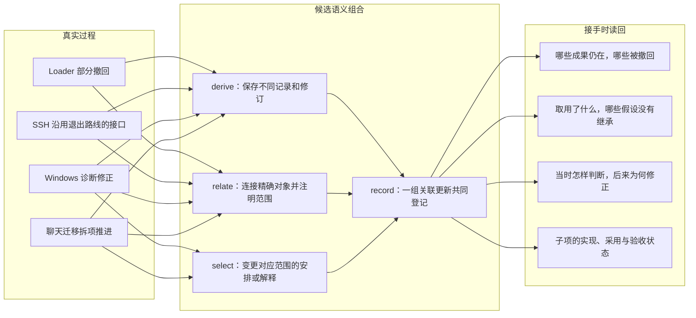

# DSH 记录机制比较 v1：共同语义、组合与删减

**这轮没有找到必须独立存在的 derive、relate 或 select 函数。找到的是几种必须保留的区别：记录要有可定位的版本，关系要说明作用范围，当前安排要有明确的变更依据。**这些含义可以分成语义操作，也可以由统一登记与读回规则承担。

对[DSH 底稿 v1](dsh-process-truth-v1.md)的 16 段过程，制作了普通工作文档、语义显式操作、统一事务登记三份表示。三份表示保留同一批 83 条来源事实、16 条研究者记录的接手边界及其来源。静态读回恢复了相同记录、来源和 27 项政策／解释选择；这是本轮表示的一致性检查。内容含义由同一研究者整理，独立接手是否正确、维护成本是否下降和长程任务收益仍待验证。

## 实际比较了什么

**普通文档**逐步增补工作记录，保留稳定条目编号、作用范围、版本化来源、决策更改和历史。它有明确引用与更新约定，属于认真维护的工作文档基线。

**语义显式版**使用 derive 保存有身份的记录与工作目录修订，relate 连接精确记录，select 改变特定范围的政策、解释或计划。一次关联更新放在同一个登记组中。事实观察不因 select 改变。

**事务统一版**用 prepare 构造同样的新增记录、关系及选择变化，再用 record 登记；采用相同版本前提与引用规则。这里比较的是描述协议，尚未实现事务数据库。

三份表示都区分来源报告和研究者解释。Git author/committer 是提交署名；原文未明确的决策者保持未知。本轮的 CAS 前提是离线串行登记的构造条件，没有把它冒充 DSH 原开发者采用的数据库协议。

## 真实过程怎样组合

图中每个基本操作只登记调用者已经判断的内容。例如，SSH 复用了哪些接口，需要从实际材料识别；relate 保存这个判断及依据。接口本身不负责发现兼容性。

### 部分撤回：要保留范围，不能只记录方向标签

T01 的记录顺序包含加入事务重载、提出撤回范围、实际撤回与消费者适配、后续启动策略修补。语义显式版分别保存这些记录，用局部保留关系指向旧版本，并登记新失败策略。普通文档把同一范围写成有编号的条目；统一版将记录、引用和政策变化放进 delta。

读回结果是：事务回滚保证退出，文件初始化、模块导出及无关能力留下；调用者还要检查实际激活结果。**旧方案的整体标签无法代替这三个范围。**撤回决策最终由谁作出仍未知。[T01 事实](dsh-process-truth-v1.md#t01)。

### 诊断修正：新解释替换的是特定故障的归因

T13 先保存“尾部晚到”的来源报告，再保存修补前后相同耗时、畸变尾部与替换控制台的记录。select 在 `windows.failure-explanation` 范围内由早期解释改为新解释；原测量、宽限修补和旧解释保留。

统一版把这项选择存成有前提的政策变更；普通文档保留“当前解释由哪条改成哪条”。三者均可读回：该宿主的这次故障归因被修正，其他真实延迟场景没有被一并否定。七个提示符正常属于作者报告。[T13 事实](dsh-process-truth-v1.md#t13)。

### 拆项推进：工作身份与状态不能绑定到文件名

T12 的同一篇迁移清单包含已提交视觉功能、未暂存草稿、分组基础和未完成验收。它们分别进入记录，完成分组基础没有使全部产品行为变为完成。T03 的 LogicalSession 阶段也保留草稿状态。

本轮采用研究编号整理这些差异，尚未给各个子功能都建立独立工作身份。**完整的子任务查询和独立更新仍需把可独立跟踪的子项显式建成对象。**因此，目前证明的是这些区别能保留和读回，尚未证明工作身份规则已经足够。[T12](dsh-process-truth-v1.md#t12)、[T03](dsh-process-truth-v1.md#t03)。

## 逐过程读回与发现

每行检查当前状态、理由或未知、保留范围、未完工作及来源定位。以下为同一研究者的语义走查；完整回答和精确条目列表保存在本地比较批次。

| 过程 | 当前状态与理由 | 保留、未完与歧义 |
|---|---|---|
| [T01](dsh-process-truth-v1.md#t01) | 撤回事务式重载，保留独立修补；维护上游偏离成本；完整决策者未知 | 文件初始化、模块导出及无关能力保留；消费者审查实际激活；启动失败策略继续修补 |
| [T02](dsh-process-truth-v1.md#t02) | 声明式配置，活跃使用者保留旧修订；跨会话读者、配置写回与资源寿命问题 | 旧修订在进程内存活，重启解析当前定义；缺失定义会恢复失败；局部修补主线日期未知 |
| [T03](dsh-process-truth-v1.md#t03) | 后续流式迁移已记录；重建仍有草稿和未完阶段；首次撤回原因未知；大文件性能为作者报告 | 源代际保留；两次实现的复用范围未知；阶段 1/2 草稿完成、3 有实现与 CI 但仍草稿、4/5 未完 |
| [T04](dsh-process-truth-v1.md#t04) | 直接向目标 inbox 投递；减少独立 outbox 身份、确认与重试管理 | 名单、任务和旧消息展示保留；旧待发不再投递；成功仅为接纳；实际用户待发损失未知 |
| [T05](dsh-process-truth-v1.md#t05) | 改为写文件并使用普通插件管理器安装；临时运行时代码重启不恢复，持久成果需普通插件 | 原运行时消费者与历史卡片保留；配置保存与激活分开；当时包替换仍需重启 |
| [T06](dsh-process-truth-v1.md#t06) | Host 任务存储、冷会话到期恢复，历史有限保留；会话未加载时旧提醒不触发；全量 JSON 增长 | 旧事件可读但不自动导入；已入会话消息保留；跨存储崩溃可重复投递；接纳不等于模型完成 |
| [T07](dsh-process-truth-v1.md#t07) | 退出 E2B 供应实现，远程接口继续供 SSH 等使用；固定 E2B SDK 的控制通道与输出保留成本 | 文件、进程、终端接口及异步操作约定保留；SSH 与删除的准确先后未知；不推导整个路线证伪 |
| [T08](dsh-process-truth-v1.md#t08) | 统一 activation 入口，本地与外部后端保留差异；Task 不宜代表持续 Agent；避免多套执行生命周期 | 历史单次描述与外部单次执行适配保留；通知允许重复；清理失败不抹去执行结果 |
| [T09](dsh-process-truth-v1.md#t09) | 通用侧栏加按类型内容保留；旧详情栏限制；卸载或 DOM 祖先改变会断开浏览器 | 布局引擎继续使用，其他类型按可见性挂载；原型和评审完整记录未知；保活不等于所有页常驻 |
| [T10](dsh-process-truth-v1.md#t10) | 人工持久暂停由用户恢复；第一次取消当前轮后，后续人类轮仍可被模型绕过 | 目标事件、输入队列、active-but-disarmed 的条件式恢复保留；运行故障原始日志与精确合入时间未知 |
| [T11](dsh-process-truth-v1.md#t11) | 开始即登记 job；前台只是限时等待；评审发现超时才登记造成额外交接协议 | 同一进程、输出游标与取消路径；jobs 可选；无 registry 等情况仍期限终止；前台分组后续 |
| [T12](dsh-process-truth-v1.md#t12) | 已完成独立功能留 channel，其余分阶段推进；整批迁移混合独立视觉和结构，难分辨性能 | 原 PR 留作参考；独立功能和分组基础分别保留；未暂存草稿、产品接入、GUI 演示与性能待验收 |
| [T13](dsh-process-truth-v1.md#t13) | 该宿主改用随包控制台；20.8 秒对照及畸变尾部推翻该故障的延迟解释 | 宽限历史保留；未由本次证据否定所有延迟场景；桌面需保留随包二进制；七次成功为作者报告 |
| [T14](dsh-process-truth-v1.md#t14) | 按已落地的逐项版本后端重写 UI；旧接口与目录漂移，另有重复后端 | 新后端继续用，旧分支作为历史来源；无代码复用范围证据；后端合入时用户功能未完；之后 E2E 为作者报告 |
| [T15](dsh-process-truth-v1.md#t15) | 共享转换、锁定外部引擎、交付绑定版本运行时；并发资源与独立引擎维护周期、用户环境需求 | 多个读者共享结果，单个取消不取消他人任务；内存限制有范围；应用运行、签名和引擎发布分别验收 |
| [T16](dsh-process-truth-v1.md#t16) | 采用原生 tool 消息和相邻迁移；会话包装与模型角色不一致 | 消息、调用和内容身份保留，原扩展归属保留；嵌套包装拒绝并留源；新角色需日志与适配投影 |

这一轮形成了五项具体修正：

1. **未决项也必须进入表示。**初稿保留了正文事实，却漏掉底稿中的接手边界；这会迫使读回者依靠原始底稿回答。已补入 16 条研究者缺口记录，明确它们属于本轮审查范围，三份表示一同保存。
2. **同一工作的记录目录与工作本身要分开。**初稿每增加事实就生成一个目录版本；删掉这些目录版本后，按不可变记录顺序仍可恢复相同成员。逐次保存目录是实现选择。
3. **替代关系必须限定对象与条件。**终端新归因针对这些宿主和这次故障；Team 新消息机制只替换交付部分。无法把整个工作统一设为“已否定”。
4. **采用关系也有演化身份。**走查初稿把两轮 Goal 暂停政策分配成两个独立键，会让它们在“当前政策”中并列；本轮改为同一范围的连续修订。范围边界由调用者声明，仍需独立复核。
5. **资料可见时间与事情发生时间分别保存。**回顾性笔记可能在后来才报告早期失败。三份记录按来源版本可见时间登记；完整材料之后才加入研究归纳的跨记录关系。没有用笔记文件名日期将后来结论倒灌到过去。

## 删除与合并检查

| 删除或改写 | 本轮实际检查 | 结果与代价 |
|---|---|---|
| 独立 derive / relate 函数 | 改读统一版的 typed add 与 relations | 记录及关系相同；身份、父版本、类型、范围与引用规则仍需维护 |
| 每步生成工作目录版本 | 删除 99 次目录 derive，再从不可变记录顺序恢复成员 | 相同成员可恢复；需要明确的投影规则。目录可以作为缓存 |
| 独立的 sourced_from 关系对象 | 改读记录内的精确 source_ids | 147 条来源连接可原样恢复；精确引用仍存在，独立关系写入可以省掉 |
| 独立 select 函数 | 将 30 次选择编码为有类型事件，并保留 expected 检查和确定性投影 | 相同 27 项当前政策可恢复；选择语义与版本检查仍需维护 |
| 保存 prepare 构造条目 | 只读 record，省去 115 条 prepare | 读回相同；构造和接纳检查仍需完成 |
| record 接口改为文档追加协议 | 比较普通文档中的断言、来源与政策投影 | 本轮相同；并发与原子登记需要等价协议，尚未检验 |
| select 连同选择数据一起删除 | 仅保留事实文本与一般关联 | 固定政策键的确定性投影缺失，需要重新理解自然语言；这不意味着人完全无法读懂 |
| 关系端点从精确记录改为工作 ID | 对 16 条跨记录联系替换端点 | 每条都出现多个候选记录；工作 ID 无法直接回答所指版本，需要额外检索或推理 |

这轮检查支持把语义接口作为便利封装，继续检验共同的登记基础。它没有证明 derive、relate、select 三个函数不可再减，也没有证明一切内容都应平铺进一个无约束的 record。

## 成本记录与适用范围

本轮包含 83 次来源事实增补、16 次接手边界增补，以及 16 次完整材料可见后的关系补记。来源目录包含 49 个固定来源对象。49 份来源元数据和可读取正文的 Git blob 已核验；这些检查确认位置与内容对象，不替代作者工程结论的独立复验。

| 表示 | 本轮保存与更新 | 文件字节数 |
|---|---|---:|
| 普通工作文档 | 99 次条目增补、16 次关联补记 | 76,621 |
| 语义显式版 | 247 次 derive、163 次 relate、30 次 select；记录和关联共 115 个登记组 | 136,681 |
| 事务统一版 | 115 次 prepare、164 次 record，其中 49 次为来源对象登记 | 232,473 |

字节数是本轮文件的实际大小。统一版同时保存 prepare 与 record 的完整 delta，显式版有独立来源对象，文档版有自己的展示标记，因此该大小不能直接当作运行成本排名。没有测量人工维护时间、模型 Token、检索延迟或独立接手正确率。

另有一项尚未收敛的负担：本轮 16 条跨记录联系用了 12 种关系名称。它们是研究者对来源含义的标注，尚未成为一组统一的推导规则；不能把统一登记接口视为已经解决这部分语义复杂性。

三份表示都需要六条共同约定：稳定记录身份；精确来源与版本；报告／决定／观察区分；范围内修订；未知项保留；资料可见时间与事件发生时间区分。显式版另需操作分组和配置前提；统一版需 delta 类型与投影规则；文档版需条目引用与当前政策更新约定。这些约定的维护难度尚未实测。

## 元操作修订建议

**继续以不可变的有类型记录和受约束的登记为共同底座，把版本生成、关系和选用作为可组合的语义接口。**当前先减掉两个强制要求：不要求每条事实都产生工作目录版本，不要求每条来源引用都成为独立关系对象。

保留精确引用、历史修订、局部取用范围和明确的选择事件。只有关系本身需要独立修订、复用或采纳时，才要求独立的关系身份；复杂整合仍由上层识别取用边界、必要依赖和冲突，再共同登记。

下一步原型范围建议限定为不可变记录、精确引用、带前提的选择事件和确定性读回，用于比较同一语义的两种实现；自动理解、工作身份自动判定和任务效果实验留待后续方案。实施前先收敛三个问题：子功能何时取得独立工作身份；关系类别能否收敛、内嵌后怎样定位并修订它；当前安排的范围怎样声明和协调。DSH 的连续过程可继续作为反例库。当前同输入检查可交付，G4 保持候选验证状态；尚未冻结完整协议，G5 跨项目验证和 G6/G7 原型与任务效果尚未开启。

执行、复查和本地完整表示

本地批次：仓库根目录相对路径 `artifacts/agent-task-state/maintenance/dsh-composition-2026-10-20/v2/`。父目录与 v1 子目录保留初稿；v2 补齐接手边界，v2 的 manifest 与输入哈希是本轮依据。复查使用 `verification.json`，详细文件如下：

- `ordinary-documents.md`：可独立读取的完整普通文档表示。
- `semantic-operations.jsonl`：完整来源对象和语义操作序列。
- `transaction-records.jsonl`：同输入的 prepare/record 序列。
- `readback-answers.json`：16 过程的当前、理由、保留、未完和定位回答。
- `metrics.json`、`manifest.json`：构造成本、哈希和未测量项。
- `verification.json`：三个静态读回器的记录一致性、引用与顺序检查，以及九项接口改写／删减检查结果。

99 条记录（83 条来源事实与 16 条研究者缺口）均能读回原断言、证据归属、来源 ID 和来源可见时间；16 条跨记录联系和 27 项政策投影一致。事实输入中的自然语言范围没有全部拆成可程序验证的语义对象，表中的语义回答仍是同作者审查。

复查工具只读取保存的表示、检查引用并重建比较用索引，不执行 DSH、不接入数据库、不调用模型。独立盲重建时应另建隔离输入，不能交付本页、底稿或答案文件；本轮没有执行这种独立试验。

