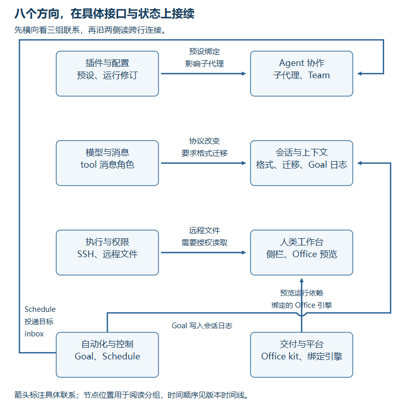
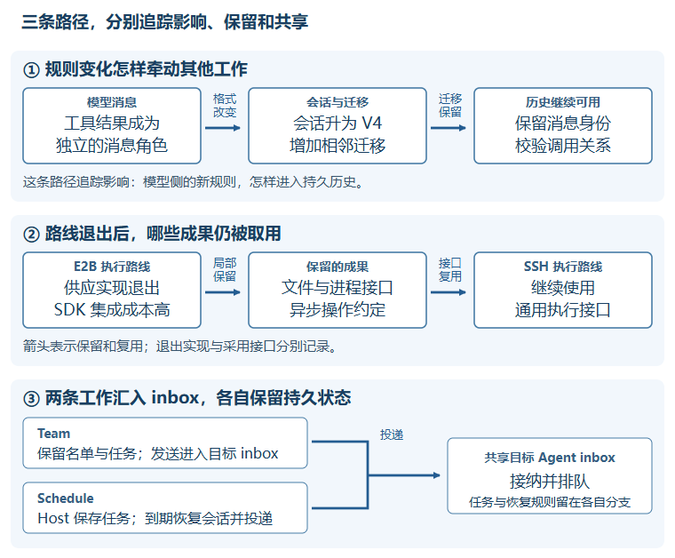

# DSH 工程全景：主要方向、演化与接续

我们整理 DSH，是为了研究：复杂开发反复换方案、复用旧成果、修改判断时，少量基本操作怎样把工作保存清楚。**我目前的判断是，机制首先需要保住每次变化的边界：影响了谁、保留了什么、依据哪个版本，以及现在采用什么。**这篇报告先展示工程全局，再沿真实连接说明这个判断从哪里来。

本文整理截至 **2026 年 10 月 15 日**的公开可达记录。开发历史从 6 月可见；8 月的记录已有开发者预览入口。准确转为公开仓库的时刻仍未知。[版本时间线](dsh-project-history.md#起点开源时已经是一个生长过的系统)保留日期依据。

## 先看八个方向怎样接起来

DSH 的工作在几处公共接口和状态上相遇。先看图中三条横向连接：预设影响子代理能用什么，模型消息规则要求会话格式跟着变，远程文件需要工作台提供可读取的入口。再沿两侧看自动化：Goal 保存在会话日志里，Schedule 到期后向协作所用的目标 inbox 投递。右下角的 Office 引擎交付，则支撑右侧工作台的预览能力。

[放大总图](figures/dsh-direction-overview.svg)。图中的连接分别可查[预设与子代理](dsh-process-truth-v1.md#t02)、[消息与迁移](dsh-process-truth-v1.md#t16)、[远程文件与工作台](dsh-development-analysis.md#6-工作台和远程执行把隐含问题变成了用户实际遇到的问题)、[Goal](dsh-process-truth-v1.md#t10)、[Schedule](dsh-process-truth-v1.md#t06)和[Office 交付](dsh-process-truth-v1.md#t15)。节点位置按阅读需要安排，版本时间另见[时间线](dsh-project-history.md)。

从这些连接可以看出，一项局部修改会留下跨方向的后续工作：调整预设，需要检查子代理；改消息格式，需要迁移历史；改变运行环境，需要处理文件读取和预览。记录开发过程时，既要能找到每条工作的历史，也要能沿这些连接检查受影响的工作。下面的表补齐各方向的发展，再选三种连接详细看其变化范围。

## 八个方向怎样发展

先用这张表定位全局：每行是一条长期工作方向，横向读它从什么能力起步、经历了什么变化、现在留下哪些工作。不同方向并行推进，阶段之间有重叠。

| 方向 | 起步 | 关键变化 | 截止时的状态与未完工作 |
|---|---|---|---|
| **插件与配置** | 插件组成 Agent，预设决定能力组合 | Loader 加入事务重载后又撤回；Creator 改走普通插件安装；预设改为声明式配置 | 已采用运行修订保留机制；旧修订可供正在工作的 Agent 使用，重启按当前配置恢复。热更新和需重启情况分别处理 |
| **会话与上下文** | 事件日志支持恢复、分叉、压缩 | 移除权威 SQLite 后端；迁移实现合入、撤回、再实现；会话格式演进至 V4 | 历史格式有迁移与验证规则；LogicalSession 重建仍有阶段未完成，不能和已发布格式混为一项完成状态 |
| **Agent 协作** | 单次子代理、持续会话、工作流与团队 | 持久会话和一次执行分开；统一 activation；Team 消息转交目标 inbox | 本地持续会话与外部单次执行保留能力差异；Team 名单、任务继续存在，旧 outbox 的恢复投递退出 |
| **执行与权限** | 文件、进程、终端和沙箱工具 | E2B 退出而接口保留，SSH 沿用这些接口；Shell 改为命令开始即登记任务，前台限时等待 | 远程执行与本地控制职责分开；取消、结果未知、权限变化和后台资源释放继续修补 |
| **人类工作台** | 聊天、工具详情和文件链接 | 通用侧栏接纳文件、终端、Office、浏览器；聊天折叠整批回退后分项推进 | 侧栏继续保留，并为浏览器等内容保持实例寿命；聊天分组基础与产品验收分别有进度 |
| **模型、消息与多模态** | 模型适配、图像输入和上下文路由 | 动态提示；工具结果成为独立消息角色，带动 V3→V4 迁移与适配器调整 | 当前格式采用原生 tool 消息；旧包装由相邻迁移转换，无法无损处理的输入保留原始数据 |
| **自动化与用户控制** | 同会话目标和提醒 | Goal 与运行授权分开；Schedule 改由 Host 存储；人工暂停经历两轮修补 | 冷会话可到期恢复投递；旧提醒需重建；人工暂停由用户恢复，目标存在与允许继续运行分别保存 |
| **交付与平台** | 源码、npm、SDK 和平台依赖 | LibreOffice kit 独立发布；桌面绑定运行时与安装验证 | 应用锁定引擎版本，升级需更新依赖；桌面运行时按版本与内容校验安装，实际可执行性另有检查 |

## 沿三条路径，看一项变化怎样接到其他工作

八个方向中，我们先追三条有明确记录的连接。选它们，是因为它们分别检验三种不同的记录能力：**追踪影响范围、保留局部成果、区分共享机制下的不同承诺。**图按①②③从上到下读，下面的解释使用相同编号。

[查看可放大的矢量图](figures/dsh-evolution-paths.svg)。这三条路径用于解释连接方式；完整八方向及其余过程仍在上表和底稿中。

### ① 一处规则变化，怎样牵动会话和历史迁移

这一条先看变更的影响为什么会跨模块。模型把工具结果视为独立消息角色，旧会话却将它包在 user 消息中；两种描述使验证、回放和模型适配出现分歧。DSH 因此在 V4 中采用独立 tool 消息，并通过 V3→V4 的相邻迁移转换旧包装。转换还要保留消息身份、工具调用身份和扩展字段，支持已有历史继续使用。[消息协议](dsh-process-truth-v1.md#t16)、[迁移过程](dsh-process-truth-v1.md#t03)。

沿这条线，最初的“调整消息表示”连到了格式、迁移、验证和适配工作。若只记“采用 V4”，接手者看不到这些后续责任。**记录应把新规则所影响的工作连起来，并保留各部分的实施与验收状态。**底稿中的 LogicalSession 重建仍有草稿和未完成阶段，不能随着格式升级一起标成完成。

### ② 放弃一个实现，为什么仍能使用它留下的成果

第二条用来检查撤回和复用能否同时表达。E2B 退出记录将固定 SDK 的控制通道和输出保留成本作为理由；退出范围包括供应实现及相关依赖。通用文件、进程、终端接口和异步操作约定继续保留，SSH 使用这些公共接口提供远程执行。[E2B 与 SSH 的记录](dsh-process-truth-v1.md#t07)保留了取用范围，准确落地先后仍有待查项。

这里需要同时回答两个问题：放弃了什么，保留了什么。把整个 E2B 工作标为失败，会掩盖接口的后续用途；把它标为已复用，又会掩盖供应实现已经退出。**记录需要指向具体成果及版本，说明被取用的部分；从旧工作继承哪些判断，也要有明确范围。**

### ③ Team 和定时任务共用 inbox，为何不能合成一种状态

第三条检查共享机制会不会抹平业务差异。Team 将独立 outbox 替换为直接向目标 Agent inbox 投递，取消自身的重试和去重机制，名单与任务继续保留。Schedule 也向 inbox 投递，但任务由 Host 存储管理，到期时可以恢复冷会话。它还要处理任务存储和消息存储分开提交带来的重复投递风险。[Team](dsh-process-truth-v1.md#t04)、[Schedule](dsh-process-truth-v1.md#t06)。

两条工作在 inbox 接起来，共用的是消息接纳入口。它们自己的持久状态、恢复规则和产品承诺仍有区别；接纳消息也不表示模型已经完成任务。**记录中的“复用某机制”，需要与“承担哪些责任”分别表达。**否则接手者可能从一个共用组件，推导出来源并未承诺的行为。

## 沿这些连接，推导记录机制应承担什么

现在把图中的工程事实转成候选机制的要求。下面每一行都说明：省略某种信息以后，后续工作会在哪里失去依据。

| 路径中的事实 | 只保留当前结果，会丢掉什么 | 记录机制需要提供什么 |
|---|---|---|
| 消息角色变化牵动格式和迁移 | 新规则影响哪些消费者，哪些迁移还未完成 | 前提版本、影响联系，以及分别跟踪的后续工作 |
| E2B 实现退出，接口继续供 SSH 使用 | 撤回和保留的具体边界，复用的成果来源 | 精确成果引用、局部取用范围和演化历史 |
| Team 与 Schedule 共用 inbox | 不同存储与恢复承诺，接纳和完成的区别 | 有范围的关系、执行观察和未完成责任 |

这些要求可以从已有记录中得到检验，尚未决定要用几个函数来实现。同一条精确引用可能承担来源、取用或依赖的表达；它们能否共享更新规则，需要用具体反例检查。

还需补上判断自身的演化。Windows 终端最初被解释为提示符尾部晚到，修补后仍失败，后续测量发现尾部已经到达但格式异常，于是更换控制台宿主。[终端排查](dsh-process-truth-v1.md#t13)要求记录同时保留当时的解释、修补结果、新证据和后来采用的判断。**改变当前解释，应当留下解释怎样被修正；旧测量也要继续指向它实际检查的版本与条件。**

配置、Creator、侧栏和交付的其他连接，继续见[16 段过程底稿](dsh-process-truth-v1.md)。部分撤回、短暂试验和零净变化合入的查证资料保留在[详细检索图](dsh-work-history.html)与[覆盖底稿](dsh-project-history-evidence.md)。

## 这一轮把我们带到哪里，我建议怎样继续

[三种表示比较](dsh-representation-comparison-v1.md)中，认真维护的普通文档、三个语义操作和统一事务登记都保存了同一批输入。这个结果让下一步的重点落在规则上：哪些信息和约束必须保留，才能让不同接口表达同一件工作？下面三项检查给出了具体线索。

| 本轮检查 | 可以作出的判断 | 对设计的影响 |
|---|---|---|
| 去掉独立 select 接口，保留选择事件、版本前提和读回规则，仍得到相同当前选用 | 选择的含义可以由共同登记机制承担 | select 可作为上层便利接口；先定义怎样修订同一范围内的选择 |
| 来源关系内嵌后仍可恢复；将跨记录端点换成笼统工作 ID 后，出现多个候选记录 | 精确指向成果和版本是必要约定，是否单独建关系对象可以另选 | 先明确引用的范围与修订办法，再决定关系对象的形态 |
| 16 条跨记录联系用了 12 种名称 | 登记方式统一了，关系的含义和更新规则仍有整理空间 | 对照真实过程检查哪些关系共享规则，哪些必须保留差别 |

**我的判断是，共同登记机制值得继续检验，下一步应优先收敛引用、修订和选用的规则。**例如，暂停一条路线通常保留成果和恢复入口；撤回一次实现可能只移除部分成果；新解释替代旧解释，还需要保留旧测量所针对的版本。这些动作能否由共同操作组合，要看规则能否准确保存这些差别。

下一份设计据此交付三组具体规则：工作和子任务怎样保持或分出身份；引用怎样限定成果范围并随修订变化；当前选用怎样更新，以及它与实施、验证结果怎样分别记录。每组规则都用底稿中的过程编码和读回，再删除或合并规则，指出实际丢失或产生歧义的信息。复杂判断由谁提供，也要一同写明，才能看清操作是否只是把负担藏进参数。

三组件架构继续作为已有设计假设：工作库保存记录，语义维护器提出解释和更新，视图生成器组织内容。本轮比较检验了记录方式，其结果尚不足以确认这三个职责就是最优划分。

普通文档同样保存了本轮输入，因此显式机制的价值还要通过更新、查证和接续的可靠性与成本来检验。本轮完成的是同作者离线走查；独立接手正确率和维护收益仍待后续验证。来源中的工程测试和性能数字归属作者报告。
