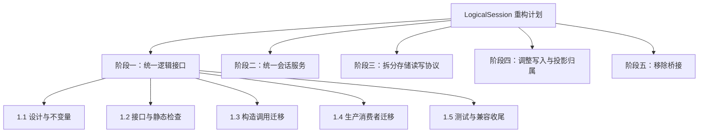

# DSH 工作历史地图与全量盘点

**DSH 的工作历史已经扩展为一张可查证的关系图。**[打开工作历史地图](dsh-work-history.html)，可以看已核实的关系链、搜索全部历史主题、查看主线提交中的文件变化，也可以展开原文查替换范围。图中目前有 171 条关系，覆盖 200 个历史文件主题，另有 27 个从明确计划中展开的阶段节点和一个待解析引用。

资料沿用 2026 年 10 月 15 日的固定版本。机器盘点已覆盖全部历史主题和主线变更，正文关系仍在逐项审阅。现有十段过程作为细读案例保留；全量范围和审阅进度在地图的“覆盖与待查”中更新。

## 工程有多大，工作又怎样连接

DSH 自己的文档划分了 **66 个子系统**，包括会话、持久化、压缩、预设、子代理、Team、文件、进程、远程执行、Web 和观测等；当前有 349 个包。全部可见历史中找到 1,358 个带日期的笔记文件主题，其中 1,266 个在截止版本仍然存在。子系统目录提供结构入口，历史笔记和提交提供工作的演化记录。

这些工作已经能连出三种具体形状。

**第一种是旧决定被局部修改，其他部分继续沿用。**输入框改用 Lexical 时，替换的是编辑器部分，提交状态机、触发菜单和插件扩展点仍沿用旧方案。插件管理后来增加安装失败回滚，卸载继续保留原来的部分修改策略。要理解当前结果，需要同时读到新决定和旧决定的保留范围。

**第二种是跨模块复用，也会出现路线退出后成果继续使用。**文件接口先分离存储与策略，远程执行随后复用公共文件和进程接口。E2B 供应实现退役时，这些接口和异步操作约定继续保留；SSH 使用它们实现另一套远程后端。

Creator 安装能力复用已有插件管理器，把锁、包安装、启用和热更新继续交给同一个管理者。[文件接口拆分](https://github.com/deepseek-ai/deepseek-harness/blob/86a402200d95fecef4529d969836f1fe13c6cb0d/.agents/notes/archived/simplification/2026-06-26-fsspec-style-fs-seam.md)、[E2B 退役](https://github.com/deepseek-ai/deepseek-harness/blob/86a402200d95fecef4529d969836f1fe13c6cb0d/.agents/notes/implemented/simplification/2026-09-11-remove-e2b-providers.md)、[Creator 安装](https://github.com/deepseek-ai/deepseek-harness/blob/86a402200d95fecef4529d969836f1fe13c6cb0d/.agents/notes/implemented/architecture/2026-09-16-creator-persistent-plugin-management.md)各自记录了具体边界，地图保存逐边原文。

**第三种是明确的计划嵌套。**LogicalSession 重构分五阶段，第一阶段又分五个子阶段。作者报告前三阶段已有草稿工作，第三阶段实现和远程 CI 完成但仍为草稿，第四、第五阶段未完成。输入重构另有“先机械提取职责，再改变共享草稿行为”的两阶段计划，第一阶段列出五处提取。

[原始重构计划](https://github.com/deepseek-ai/deepseek-harness/blob/86a402200d95fecef4529d969836f1fe13c6cb0d/.agents/notes/proposed/architecture/2026-09-06-logical-session-storage-rebuild.md)同时保留每阶段的不变量、验收条件和进度。

还有一条值得保留的反复：ACP 早期支持会话模型选择，随后限定为自动化协议，后来又通过标准配置恢复选择。历史版本里的中间决定补齐了这条链。地图会分别展示每次改变的范围。

## 距离穷尽还差什么

**正文关系继续逐条核对。**当前正文有 1,074 处关系候选，已核对 131 处，尚余 943 处；历史版本另核对 8 处。候选词扫描之外，仍需要按主题正文补查没有显式关系措辞的过程。图中的 171 条边还包括补查的跨领域联系和明确计划层级，数量与候选出现次数分别统计。

**代码过程需要沿实际差异追踪。**2,172 次主线变更中，有 847 次未修改任何 notes 路径。这些提交已进入主线检索入口，后续检查差异，再确认哪些过程缺少设计记录。完整提交消息中找到 29 条明确的撤回声明，其引用的原始 SHA 全部不在截止版本的可达历史中。对照同标题提交、文件前后状态和 Git 先祖关系后，24 条已经找到完整的内容逆变换，包含一次撤回后的重新应用；其余 5 条继续查补丁。原消息中的 SHA 对应关系仍保留待查。

**讨论和评审链仍需补查。**固定仓库元数据中 Issues 和 Pull Requests 功能关闭，Git 合并消息仍保留 PR 编号。公开讨论与评审正文目前缺失；作者私人尝试和未公开的取舍也保留未知。

下一轮继续清理这三类缺口。truth 仍处于扩充和复核阶段，元操作编码比较尚未开始。

详细数量、版本选择、关系审阅规则与本地产物位置见[覆盖审计](dsh-project-history-evidence.md#2026-10-19-全量盘点与关系图审计)。
