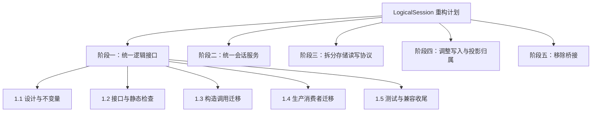

# DSH 工作历史地图与全量盘点

[打开工作历史地图](dsh-work-history.html)，可检索历史工作、沿关系查原文，也可展开同一篇笔记内部的尝试、撤回和评审修改。资料固定截至 2026 年 10 月 15 日。

这轮把检查从 40 个发布快照扩到了截止提交可达的全部分支，补入了发布间隙被移除的记录、分支中的旧方案和早期编号 ADR/RFC。**新增 181 个文件名的代表正文已读完，551 段新增引用和 447 段过程措辞已核对。**其中的文件更名另有提交证据，前后正文分别保留。

## 工程有多大，工作又怎样连接

DSH（DeepSeek Harness）的项目文档划分了 **66 个子系统**，涵盖会话、存储、压缩、预设、子代理、代理团队、文件、进程、远程执行、Web 和运行观测等领域。当前代码包含 349 个包。40 版本目录中的 1,358 个日期文件名，有 1,266 个在截止版本仍然存在；同一项工作也可能曾使用不同文件名。

这些工作已经能连出三种具体形状。

**第一种是旧决定被局部修改，其他部分继续沿用。**输入框改用 Lexical 时，只替换了编辑器；提交流程、输入触发菜单和插件扩展方式仍沿用旧方案。插件管理后来增加安装失败回滚，卸载继续保留原来的部分修改策略。

**第二种是跨模块复用，也会出现路线退出后成果继续使用。**文件接口先分离存储与策略，远程执行随后复用公共文件和进程接口。E2B 供应实现退役时，这些接口和异步操作约定继续保留；SSH 使用它们实现另一套远程后端。

Creator 安装能力复用已有插件管理器，把锁、包安装、启用和热更新继续交给同一个管理者。[文件接口拆分](https://github.com/deepseek-ai/deepseek-harness/blob/86a402200d95fecef4529d969836f1fe13c6cb0d/.agents/notes/archived/simplification/2026-06-26-fsspec-style-fs-seam.md)、[E2B 退役](https://github.com/deepseek-ai/deepseek-harness/blob/86a402200d95fecef4529d969836f1fe13c6cb0d/.agents/notes/implemented/simplification/2026-09-11-remove-e2b-providers.md)、[Creator 安装](https://github.com/deepseek-ai/deepseek-harness/blob/86a402200d95fecef4529d969836f1fe13c6cb0d/.agents/notes/implemented/architecture/2026-09-16-creator-persistent-plugin-management.md)各自记录了具体边界，地图保存逐边原文。

**第三种是明确的计划嵌套。**LogicalSession 重构分五阶段，第一阶段又分五个子阶段。作者报告前三阶段已有草稿工作，第三阶段实现和远程 CI 完成但仍为草稿，第四、第五阶段未完成。输入重构另有“先机械提取职责，再改变共享草稿行为”的两阶段计划，第一阶段列出五处提取。

[原始重构计划](https://github.com/deepseek-ai/deepseek-harness/blob/86a402200d95fecef4529d969836f1fe13c6cb0d/.agents/notes/proposed/architecture/2026-09-06-logical-session-storage-rebuild.md)同时保留每阶段的不变量、验收条件和进度。

还有一条值得保留的反复：ACP 早期支持会话模型选择，随后限定为自动化协议，后来又通过标准配置恢复选择。历史版本里的中间决定补齐了这条链。地图会分别展示每次改变的范围。

## 新补出的两条完整返工链

**Shell 执行经历了连续两次收敛。**最初 `run` 和 `start` 分开，长命令超时会被杀掉。随后统一为 `execute`，由执行器在超时时提出转后台的请求。评审发现，旧方案要等命令超时才登记后台任务。于是改成命令一开始就登记任务，由前台等待结果；命令从开始就能出现在任务列表中，供人查看和停止。地图保留[超时转后台的版本](https://github.com/deepseek-ai/deepseek-harness/blob/b42a93d62f713b0c84f501ab682dbf57eca2a410/.agents/notes/implemented/feature/2026-08-26-shell-execute-timeout-promotion.md)和[开始即登记任务的版本](https://github.com/deepseek-ai/deepseek-harness/blob/86a402200d95fecef4529d969836f1fe13c6cb0d/.agents/notes/archived/feature/2026-08-26-shell-execute-projection-and-jobs-at-start.md)及各自理由。

**聊天过程折叠曾整批落地，又退回分项推进。**作者记录 PR #4565 合并八分钟后因性能回退。原 PR 要增加三种详略模式，把回复之间的工具调用和推理折叠起来。回退后，界面调整、折叠规则、每轮对话的状态与消息分组分别推进。迁移表逐项记录代码、提交和验收；分组基础设施完成时，产品接入与性能验证仍有未完成项。[迁移记录](https://github.com/deepseek-ai/deepseek-harness/blob/8b43d44cc6b12a9f494693f6e089ebae193b8487/.agents/notes/proposed/feature/2026-09-20-chat-work-details-migration.md)和[分组基础设施](https://github.com/deepseek-ai/deepseek-harness/blob/86a402200d95fecef4529d969836f1fe13c6cb0d/.agents/notes/implemented/architecture/2026-09-21-conversation-build-groups.md)在图中分别可查。

## 补齐后的历史还能看到什么

**合并进主线与保留最终改动，是两件分别发生的事。**847 次变更里有 7 次相对父版本没有文件变化，但仍把其他分支提交纳入历史。其中一条带入了 trace workbench、桌面工作台及其后续修订。地图的主线入口现在能展开本次进入主线的分支提交、作者和时间。

**撤回时也可能继续向前修改。**29 条明确的撤回声明中，24 条找到完整文件状态逆变换，另 5 条已核对差异。SQLite 恢复被删的事件字段时，保留了期间的存储更新，并将格式版本升到 20。CI 恢复并发配置时，实际基线已经再次降低，撤回补丁因此与最早的修改不同。

这些记录补充了修订、撤回、保留和继续推进同时出现的过程。原始提交消息中的 29 个目标 SHA 均不在截止版本可达历史中，已核对的内容对应保留各自证据。

**旧工作还会因为其他路线先落地而失去适配条件。**消息反馈的早期全栈尝试使用一套接口，后来落地的后端采用了另一套接口；期间目录又发生两次更名。作者检查后选择关闭旧 PR，按新后端重做界面。地图新增了这两条 PR 的来源记录，能看到旧尝试与后来实现在哪里分开。

同一篇笔记还会保留短暂的实现：预设查询曾改为逐行解析包路径，测量后因明显变慢而撤回；引导界面的链式方案、中文搜索分词器也有做出后撤回的记录。点开相应工作，可展开这类正文内部的过程。

## 覆盖范围与查证入口

文件编目已扩到截止提交可达的全部分支。新增文件的代表正文、上一轮筛出的历史引用和演化措辞已审阅；文件迁移保留前后版本，补丁还原与引文来源另有校验记录。

地图同时保留已分类的工作关系、历史演化引用和文件迁移。虚线从声明指向所引用的工作，点击后可查看具体范围、当时状态和固定版本。

取消关键词筛选后，仍有一批普通引用正在逐项检查。全部历史正文逐篇精读和全部代码差异逐行语义审查仍未完成。公开 PR 讨论、私人尝试和部分撤回理由目前缺失。元操作比较尚未开始。

详细数量、逐项记录与验证结果见[覆盖审计](dsh-project-history-evidence.md#2026-10-20-全部可达提交补查)。
