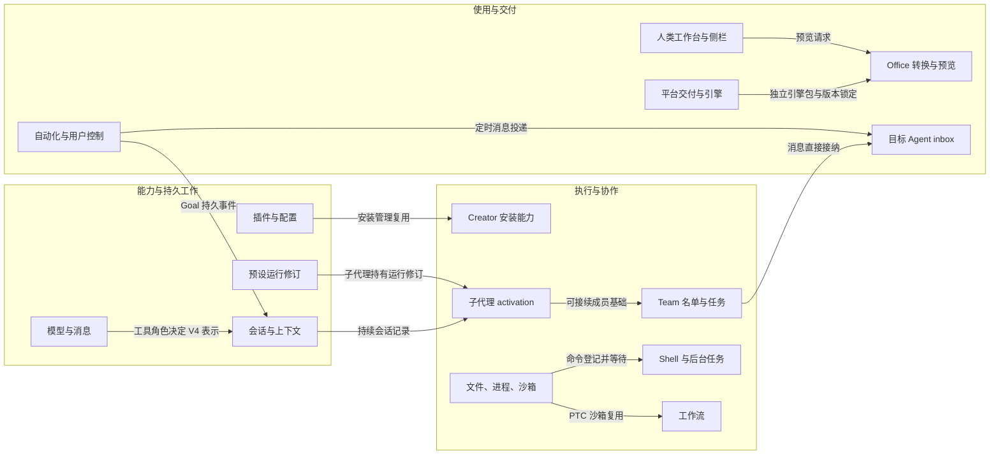

# DSH 工程全景：主要方向、演化与接续

DSH 的开发围绕八个相互连接的方向推进：扩展 Agent 的能力、保存与恢复会话、组织协作、执行工具、展示成果、接入模型、运行自动化，以及把整套系统交付给用户。**同一项能力通常经历多个决定；后续变更会替换其中一部分，也会继续使用旧成果。**

本文整理截至 **2026 年 10 月 15 日**的公开可达记录。开发历史从 6 月可见；8 月的记录已有开发者预览入口。准确转为公开仓库的时刻仍未知。[版本时间线](dsh-project-history.md#起点开源时已经是一个生长过的系统)保留日期依据。

## 八个方向怎样发展

下表按每条线内部的演化组织。不同工作并行发生，阶段之间有重叠。

| 方向 | 起步 | 关键变化 | 截止时的状态与未完工作 |
|---|---|---|---|
| **插件与配置** | 插件组成 Agent，预设决定能力组合 | Loader 加入事务重载后又撤回；Creator 改走普通插件安装；预设改为声明式配置 | 已采用运行修订保留机制；旧修订可供正在工作的 Agent 使用，重启按当前配置恢复。热更新和需重启情况分别处理 |
| **会话与上下文** | 事件日志支持恢复、分叉、压缩 | 移除权威 SQLite 后端；迁移实现合入、撤回、再实现；会话格式演进至 V4 | 历史格式有迁移与验证规则；LogicalSession 重建仍有阶段未完成，不能和已发布格式混为一项完成状态 |
| **Agent 协作** | 单次子代理、持续会话、工作流与团队 | 持久会话和一次执行分开；统一 activation；Team 消息转交目标 inbox | 本地持续会话与外部单次执行保留能力差异；Team 名单、任务继续存在，旧 outbox 的恢复投递退出 |
| **执行与权限** | 文件、进程、终端和沙箱工具 | E2B 退出而接口保留，SSH 沿用这些接口；Shell 改为命令开始即登记任务，前台限时等待 | 远程执行与本地控制职责分开；取消、结果未知、权限变化和后台资源释放继续修补 |
| **人类工作台** | 聊天、工具详情和文件链接 | 通用侧栏接纳文件、终端、Office、浏览器；聊天折叠整批回退后分项推进 | 侧栏继续保留，并为浏览器等内容保持实例寿命；聊天分组基础与产品验收分别有进度 |
| **模型、消息与多模态** | 模型适配、图像输入和上下文路由 | 动态提示；工具结果成为独立消息角色，带动 V3→V4 迁移与适配器调整 | 当前格式采用原生 tool 消息；旧包装由相邻迁移转换，无法无损处理的输入保留原始数据 |
| **自动化与用户控制** | 同会话目标和提醒 | Goal 与运行授权分开；Schedule 改由 Host 存储；人工暂停经历两轮修补 | 冷会话可到期恢复投递；旧提醒需重建；人工暂停由用户恢复，目标存在与允许继续运行分别保存 |
| **交付与平台** | 源码、npm、SDK 和平台依赖 | LibreOffice kit 独立发布；桌面绑定运行时与安装验证 | 应用锁定引擎版本，升级需更新依赖；桌面运行时按版本与内容校验安装，实际可执行性另有检查 |

## 这些方向在哪里接起来

图中的箭头表示具体使用关系，标签写明用途。演化先后在上表及各过程内说明。

**配置的改变会影响正在执行的工作。**会话预设先把插件移入 Agent 作用域，曾使 Host 的跨会话读者找不到服务；后来的声明式配置又要求保留仍被使用的旧运行修订。Creator 则复用插件管理器，把安装和配置保存接回已有管理路径。[预设过程](dsh-process-truth-v1.md#t02)、[Creator 过程](dsh-process-truth-v1.md#t05)。

**协作共用执行设施，但每层保留自己的含义。**子代理统一一次执行的生命周期；Team 使用可接续成员，并将消息交给目标 inbox。名单和任务仍由 Team 保存。Schedule 也使用 inbox 投递，但另有 Host 任务存储和到期恢复规则。[子代理](dsh-process-truth-v1.md#t08)、[Team](dsh-process-truth-v1.md#t04)、[Schedule](dsh-process-truth-v1.md#t06)。

**消息协议会反过来改变持久历史。**模型将工具结果视为独立角色，会话原先却把它包装在 user 消息中。V4 统一这两种描述，迁移必须保留消息身份、工具调用和扩展字段。LogicalSession 重构是另一项多阶段工作，仍有草稿和未完成部分。[消息协议](dsh-process-truth-v1.md#t16)、[会话迁移与重建](dsh-process-truth-v1.md#t03)。

**执行能力会跨产品复用，也会继续产生修补。**E2B 的试验验证了通用执行接口，供应实现退出后接口留给其他后端。Shell 的评审进一步把进程寿命与前台等待分开；Windows 终端排查则经历解释被测量结果修正。[远程执行](dsh-process-truth-v1.md#t07)、[Shell](dsh-process-truth-v1.md#t11)、[终端排查](dsh-process-truth-v1.md#t13)。

**工作台的能力依赖交付，但两者有不同的演化。**Office 预览和文档检查共享转换服务，需要协调优先级、缓存和单个读者取消；引擎在独立仓库发布，Harness 锁定版本并负责集成。侧栏另行管理内容实例，聊天折叠另有分项迁移和性能验收。[Office 与平台](dsh-process-truth-v1.md#t15)、[侧栏](dsh-process-truth-v1.md#t09)、[聊天折叠](dsh-process-truth-v1.md#t12)。

## 从这些过程里，需要保留什么

全景中的变化需要同时保留四件事：**发生过什么、当时依据什么、具体改了哪一部分、现在还有什么要继续做。**

Loader 撤回了事务保证，却留下独立修补；Team 替换了消息交付机制，却保留名单与任务；旧反馈方案因新后端先落地而失去适配条件，随后重做界面；人工暂停修补后又暴露另一条恢复路径。只用一个“完成／失败”标签，会丢失这些区别。[反馈重做](dsh-process-truth-v1.md#t14)、[人工暂停](dsh-process-truth-v1.md#t10)。

已有记录还保存了净文件变化为零的合入、部分逆变换、短暂试验后撤回等情况。这些作为版本与范围检查的补充材料，保留在[覆盖与证据底稿](dsh-project-history-evidence.md)和[详细检索图](dsh-work-history.html)。

## 本轮的机制检查结果

[过程底稿 v1](dsh-process-truth-v1.md)固定上述连续过程和证据边界。[三种表示比较](dsh-representation-comparison-v1.md)据此逐步登记并读回。

当前结果支持一个较小的共同基础：**保留有身份的版本、连接精确记录、显式改变当前安排；登记机制把关联变化一起保存。**普通工作文档也能表达这些过程。显式操作的潜在作用在于让引用、更新和读回规则统一，维护收益仍需要实际使用验证。

本轮为同一研究者完成的离线表达检查。来源中的性能与测试沿用作者报告；缺失的决策主体、撤回理由和运行结果继续留在底稿。下一步是针对已暴露的规则缺口复核候选，再确定离线原型的实施范围。
