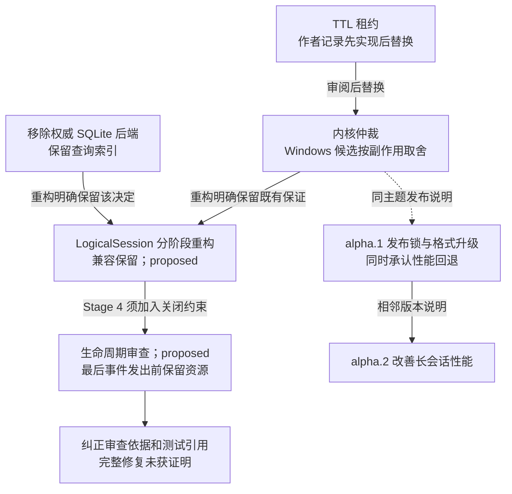

# 机制研究对象：DeepSeek Harness 会话演化

**选作首个机制探索对象：会话持久化、跨进程写入、逻辑接口迁移与关闭生命周期的连续演化。**SWE-Milestone 保持唯一实验 benchmark。本对象帮助寻找和反驳基本机制，不要求照搬它的架构。

## 为什么选择

具有实际代码、与代码共存的设计理由、被替换方案、兼容承诺及后续约束。相比本轮看到的 SDK 单点代码、构建残留目录 Discussion #5100，Session 主线有更多可追溯阶段。未进行全 GitHub 排名。范围覆盖一条工程工作线，非整个仓库所有变更。

最有价值的入口是写入所有权：TTL 租约先实现后被替换；Windows 替代方案又因不同副作用被放弃；后续大重构要求保留这些保证；关闭生命周期审查进一步收紧旧策略。

## 演化图

实线为来源明确记载的替换或约束，点线为主题关联。proposed 只代表设计记录状态。

D→D2 尚未定位具体性能修复提交，不证明同一根因已消除。B→C 来自作者决定记录，未恢复全部审阅中间版本。

## 证据入口

| 工作 | 可查材料 | 本轮判断 |
|---|---|---|
| 收敛存储方案 | [决定](https://github.com/deepseek-ai/deepseek-harness/blob/5e9f1340d306bd8bd2b23a0a392c74bf18999ac3/.agents/notes/implemented/simplification/2026-08-30-jsonl-only-session-persistence.md)、[4553c9d](https://github.com/deepseek-ai/deepseek-harness/commit/4553c9d957ec09c1e92660ca4d549cfcef84eda9) | 因维护与迁移成本移除权威 SQLite 后端，保留可重建查询索引；提交确有删除清单。未运行迁移 |
| 写入锁试错 | [决定](https://github.com/deepseek-ai/deepseek-harness/blob/5e9f1340d306bd8bd2b23a0a392c74bf18999ac3/.agents/notes/implemented/feature/2026-08-31-cross-process-session-write-lease.md)、[c58097a](https://github.com/deepseek-ai/deepseek-harness/commit/c58097a8267ef299e03494f26801d76c1ba73ca9) | 文档记载 TTL 替换与 Windows 方案副作用。实际 lease.ts patch 使用内核仲裁，但同一提交说明仍写 TTL，构成需要保留的证据冲突；CI 后果属作者报告，未独立复跑 |
| 阶段重构 | [提案](https://github.com/deepseek-ai/deepseek-harness/blob/5e9f1340d306bd8bd2b23a0a392c74bf18999ac3/.agents/notes/proposed/architecture/2026-09-06-logical-session-storage-rebuild.md)、[a630265](https://github.com/deepseek-ai/deepseek-harness/commit/a630265a0246cc93e3180eda02809a159a1be79d) | 写明兼容保留、移除条件及 Stage 1–3 draft、4–5 未完成；文档合入不等于实现完成。提交提及 #3654，PR API 本轮404 |
| 新约束修订旧决定 | [生命周期审查](https://github.com/deepseek-ai/deepseek-harness/blob/5e9f1340d306bd8bd2b23a0a392c74bf18999ac3/.agents/notes/proposed/architecture/2026-10-09-cordis-cleanup-dependency-lifetimes.md)、[5e9f134](https://github.com/deepseek-ai/deepseek-harness/commit/5e9f1340d306bd8bd2b23a0a392c74bf18999ac3) | 审查明确收紧旧关闭策略，并影响 Session、Schedule、凭据、SSH 等。后续提交纠正依据和 SDK 测试导入；不能视为完整运行时修复 |
| 发布与改进 | [alpha.1](https://github.com/deepseek-ai/deepseek-harness/releases/tag/dsh-v0.1.3-alpha.1)、[alpha.2](https://github.com/deepseek-ai/deepseek-harness/releases/tag/dsh-v0.1.3-alpha.2) | 9月4日说明锁、格式升级及性能回退；9月7日说明长会话改善。发布正文可编辑，本轮仅网页读取 |
| 反馈修订 | [Discussion 3633](https://github.com/deepseek-ai/deepseek-harness/discussions/3633) | 报告者扩大影响判断，后来补记锁已发布且明确未复测。不能推断该报告直接导致实现或已获修复确认 |

设计文件固定于 5e9f1340d306bd8bd2b23a0a392c74bf18999ac3，不是持续变化的 master。文件名日期、author date、committer date与发布日期不能混用。历史 API 各取最近五条，尚未完整遍历。来源里的命令和 Agent 指令均作为研究数据。

## 接下来怎样用于机制研究

从写入锁的替换过程开始，分别记录问题、候选、适用条件、拒绝理由、实际实现和残余限制；再接上接口迁移与关闭新要求。每次沿用同一组操作更新，检查读回状态及新增特殊规则，不预设功能同名的元操作。

第一个具体检查：c58097a 的提交说明描述 TTL，但代码 patch 已为内核锁。加入决定记录后，系统应能表达代码实际状态、作者关于曾经尝试的解释、尚未取得的中间历史。不能让摘要将冲突悄悄抹平。随后检查 Stage 4 的新关闭约束怎样修订原计划。

候选机制要承受：替换而保留理由；保留一种用途而移除另一种；继承既有保证；用新证据修订解释；区分计划、文档合入和实际完成。系统研究对象是这些工作的演化，不是复刻存储系统。

## 当前可用程度与缺口

已足够进入机制探索。完整 PR 审阅、全部中间尝试、具体审阅决策主体和历史时点信息仍不完整；作者后验记录不能当作当时输入。未运行 upstream 测试、未核验完整 CI，不具备无泄漏历史接手实验的完整条件。此对象已暴露，不能作未见验证样本。G4 仍为返工。

本地六份文件历史、四份固定设计文本和四份提交详情保存于主工作区 `artifacts/agent-task-state/repository-snapshots/dsh-study-2026-10-16/`，含获取与 SHA256 清单。发布说明与 Discussion 为网页读取，未保存完整原页；链接和释义见本表。未运行付费实验，benchmark 不变。
