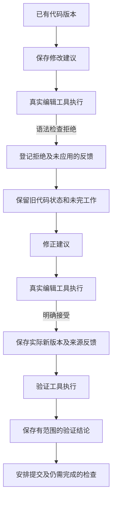

# 真实开发过程对元操作候选的首轮检查

**已有三个语义操作可以描述本轮大部分记录变化，但还不能据此冻结它们。**真实材料暴露了一处必须补清的界限：决定采用什么，与记录现实里已经发生什么，不是同一种状态变化。后者不能因为没有被 select 就消失，也不能因为被 select 就真的发生。

本轮输入为[活动地图](software-development-activity-map.md)、[记录与 Agent 映射](activity-record-agent-mapping.md)以及[候选 v0.2](primitive-candidates-v0.2.md)。这是逐过程的纸面语义检查，未实现或运行三套近邻。

## 在相同工作点尝试组合

下面用“版本生成、关系、选用”表达候选；登记指底层 record，不把它与工程工具的真实执行混为一谈。

| 工作点 | 候选如何记录和更新 | 读回时必须成立 | 检查发现 |
|---|---|---|---|
| Python 条件式接受 | 保存决定及阶段约束版本，关联主体和依据，更新当前计划选用 | 接受方向不自动获得默认/生产许可；未来阶段仍未发生 | 可表达；许可范围不能只藏在 accepted 标签里 |
| Kubernetes 合并与 follow-up | 保存审阅/hold/解除/合并观察，关联所针对内容，另存未完成义务，更新工作安排 | merged、许可和义务各自保留；更大重构仍未完成或未知 | 可表达，但需明确哪些是不可由选用撤回的历史事实 |
| curl 上游修复与下游处理 | 保存精确修复、发布及适用范围，关联公告和条件；本地部署另有安排 | 上游 fixed 不等于下游已部署，缓解不等于根因修复 | 单一工作状态不足，范围和主体不能省略 |
| GitLab 快照跨用途复用 | 原快照保持精确引用，新增恢复用途与结果关系，再安排改进 | 复用不要求复制快照；服务恢复、数据损失及义务并存 | 来源/用途关系可以表达；历史快照不能从“当前未选用”推成当时不存在 |
| Agent 被拒编辑 | 保存修改建议和拒绝观察，关联目标旧版本；不产生已经应用的代码版本 | 真实代码状态保持原样，建议及失败原因仍可查 | 不能把每次 derive 都解释为现实产物已改变 |
| Agent 接受编辑、单例检查、提交 | 接受观察关联实际新产物，测试关联该版本及输入，提交阶段另存，更新当前工作安排 | 单例通过、submitted、完整验收是不同判断 | 可表达，但必须有事件结果与产物版本之间的明确规则 |

这些都是材料能够支持的状态问题。没有证据的许可、测试、动机或后续完成继续未知，不能让操作自动补成成功。

## 一个实际工具过程怎样组合

建议和新内容可以由版本生成保存，反馈及各自目标通过关系定位，当前安排通过选用改变；所有库内更新经登记检查。图中编辑和测试仍是执行层工作。库中的原子登记不能保证真实工具无部分副作用。

## 删除或合并操作的检查

- 如果取消保留版本、只覆盖内容，拒绝建议与已应用修改、旧测试与新实现会难以准确区分；但使用不可变事件保存内容也能提供版本历史，所以这不证明必须有名为 derive 的独立接口。
- 如果取消独立 relate，把有类型的精确引用放入版本内容，也可能表达相同依据；代价是关系修订、查找与约束规则必须在该表示中明确。关系语义必要，不等于单独一个函数必要。
- 如果取消 select，用确定性投影及有权限的采用事件表达当前安排，也可能等价。必须保留“候选”和“当前采用”的区别，但它可以由登记协议提供。
- 如果把所有内容统一交给 record，接口数量最少，但仍要定义尝试、反馈、产物、判断、许可和义务之间哪些推导被允许。不能把这部分隐藏成本当作消失。

因此本轮尚不能在“三个语义接口”与“统一登记接口”间证明哪个更精简。两者都应按语义规则、额外约定及维护成本比较，不按函数名计数。

## 与近邻在同一问题上的重叠

2026-10-15 复核所读固定 v1 方法章节；三篇均为 2026 年论文，正式发表 venue 本轮未取得新增证据，继续沿用来源清单的待核实状态。

| 本轮问题 | ESAA | MAGE | StateMem |
|---|---|---|---|
| 保存尝试、拒绝与实际结果 | 意图、调度、effects、拒绝事件及投影是直接重叠；外部编辑是否应用仍须按事件类型核查 | action-observation 原始节点可保留反馈，摘要是否保留关键区别需检查 | 单元内容和来源可编码，执行回执协议不是所读方法重点 |
| 合并仍留义务、暂停不代表否定 | 任务/issue/hotfix 和 read-model 可表示后续工作，不能说只有 append | 当前路径与分支提示可保存，但非错误延期义务的持久规则需额外约定 | 多条 active 状态及来源可并存，不能说只能留一条状态 |
| 条件、范围和版本改变 | 可由事件与投影规则扩展，定制成本须明列 | Maintain/Revise 核查与改路径不能直接当条件依赖传播 | typed dependencies、supersession 与 needs_recheck 已原生处理相当部分问题 |
| 当前计划和历史事实分开 | 事件与投影已有直接借鉴 | 历史节点与 active path 有相关区别 | 保留 superseded 单元及 active rendering 有相关区别 |

来源：[ESAA §3](https://arxiv.org/html/2602.23193v1)、[MAGE §3.2 至 §3.3](https://arxiv.org/html/2606.06090v1)、[StateMem §5](https://arxiv.org/html/2608.19652v1)。表格是已读规则的对照，不是逐方法适配后的结果；“需约定”不代表理论上不能表达。当前没有证明我们的候选优于近邻。

## G4 判定：需要返工，尚不冻结核心

初检已经把候选用于六个真实材料工作点，并检查操作删减和近邻重叠。**当前不判定 G4 通过。**原因不是缺一个故事，而是下列规则尚未成为一套能一致使用的协议：

1. 明确实际发生的反馈怎样产生关于产物的记录；修改建议、拒绝、部分生效、成功和未知不能被同一种“新版本”含混处理。
2. 明确 select 改变的是工作采用与安排，哪些观察事实不受它控制；选用不能假造现实，未选用也不能抹去现实。
3. 明确许可、交付阶段、验证范围和未完义务怎样同时存在，以及修订后哪些许可/判断需要重新核对；不能统一塞入一个 done 状态。

下一次修订需要比较两种完整编码：以不可变事实登记为基础维护版本/关系/采用，或把反馈与判断明确建模为有类型版本，再用登记保存。先用本轮六个工作点检查相同读回结果、未应用/部分应用反例和操作顺序，再决定是否保留现有接口。这里列的是必须解决的语义，不预设要新增三种元操作。

保留材料只在规则冻结后开启。本轮仍未取得候选保留项目的可用过程，G5 不启动；原型与效果实验也没有准入。整体能力范围继续保留，不因这一处待修订界限收窄研究目标。
