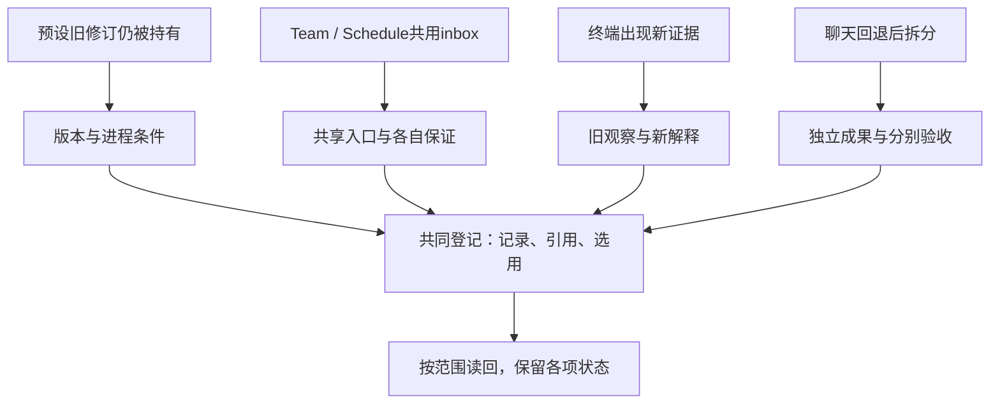
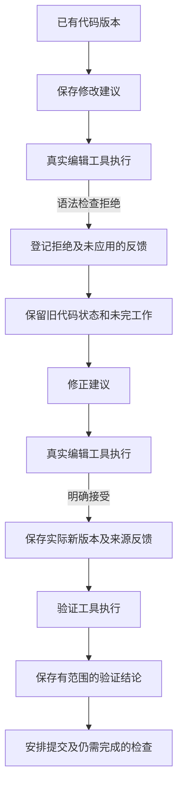

# DSH 真实过程的元操作组合与语义检查

2026-10-23：[工作操作分轮收敛](work-operation-rounds-v0.1.md)已交付身份与生命周期对照；[明细](work-operation-rounds-v0.1-evidence.md)保存强替代及候选全量去向。

2026-10-22：新的工作操作候选已完成[16 段四份对照](work-operation-coverage-v0.1.md)，与下文记录层语义走查分开。本页保留前轮依据。

本页完成了 2026-10-21 逐过程语义走查：Loader 详细推演、全部 16 段的 80 项人工读回、14 个有限删减反例和接口合并复核。结论与边界见[候选 v0.3](primitive-candidates-v0.3.md)，下文保留依据，历史检查折叠在末尾。

## 2026-10-21：从 Loader 局部撤回推演记录规则

本轮承接用户批准的五步计划：完整推演 Loader，跨过程检验，覆盖全部 16 段，删除和合并规则，形成候选 v0.3。固定底稿与第一轮比较保留。本页维护推演和核查明细，人类概览见[工程全景](dsh-work-history.md)。

### 先看 Loader 撤回中发生了什么

撤回涉及三组不同对象：事务回滚保证、独立有效的修补，以及必须适配的消费者。原始撤回提交还明确称自身为机械中间结果，检查发现了消费者和打包不兼容；消费者适配在随后提交完成。记录如果只把整个 Loader 从“事务”改成“非事务”，就会丢掉中间失败、保留范围及后续责任。

| 资料可见时点 | 当时可以记录什么 | 仍不能回答什么 |
|---|---|---|
| 8 月 2 日提交 | L01：加入事务式重载的实现报告 | 后来的撤回、撤回理由和精确保留范围尚未进入材料 |
| 9 月 9 日撤回提交 | L02：逆序撤回五提交并保留独立后续行为；L03：机械中间态检查暴露不兼容 | 此时不能记录消费者已经适配或撤回后可用 |
| 同日消费者适配提交 | L04：检查激活、等待子树与清理结果；L05：作者报告验证范围及完整运行仍有失败 | 不能把局部检查或多数通过写成全部验收 |
| 9 月 11 日后续提交 | L06：存在保留启动失败政策的修补 | 标题不足以支持全部失败路径已验收 |
| 10 月 15 日固定笔记快照 | L07：回顾的维护成本理由；L08：两项独立修补及无关成果保留；L09：当前非事务保证及消费者责任；L10：旧代际保证的历史解释 | 准确决定时间、完整决策主体与独立复验仍未知 |

上述日期是本轮固定来源的可见边界。笔记可能更早包含这些内容，本轮没有查定其首次出现；因此只在固定快照处读入。L01 和 L10 拆开保存，避免用早期提交时间提前暴露后来的回顾解释。T01.04 也拆成不同提交的观察。

### 用同一事实构造三种表示

三种表示共用 L01 至 L10，每条保存范围、报告类别、原事实编号、来源版本、资料可见时间、事件时间和署名。研究整理者和未知的工程决策者分别记录。

| 更新 | 普通工作文档 | derive / relate / select | prepare / record | 调用者判断与程序检查 |
|---|---|---|---|---|
| 加入旧实现 | 新增 L01 实现条目及链接 | derive 保存 L01；来源精确引用内嵌 | record 登记同一内容；prepare 只构造 | 程序核对来源；调用者区分提交标题与完整保证 |
| 撤回并保留部分 | 新增 L02、L03；当前说明写明机械中间态 | derive 保存报告；relate 引用撤回范围与保留范围 | 同一 delta 保存报告和有范围关系 | 取用边界由来源和调用者提供；程序不从五次 revert 推导整项工作失败 |
| 适配消费者 | 追加 L04、L05，连接 L03 暴露的问题；维护当前兼容状态说明 | derive 保存实施及验证报告；relate 连接后续适配；select 更新对应的解释入口 | 构造报告、关系和选择事件后 record；版本前提针对解释入口 | 程序区分报告和选择；调用者解释哪些检查支持哪些消费者 |
| 后续失败政策修补 | 新增 L06，保留原验证范围 | 新增实施记录，更新失败政策的解释入口 | 增补同一范围的报告与解释选择 | 不自动扩大为整个 Loader 验收 |
| 回顾理由与保留范围出现 | 追加 L07 至 L10；分别维护当前保证、独立修补和消费者义务 | derive 固定解释，relate 精确连接支持对象；select 采用有来源的当前解释 | 同样的声明、引用与解释选择装入 delta | 选择者是研究整理者；选择当前解释不冒充当年工程决策 |

完整三份逐条表示保存在新批次的 loader 文件。为保证文档基线不被刻意削弱，它保留相同精确字段和链接；机器可读块供静态读取，表格和叙述供人理解。该形式尚未测量日常维护便利性。

### 读回 Loader：结论、证据与成本

| 读回问题 | 表示内可以恢复的答案 | 支持记录 | 评定 |
|---|---|---|---|
| 撤回了什么 | 事务式重载及其回滚保证；较大合并中的无关能力不在撤回范围 | L02、L07、L09、L10 | 完整输入后准确恢复；早期前缀缺少回顾理由 |
| 保留了什么 | 独立后续行为；固定快照进一步明确 Include 初始化与重读、Schemastery 导出，以及无关仓库插件能力 | L02、L08 | 恢复到公开记录明确的范围；源码级成果边界仍需精确锚点 |
| 撤回后是否立即可用 | 中间检查发现不兼容，随后有消费者适配与范围有限的作者验证 | L03、L04、L05 | 准确恢复；不能推出独立验收成功 |
| 谁继续承担责任 | 消费者检查实际激活、等待所需子树与清理；后续启动失败政策仍有修补 | L04、L06、L09 | 可恢复责任；不能把长期保证写成尚未执行的待办 |
| 为什么撤回、谁决定 | 固定笔记说明上游偏离维护成本；完整决定者未知 | L07 | 原因可查，主体缺口保留未知 |

三种表示在本次同作者读回中均能表达这些答案，程序只检查载荷、前缀及引用一致性。本轮定向补读 1 个已有正文 blob 与 4 个 commit 对象；所有表示平等获得这五份证据。对话内读回没有独立查证次数或人工耗时测量，不填写为零。

### 第一阶段形成的规则

1. 以精确记录为引用目标，局部成果用明确选择范围定位。工作身份负责持续跟踪，不能用它替代所有成果引用。
2. 报告的类别、适用范围和来源保留；选择事件修改当前安排或解释入口，历史实施与测量继续存在。
3. 责任要区分持续保证与未完成清单。消费者必须检查激活是一项长期责任，有后续修补也不表示每个消费者仍未适配。
4. 原子登记只保证记录接纳的一致性。撤回工具、编译和测试处于外部执行层，可能存在中间失败。

以下将这些规则用于预设、Team/Schedule、终端归因和聊天返工，再回到全部 16 段过程。修订均关联具体困难。

## 跨过程检验：相同操作需要保住哪些差别

Loader 给出了局部修改的起点。下列过程继续使用“保存记录、精确关联、更新当前解释或安排”，检查同一套规则能否成立。表中的身份和范围由本研究声明，不能冒称作者原有数据模型。

| 过程与关键变化 | 操作怎样组合 | 可以恢复什么 | 澄清的规则 |
|---|---|---|---|
| T02：会话预设 → 声明式定义 → 旧修订被持有 → 重启重新解析 | 保存各阶段报告；关联定义、运行修订及使用者条件；按进程内/重启分范围 | 旧版退役且仍被持有，与新定义被选用并存 | 全局 current 不能替换所有使用者版本；运行绑定事实不由 select 撤销 |
| T04：outbox → inbox；T06：会话日志 → Host 存储 → 有限历史 | 分别保存交付保证、成员任务、存储和接纳报告；关联共享入口；分别维护解释 | Team 退出重试，Schedule 保留冷恢复；二者接纳均不等于完成 | 共享不继承业务保证；登记事务不保证外部两个存储原子提交 |
| T13：晚到解释 → 宽限失败 → 尾部格式证据 → 更换宿主 | 保存观察及对象条件；新解释连接新证据；更新本例归因 | 旧测量可查，新解释只覆盖本次故障及宿主 | 判断修订不改写观察；本例结论不扩大为所有延迟问题 |
| T12：整批合入 → 性能回退 → 拆分独立成果 → 基础落地、产品未验收 | 保存回退与拆分报告；声明定位符或工作身份；按子范围跟踪 | 独立成果保留，基础 implemented 不覆盖 GUI 和性能未完成 | 独立身份按管理需要声明；普通清单项可先用精确定位符 |

这些区别没有要求新增“退役”“共享”“证伪”或“返工”登记函数。它们要求范围、阶段和关系意义真正保存在记录中。只有函数名而缺少这些内容，仍会读错。

### 全部 16 段的覆盖检查

每段检查当前与未完、阶段与证据、保留与替代、影响与连接、依据主体与缺口。下方展开 80 项回答及依据。答案由同一研究者归纳；静态程序只核对载荷、引用和时间，不能将它当作 80 次独立语义测试。

本轮三种表示保留了各项回答所需的原记录，尚未发现必须新增专用登记操作的实例。三类边界继续存在：公开资料未给出的主体、原因和验证；尚未全部绑定源码区间的局部成果；由调用者声明的工作身份与范围。后两项是机制仍需承担的额外约定，不能记作程序已解决。

| 过程 | 新困难与处置 | 五项读回 |
|---|---|---|
| [T01 Loader](dsh-process-truth-v1.md#t01) | 撤回范围不同于工作身份；持续责任不同于未完成事项 | 五项已走查，缺口见下方回答 |
| [T02 预设](dsh-process-truth-v1.md#t02) | 当前定义和被持有修订可同时存在；作用域包含使用者与进程寿命 | 五项已走查，缺口见下方回答 |
| [T03 迁移与重建](dsh-process-truth-v1.md#t03) | 计划阶段不必都建独立工作对象，但必须能精确定位；时间相邻不能补因果 | 五项已走查，缺口见下方回答 |
| [T04 Team](dsh-process-truth-v1.md#t04) | 共享入口与保证是两种内容；取消恢复能力不抹去历史展示 | 五项已走查，缺口见下方回答 |
| [T05 Creator](dsh-process-truth-v1.md#t05) | 产品修改入口与底层服务可以独立变化；权限是有范围的条件 | 五项已走查，缺口见下方回答 |
| [T06 Schedule](dsh-process-truth-v1.md#t06) | 同一事实有持久/发现/执行三个不同承诺；外部一致性不能由登记原子性代替 | 五项已走查，缺口见下方回答 |
| [T07 E2B 与 SSH](dsh-process-truth-v1.md#t07) | 成果复用要限定部分和条件；整合依赖识别仍由调用者负责 | 五项已走查，缺口见下方回答 |
| [T08 子代理](dsh-process-truth-v1.md#t08) | 同一管理入口不统一能力；执行结果与清理结果要独立定位 | 五项已走查，缺口见下方回答 |
| [T09 侧栏](dsh-process-truth-v1.md#t09) | 同一组件的多个责任可分别修订，无需强制建立全部子工作身份 | 五项已走查，缺口见下方回答 |
| [T10 Goal](dsh-process-truth-v1.md#t10) | 同一对象有多个独立状态轴；当前选择和现实授权必须区分 | 五项已走查，缺口见下方回答 |
| [T11 Shell](dsh-process-truth-v1.md#t11) | 条件分支要保存反例条件；可选组件不能成为隐含全局前提 | 五项已走查，缺口见下方回答 |
| [T12 聊天返工](dsh-process-truth-v1.md#t12) | 清单项可先用稳定定位符；独立推进或验收时再声明子工作身份 | 五项已走查，缺口见下方回答 |
| [T13 Windows 终端](dsh-process-truth-v1.md#t13) | 修订解释不能改写旧观察；影响范围限于证据覆盖的故障与宿主 | 五项已走查，缺口见下方回答 |
| [T14 反馈 UI 适配](dsh-process-truth-v1.md#t14) | 依赖变化产生复核需要，不能自动推出被依赖对象无效或全部重做 | 五项已走查，缺口见下方回答 |
| [T15 Office 与交付](dsh-process-truth-v1.md#t15) | 多消费者和组件责任范围显式保存；资源观察不冒充整个系统保证 | 五项已走查，缺口见下方回答 |
| [T16 消息协议](dsh-process-truth-v1.md#t16) | 身份保留与内容变换分开；共享迁移协议不自动代表全部迁移已完成 | 五项已走查，缺口见下方回答 |

展开 80 项同作者读回、依据与缺口

### T01 · Loader

1. **当前与未完：**采用非事务加载，消费者需审查激活；后续启动失败政策有修补，整体独立验收未知。依据：T01.04、T01.05。
2. **阶段与证据：**撤回决定、撤回提交、消费者适配与验证报告分开；机械中间态不兼容由本轮原始提交补读确认。依据：T01.02、T01.04。
3. **保留与替代：**Include 初始化、模块导出和无关仓库插件能力保留，不撤回整个较大合并。依据：T01.03。
4. **影响与连接：**消费者承担实际激活检查，影响预设和启动；不能由此推导每个消费者仍未适配。依据：T01.05。
5. **依据主体与缺口：**理由是 vendored 偏离上游的维护成本；完整决定者未知，commit 署名另存。依据：T01.02、T01.GAP。

### T02 · 预设

1. **当前与未完：**声明式配置生效；旧运行修订在进程内供已有使用者持有，重启另按当前定义解析。依据：T02.03、T02.04、T02.05。
2. **阶段与证据：**配置保存与激活分开；主线提交与设计记录报告区别保存。依据：T02.03、T02.04。
3. **保留与替代：**旧修订退役后仍可被使用，最后引用释放时清理；不承诺跨进程恢复旧执行树。依据：T02.04、T02.05。
4. **影响与连接：**会话内服务变更影响 Host 读者、写回、持久身份和释放时机。依据：T02.02。
5. **依据主体与缺口：**局部修补主线日期未知；缺失定义会恢复失败，工程决策者未由源码署名推定。依据：T02.GAP、T02.05。

### T03 · 迁移与重建

1. **当前与未完：**后来的流式迁移有合入；LogicalSession 阶段 1/2 草稿完成，3 有实现和 CI 仍草稿，4/5 未完。依据：T03.03、T03.06。
2. **阶段与证据：**合入、撤回、草稿、作者性能报告分别保存，不能从阶段 3 CI 推出计划完成。依据：T03.01、T03.02、T03.04、T03.06。
3. **保留与替代：**源代际保留，只发布最终当前代际；两次流式方案的复用范围未知。依据：T03.03、T03.05。
4. **影响与连接：**会话格式迁移承接消息表示；LogicalSession 计划应有阶段定位，不能被格式状态覆盖。依据：T03.05、T03.06、T16.02。
5. **依据主体与缺口：**首次撤回原因未知；116 MB/16 GB 为作者报告，不能用来补作首次撤回原因。依据：T03.02、T03.04。

### T04 · Team

1. **当前与未完：**直接投递目标 inbox，独立 outbox 退出；名单任务保留，旧待发不再投递。依据：T04.04、T04.05。
2. **阶段与证据：**发送成功证明接纳，不证明模型完成；主线合入时间和笔记名日期不同。依据：T04.03、T04.04。
3. **保留与替代：**名单、任务和旧消息展示保留，旧重启重试与显式重发去重退出。依据：T04.01、T04.04、T04.05。
4. **影响与连接：**与 Schedule 共享 inbox 入口，不继承其 Host 任务存储或冷恢复保证。依据：T04.04、T06.02、T06.06。
5. **依据主体与缺口：**降低保证有实验功能稳定性约定；实际用户待发损失未知。依据：T04.06、T04.GAP。

### T05 · Creator

1. **当前与未完：**模型通过文件和普通插件管理器安装持久成果，已安装包替换当时仍需重启。依据：T05.03、T05.05。
2. **阶段与证据：**配置保存、授权和能力激活分别报告；有文件不等于已获运行批准。依据：T05.05。
3. **保留与替代：**模型旧修改入口退出，已有运行时/Client 消费者与历史卡片仍保留。依据：T05.04。
4. **影响与连接：**共享插件管理；profile 级配置影响多会话，不能按单个会话范围更新。依据：T05.03、T05.05、T01.05。
5. **依据主体与缺口：**旧临时成果重启不恢复，需另实现普通插件；没有自动转正证据。依据：T05.01、T05.02。

### T06 · Schedule

1. **当前与未完：**Host 保存任务，到期恢复冷会话；历史按时间和数量保留，旧提醒需显式重建。依据：T06.02、T06.03、T06.04。
2. **阶段与证据：**回执说明消息持久进入 inbox，任务完成未知；跨存储崩溃可重复投递。依据：T06.06。
3. **保留与替代：**旧事件仍可读、不自动迁移；删除任务不删除已经进入会话的消息。依据：T06.03、T06.05。
4. **影响与连接：**与 Team 共享接纳入口；任务库和会话库分别提交，库内登记不能承诺外部恰好一次。依据：T06.06、T04.04。
5. **依据主体与缺口：**增长问题针对全量 JSON 历史；裁剪和旧历史不可用分别标记，完整任务执行未知。依据：T06.04、T06.05、T06.GAP。

### T07 · E2B 与 SSH

1. **当前与未完：**退出 E2B 提供者；SSH 远端 helper 执行，本地保留 Harness 状态与凭据。依据：T07.03、T07.05。
2. **阶段与证据：**概念验证合入、移除实现和后来公开约定分别保存；准确 SSH 落地先后未知。依据：T07.01、T07.03、T07.GAP。
3. **保留与替代：**文件、进程、终端接口及异步约定保留；固定 SDK 集成退出不否定远程执行需求。依据：T07.02、T07.04。
4. **影响与连接：**SSH 使用共同接口；修改性操作断连后不自动重放，接口复用不继承全部后端保证。依据：T07.04、T07.05。
5. **依据主体与缺口：**成本解释针对当时固定 SDK 的控制通道与输出保留；接口源码级取用范围未在本轮展开。依据：T07.02、T07.GAP。

### T08 · 子代理

1. **当前与未完：**Session 与 Activation 分开，统一执行入口；外部后端仍为单次执行。依据：T08.02、T08.03、T08.05。
2. **阶段与证据：**执行完成与清理结果分开，清理失败仍保留执行结果。依据：T08.05。
3. **保留与替代：**外部后端不伪造本地 Session 或多轮能力；历史单次描述仍可读。依据：T08.05、T08.06。
4. **影响与连接：**工作流等待和模型后台委派共享 activation，但通知规则有不同路径。依据：T08.04。
5. **依据主体与缺口：**重复完成通知是记录接受的代价；主张来自作者记录，独立运行未验。依据：T08.06、T08.GAP。

### T09 · 侧栏

1. **当前与未完：**自建侧栏保留；keepMounted 内容按声明保活，其他内容按可见性挂载。依据：T09.03、T09.04。
2. **阶段与证据：**原型通过浏览器检查为作者记录，不能推广为后续所有生命周期验收。依据：T09.02、T09.04。
3. **保留与替代：**内容保活修订保留布局引擎，布局状态、实例寿命和数据读取分开。依据：T09.05。
4. **影响与连接：**Office 预览等通过工作台查看成果，远程文件问题来自 Host 链接无法供浏览器直接读取。依据：T09.01、T15.01。
5. **依据主体与缺口：**完整原型与评审记录未知；保活不等于所有页面永久常驻。依据：T09.GAP。

### T10 · Goal

1. **当前与未完：**目标事件独立保存；持久 paused 由人恢复；active 但 disarmed 与 armed 分开。依据：T10.01、T10.02、T10.05。
2. **阶段与证据：**首次暂停修复之后仍发现稍后人类轮次可被模型用来恢复 paused，是不同阶段的结果。依据：T10.03、T10.04。
3. **保留与替代：**暂停保留输入队列；恢复/分叉保留 active 目标但默认不授权运行。依据：T10.02、T10.03。
4. **影响与连接：**目标修改不依赖消息接纳；后续修补作用于同一暂停权限范围，而非新增并列政策。依据：T10.01、T10.05。
5. **依据主体与缺口：**用户和模型的恢复权限不同；故障原始日志和精确合入时间未知。依据：T10.05、T10.GAP。

### T11 · Shell

1. **当前与未完：**开始即登记 job，前台限时等待；无 registry 等情况仍期限终止，前台分组后续。依据：T11.04、T11.05。
2. **阶段与证据：**先前 promotion offer 已交付，评审后被修改；后来的决定不抹去原实现存在。依据：T11.02、T11.03。
3. **保留与替代：**限时等待结束不必杀进程；可从开始查看停止，jobs 仍可选。依据：T11.04、T11.05。
4. **影响与连接：**新方案替代登记时机和交接责任；执行器与消费者职责重新划分。依据：T11.03、T11.04。
5. **依据主体与缺口：**无需 registry 时的兜底仍存在；后续分组不能因执行机制落地而标完成。依据：T11.05、T11.GAP。

### T12 · 聊天返工

1. **当前与未完：**独立功能留 channel，未完部分留 worktree；分组基础有 implemented 记录，产品行为仍未完成。依据：T12.03、T12.04、T12.05。
2. **阶段与证据：**构建 lint 覆盖为作者报告；GUI 演示和性能待完成；整批回退不代表所有部分失败。依据：T12.02、T12.06。
3. **保留与替代：**已提交独立视觉、摘要和过滤功能保留，原 PR 作为参考。依据：T12.03、T12.04。
4. **影响与连接：**整批方案拆成独立成果和分组基础；子项验收不提升为整个产品验收。依据：T12.01、T12.05。
5. **依据主体与缺口：**原六项基准未覆盖新热路径；未暂存草稿、GUI 和性能待验收。依据：T12.02、T12.GAP。

### T13 · Windows 终端

1. **当前与未完：**自托管故障采用随包 OpenConsole；早期晚到解释被本次尾部畸变证据修正。依据：T13.01、T13.03、T13.04。
2. **阶段与证据：**前后 20.8 秒说明宽限未解决本例；七个提示符正常为作者报告。依据：T13.02、T13.04。
3. **保留与替代：**旧测量和宽限实现的历史保留；不能从本例否定所有提示符延迟问题。依据：T13.01、T13.02、T13.03。
4. **影响与连接：**分配终端依赖桌面保留随包二进制；不同宿主和 POSIX 范围分别保存。依据：T13.05。
5. **依据主体与缺口：**新的解释由新观察支持，署名不等于最终决策者；独立复验尚无。依据：T13.03、T13.GAP。

### T14 · 反馈 UI 适配

1. **当前与未完：**以已落地逐项版本后端重写 UI，旧全栈分支关闭为 superseded。依据：T14.02、T14.03、T14.04。
2. **阶段与证据：**后端先落地时用户入口未完；后来持久恢复 E2E 为作者报告。依据：T14.01、T14.04。
3. **保留与替代：**已落地后端继续使用，旧分支保留历史来源；实际代码复用范围未知。依据：T14.01、T14.03。
4. **影响与连接：**旧 UI 依赖的接口和目录已变；需要重新适配，不等于新后端失效。依据：T14.02、T14.03。
5. **依据主体与缺口：**关闭重写理由含不兼容和重复后端；不能自动从依赖变化传播为整项工作证伪。依据：T14.03、T14.GAP。

### T15 · Office 与交付

1. **当前与未完：**共享转换队列，读者独立取消；kit 独立发布，Harness 锁定版本，桌面绑定运行时。依据：T15.02、T15.03、T15.04。
2. **阶段与证据：**签名检查和运行检查分别保存；作者测试不能推出全部内存受限。依据：T15.05。
3. **保留与替代：**单读者退出不取消其他读者工作，最后读者退出才取消共享任务。依据：T15.02。
4. **影响与连接：**预览和显式检查共享成果；kit 与 Harness 责任分开并通过准确版本依赖连接。依据：T15.01、T15.03。
5. **依据主体与缺口：**内存限额不含引擎 RSS 和调用者持有输出；系统解释器选择由用户控制。依据：T15.04、T15.05。

### T16 · 消息协议

1. **当前与未完：**V4 原生 tool 消息，适配器负责 provider 投影；相邻迁移处理旧包装。依据：T16.02、T16.04。
2. **阶段与证据：**嵌套包装拒绝并保留源代际；转换与拒绝结果分别记录。依据：T16.02。
3. **保留与替代：**保留消息与工具调用身份和内容；扩展字段按原归属加前缀。依据：T16.03。
4. **影响与连接：**新角色需要持久事件和适配投影；复用会话相邻迁移规则。依据：T16.04、T03.05。
5. **依据主体与缺口：**原模型和会话表示分歧由来源解释，不能从当前格式推出所有消费者均已验收。依据：T16.01、T16.GAP。

### 哪些关系可以共用规则

旧比较的 16 条跨记录联系使用 12 种名称。本轮保留全部端点、原谓词和范围，尝试按维护方式分组。

| 维护分组 | 原关系 | 共用设施与仍需保留的差别 |
|---|---|---|
| 局部保留与复用 | retains、partially_retains | 共同引用来源与取用范围；接口、名单任务、布局的边界各自保留 |
| 解释条件 | limits | 给判断增加条件；重启、接纳阶段与后端能力不能相互替代 |
| 变化与复核 | replaces、revises_explanation、repairs_remaining_gap、interface_changed_context | 连接新旧目标；替代实现、修正归因、补缺口、条件变化的推导不同 |
| 结构归属 | subdeliverable_of | 定位子项与总体；子项完成不推出总体完成 |
| 共享与依赖 | shared_management_environment、shared_consumer、uses_protocol | 精确连接工作；共享不推出因果或保证继承 |
| 未知原因 | reason_unknown | 保存待解问题及对象；未知不是已成立因果 |

表中是维护分组，**没有把 12 个名称证明为六种语义原语。**若将原谓词移进自由文本再声称关系数量减少，只是转移了复杂性。关系可以共用版本与引用设施，但含义仍须保存。

### 工作身份、关系修订与选用怎样处理

| 问题 | 本轮处置 | 依据与负担 |
|---|---|---|
| 何时拆工作身份 | 可独立安排、验收或取舍时由调用者声明；否则用修订内稳定定位符 | T12 独立功能与基础；T03 阶段。工作切分不是唯一现实真值 |
| 创建、修订、分叉 | 共用新增不可变内容的登记形态；保持/新建身份和父版本显式声明 | T02 多修订、T12 分离成果；资料不足以验证通用 fork 算法 |
| 整合 | 多父引用表达来源，调用者另提供取用边界、依赖与兼容判断 | T07 接口保留不继承整个 E2B；T15 共享成果有不同责任 |
| 关系修订 | 可内嵌为容器修订加关系定位符，需要独立取舍时升格为版本对象 | 新容器或关系修订留下旧引用；不强制所有关系独立建对象 |
| 局部选用 | 请求可局部表达；接纳沿用一份配置的串行版本检查，保存完整结果 | T10 两轮暂停政策不能并列；语义范围重叠由调用者声明 |
| 语义重叠未知 | 保留候选并提出协调事项，不能由不同字符串键推定独立 | 过时写入使用构造探针，不是 DSH 已观察并发轨迹 |
| 当前解释的选择者 | 本轮是研究整理者，引用作者报告 | 不能冒充原工程决定；选中报告不使其内容自动成为事实 |

## 删除与合并：机制留下了什么，代价在哪里

D 编号对应新批次中的有限表示反例。程序检查删除前后投影的差别，语义后果由研究者解释；这些是局部见证，不是任务收益实验。

| 检查 | 具体后果 | 处置与替代代价 |
|---|---|---|
| D01 只保留终端最终状态 | 旧解释及失败测量不在历史投影中 | 保留可定位历史；不可变事件可替代独立版本表 |
| D02 引用降为工作 ID | 预设旧修订与新定义不能直接区分 | 保留精确修订或增加等价定位与查证约定 |
| D03/D10 删除局部条件 | 进程内保证被扩大为跨重启；Loader 局部撤回变成整项撤回 | 保留范围与条件，不必每个范围都建立独立工作对象 |
| D04/D11 合并阶段与证据 | 基础 implemented 变成产品验收，接纳变成完成 | 保留阶段与证据归属 |
| D05 选用即授权 | Goal active 被推成允许继续运行 | 保留选择域、授权域与现实报告的区别 |
| D06 合并主体角色 | commit 作者被当成未知的决定者 | 保存角色和 unknown，授权另有依据 |
| D07 按最早来源登记复合事实 | 回顾性保证进入早期前缀 | 拆分断言；未拆时等待全部支持来源 |
| D08 删除版本前提 | 构造的旧暂停政策请求覆盖新政策 | 保留前提或等价串行检查；并发协议未实测 |
| D09/D12/D13 抹去关系含义 | 共享变继承、适配变后端失效、相邻事件变因果 | 保留谓词、范围及依据；粗分类不足以替代 |
| D14 合并执行与清理结果 | 清理失败抹去已有成果 | 分开结果维度 |
| 取消工作目录版本 | 原 99 条记录仍可投影工作成员 | 目录可作缓存，沿用第一轮已检查替代 |
| 取消独立来源关系 | 精确 source_ids 仍定位来源 | 引用内嵌，定位和修订约定保留 |
| derive/relate 合为 typed add | 新批次相同 99 记录、16 关系能读回 | 接口可合并，类型规则继续存在 |
| select 改为事件 | Loader 三次解释选择恢复两个当前入口 | 不必独立函数；选择范围与 expected 不能丢 |
| 不保存 prepare | 完整 delta 已保存时，record 可恢复同一批内容 | 构造和检查仍必需；候选缓存价值未测 |

工作目录、来源关系、选择函数的删减是第一轮已有结果，本轮在新载荷上核对相关替代，并保留 30 次报告解释选用，恢复 27 个范围入口。内嵌关系能够保留含义，不等于已经测得维护更方便。

## 结果如何改变设计

**保留可定位历史、有意义的精确引用、有范围且带前提的选用，允许它们共用登记底层。**暂停、部分撤回、复用、修正判断作为组合动作；边界识别、兼容性和关系解释由调用者提供并留下依据。

相对 v0.2，本轮不强制所有关系独立建对象，不强制清单项拥有工作身份；明确解释选用与现实报告的不同域；按支持内容处理复合事实可见时间；持续责任与未完成事项分开。修订均由上面的具体困难触发。

普通文档保留同样的字段和协议后，仍能支持本轮人工读回。候选价值在于可将引用、版本前提和更新约束变成程序检查，净收益尚待测量。关系语义和身份判断并没有因接口统一而消失。

定义与原型建议见[元操作候选 v0.3](primitive-candidates-v0.3.md)。建议原型仅做记录接纳、精确查找、范围选用与确定性投影；此处提出范围，不构成实施批准。

本轮产物、成本与验证口径

批次位于主仓库根目录相对路径 `artifacts/agent-task-state/maintenance/dsh-semantics-2026-10-21/v1/`。保留 99 条原记录、16 关系和 30 次报告解释选用；Loader 拆出 10 条断言、2 关联和 3 次研究解释选用。80 项人工答案与原记录分开，另保存各资料前缀支持门控、14 个删减反例、成本及验证结果。

Loader 定向读取 5 个已有 Git 对象。其他人工查证次数、维护时间、模型费用和独立准确率未测，不填写为零。三种方式均维护精确字段、来源和范围；普通文档配有叙述及可读条目，不通过削弱基线制造优势。

静态检查核对三种解码、引用存在、资料时间、Loader 选择链、Git 正文指纹、固定输入哈希和删减投影。它不能判断自然语言推理正确。局部成果尚未全部绑定源码区间；决定者、原因和独立验收缺口保留。关系分组、解释选用和并发探针属于研究者构造，不冒称原工程事实。

2026-10-20 及此前检查记录

## 2026-10-20 DSH 连续过程检查结果

已完成[16 过程的三种表示与删减检查](dsh-representation-comparison-v1.md)。共同信息可由普通文档和两种候选编码保留；删除工作目录版本、内嵌来源引用、将选择编译成事件均有可读回的替代。本轮建议继续共用登记基础，语义接口作为封装，优先复核子工作身份、关系修订和选择范围。协议尚未冻结，未实施数据库或验证长程任务效果。

## 在相同工作点尝试组合

下面用“版本生成、关系、选用”表达候选；登记指底层 record，不把它与工程工具的真实执行混为一谈。

| 工作点 | 候选如何记录和更新 | 读回时必须成立 | 检查发现 |
|---|---|---|---|
| Python 条件式接受 | 保存决定及阶段约束版本，关联主体和依据，更新当前计划选用 | 接受方向不自动获得默认/生产许可；未来阶段仍未发生 | 可表达；许可范围不能只藏在 accepted 标签里 |
| Kubernetes 合并与 follow-up | 保存审阅/hold/解除/合并观察，关联所针对内容，另存未完成义务，更新工作安排 | merged、许可和义务各自保留；更大重构仍未完成或未知 | 可表达，但需明确哪些是不可由选用撤回的历史事实 |
| curl 上游修复与下游处理 | 保存精确修复、发布及适用范围，关联公告和条件；本地部署另有安排 | 上游 fixed 不等于下游已部署，缓解不等于根因修复 | 单一工作状态不足，范围和主体不能省略 |
| GitLab 快照跨用途复用 | 原快照保持精确引用，新增恢复用途与结果关系，再安排改进 | 复用不要求复制快照；服务恢复、数据损失及义务并存 | 来源/用途关系可以表达；历史快照不能从“当前未选用”推成当时不存在 |
| Agent 被拒编辑 | 保存修改建议和拒绝观察，关联目标旧版本；不产生已经应用的代码版本 | 真实代码状态保持原样，建议及失败原因仍可查 | 不能把每次 derive 都解释为现实产物已改变 |
| Agent 接受编辑、单例检查、提交 | 接受观察关联实际新产物，测试关联该版本及输入，提交阶段另存，更新当前工作安排 | 单例通过、submitted、完整验收是不同判断 | 可表达，但必须有事件结果与产物版本之间的明确规则 |

这些都是材料能够支持的状态问题。没有证据的许可、测试、动机或后续完成继续未知，不能让操作自动补成成功。

## 一个实际工具过程怎样组合

建议和新内容可以由版本生成保存，反馈及各自目标通过关系定位，当前安排通过选用改变；所有库内更新经登记检查。图中编辑和测试仍是执行层工作。库中的原子登记不能保证真实工具无部分副作用。

## 删除或合并操作的检查

- 如果取消保留版本、只覆盖内容，拒绝建议与已应用修改、旧测试与新实现会难以准确区分；但使用不可变事件保存内容也能提供版本历史，所以这不证明必须有名为 derive 的独立接口。
- 如果取消独立 relate，把有类型的精确引用放入版本内容，也可能表达相同依据；代价是关系修订、查找与约束规则必须在该表示中明确。关系语义必要，不等于单独一个函数必要。
- 如果取消 select，用确定性投影及有权限的采用事件表达当前安排，也可能等价。必须保留“候选”和“当前采用”的区别，但它可以由登记协议提供。
- 如果把所有内容统一交给 record，接口数量最少，但仍要定义尝试、反馈、产物、判断、许可和义务之间哪些推导被允许。不能把这部分隐藏成本当作消失。

因此本轮尚不能在“三个语义接口”与“统一登记接口”间证明哪个更精简。两者都应按语义规则、额外约定及维护成本比较，不按函数名计数。

## 与近邻在同一问题上的重叠

2026-10-15 复核所读固定 v1 方法章节；三篇均为 2026 年论文，正式发表 venue 本轮未取得新增证据，继续沿用来源清单的待核实状态。

| 本轮问题 | ESAA | MAGE | StateMem |
|---|---|---|---|
| 保存尝试、拒绝与实际结果 | 意图、调度、effects、拒绝事件及投影是直接重叠；外部编辑是否应用仍须按事件类型核查 | action-observation 原始节点可保留反馈，摘要是否保留关键区别需检查 | 单元内容和来源可编码，执行回执协议不是所读方法重点 |
| 合并仍留义务、暂停不代表否定 | 任务/issue/hotfix 和 read-model 可表示后续工作，不能说只有 append | 当前路径与分支提示可保存，但非错误延期义务的持久规则需额外约定 | 多条 active 状态及来源可并存，不能说只能留一条状态 |
| 条件、范围和版本改变 | 可由事件与投影规则扩展，定制成本须明列 | Maintain/Revise 核查与改路径不能直接当条件依赖传播 | typed dependencies、supersession 与 needs_recheck 已原生处理相当部分问题 |
| 当前计划和历史事实分开 | 事件与投影已有直接借鉴 | 历史节点与 active path 有相关区别 | 保留 superseded 单元及 active rendering 有相关区别 |

来源：[ESAA §3](https://arxiv.org/html/2602.23193v1)、[MAGE §3.2 至 §3.3](https://arxiv.org/html/2606.06090v1)、[StateMem §5](https://arxiv.org/html/2608.19652v1)。表格是已读规则的对照，不是逐方法适配后的结果；“需约定”不代表理论上不能表达。当前没有证明我们的候选优于近邻。

## G4 判定：需要返工，尚不冻结核心

初检已经把候选用于六个真实材料工作点，并检查操作删减和近邻重叠。**当前不判定 G4 通过。**原因不是缺一个故事，而是下列规则尚未成为一套能一致使用的协议：

1. 明确实际发生的反馈怎样产生关于产物的记录；修改建议、拒绝、部分生效、成功和未知不能被同一种“新版本”含混处理。
2. 明确 select 改变的是工作采用与安排，哪些观察事实不受它控制；选用不能假造现实，未选用也不能抹去现实。
3. 明确许可、交付阶段、验证范围和未完义务怎样同时存在，以及修订后哪些许可/判断需要重新核对；不能统一塞入一个 done 状态。

下一次修订需要比较两种完整编码：以不可变事实登记为基础维护版本/关系/采用，或把反馈与判断明确建模为有类型版本，再用登记保存。先用本轮六个工作点检查相同读回结果、未应用/部分应用反例和操作顺序，再决定是否保留现有接口。这里列的是必须解决的语义，不预设要新增三种元操作。

保留材料只在规则冻结后开启。本轮仍未取得候选保留项目的可用过程，G5 不启动；原型与效果实验也没有准入。整体能力范围继续保留，不因这一处待修订界限收窄研究目标。

## 2026-10-16 机制续议：先比较共有规则

用户已明确实时记录为主要入口，历史重构为外围能力，实验锚定 SWE-Milestone。以下是待检验推导，不是新核心已冻结。

优先比较两类变化：增加可追溯记录，以及改变当前采用的解释或安排。关系本身若有稳定身份和版本，可以共用版本生成设施；独立 relate 是否必要，取决于它是否提供内嵌引用无法自然提供的更新和约束能力。记录保存成功只确认库内登记；外部动作是否生效必须有单独的观察依据。

比较的核心问题是：若全部统一为 record，类型约束、引用检查和配置更新规则是否仍清楚且可复用？若保留 derive/relate/select，各接口是否承担不可互换的责任，还是便利封装？读取和投影视图也需明确，但不因一个函数名就认定为独立元操作。

用同一组连续变化检查：保存有依据的判断；修订其解释但保留旧依据；并发提出不同修订；采用其中一个而保留其他候选；复用精确成果而不继承全部判断；新证据出现后重新安排工作。对每步列出前后状态、保证和调用者责任，允许删除或合并候选操作。边界不清时给反例，不继续增加功能专用字段掩盖问题。

当前尚未完成上述两种编码的逐步推演，G4 继续为返工状态。

