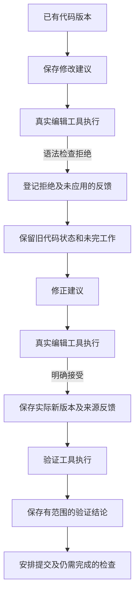

# 真实开发过程对元操作候选的首轮检查

**已有三个语义操作可以描述本轮大部分记录变化，但还不能据此冻结它们。**真实材料暴露了一处必须补清的界限：决定采用什么，与记录现实里已经发生什么，不是同一种状态变化。后者不能因为没有被 select 就消失，也不能因为被 select 就真的发生。

本轮输入为[活动地图](software-development-activity-map.md)、[记录与 Agent 映射](activity-record-agent-mapping.md)以及[候选 v0.2](primitive-candidates-v0.2.md)。这是逐过程的纸面语义检查，未实现或运行三套近邻。

## 2026-10-21：从 Loader 局部撤回推演记录规则

本轮承接用户批准的五步计划：完整推演 Loader，跨过程检验，覆盖全部 16 段，删除和合并规则，形成候选 v0.3。固定底稿与第一轮比较保留。本页维护推演和核查明细，人类概览见[工程全景](dsh-work-history.md)。

### 先看 Loader 撤回中发生了什么

撤回涉及三组不同对象：事务回滚保证、独立有效的修补，以及必须适配的消费者。原始撤回提交还明确称自身为机械中间结果，检查发现了消费者和打包不兼容；消费者适配在随后提交完成。记录如果只把整个 Loader 从“事务”改成“非事务”，就会丢掉中间失败、保留范围及后续责任。

| 资料可见时点 | 当时可以记录什么 | 仍不能回答什么 |
|---|---|---|
| 8 月 2 日提交 | L01：加入事务式重载的实现报告 | 后来的撤回、撤回理由和精确保留范围尚未进入材料 |
| 9 月 9 日撤回提交 | L02：逆序撤回五提交并保留独立后续行为；L03：机械中间态检查暴露不兼容 | 此时不能记录消费者已经适配或撤回后可用 |
| 同日消费者适配提交 | L04：检查激活、等待子树与清理结果；L05：作者报告验证范围及完整运行仍有失败 | 不能把局部检查或多数通过写成全部验收 |
| 9 月 11 日后续提交 | L06：存在保留启动失败政策的修补 | 标题不足以支持全部失败路径已验收 |
| 10 月 15 日固定笔记快照 | L07：回顾的维护成本理由；L08：两项独立修补及无关成果保留；L09：当前非事务保证及消费者责任；L10：旧代际保证的历史解释 | 准确决定时间、完整决策主体与独立复验仍未知 |

上述日期是本轮固定来源的可见边界。笔记可能更早包含这些内容，本轮没有查定其首次出现；因此只在固定快照处读入。L01 和 L10 拆开保存，避免用早期提交时间提前暴露后来的回顾解释。T01.04 也拆成不同提交的观察。

### 用同一事实构造三种表示

三种表示共用 L01 至 L10，每条保存范围、报告类别、原事实编号、来源版本、资料可见时间、事件时间和署名。研究整理者和未知的工程决策者分别记录。

| 更新 | 普通工作文档 | derive / relate / select | prepare / record | 调用者判断与程序检查 |
|---|---|---|---|---|
| 加入旧实现 | 新增 L01 实现条目及链接 | derive 保存 L01；来源精确引用内嵌 | record 登记同一内容；prepare 只构造 | 程序核对来源；调用者区分提交标题与完整保证 |
| 撤回并保留部分 | 新增 L02、L03；当前说明写明机械中间态 | derive 保存报告；relate 引用撤回范围与保留范围 | 同一 delta 保存报告和有范围关系 | 取用边界由来源和调用者提供；程序不从五次 revert 推导整项工作失败 |
| 适配消费者 | 追加 L04、L05，连接 L03 暴露的问题；维护当前兼容状态说明 | derive 保存实施及验证报告；relate 连接后续适配；select 更新对应的解释入口 | 构造报告、关系和选择事件后 record；版本前提针对解释入口 | 程序区分报告和选择；调用者解释哪些检查支持哪些消费者 |
| 后续失败政策修补 | 新增 L06，保留原验证范围 | 新增实施记录，更新失败政策的解释入口 | 增补同一范围的报告与解释选择 | 不自动扩大为整个 Loader 验收 |
| 回顾理由与保留范围出现 | 追加 L07 至 L10；分别维护当前保证、独立修补和消费者义务 | derive 固定解释，relate 精确连接支持对象；select 采用有来源的当前解释 | 同样的声明、引用与解释选择装入 delta | 选择者是研究整理者；选择当前解释不冒充当年工程决策 |

完整三份逐条表示保存在新批次的 loader 文件。为保证文档基线不被刻意削弱，它保留相同精确字段和链接；机器可读块供静态读取，表格和叙述供人理解。该形式尚未测量日常维护便利性。

### 读回 Loader：结论、证据与成本

| 读回问题 | 表示内可以恢复的答案 | 支持记录 | 评定 |
|---|---|---|---|
| 撤回了什么 | 事务式重载及其回滚保证；较大合并中的无关能力不在撤回范围 | L02、L07、L09、L10 | 完整输入后准确恢复；早期前缀缺少回顾理由 |
| 保留了什么 | 独立后续行为；固定快照进一步明确 Include 初始化与重读、Schemastery 导出，以及无关仓库插件能力 | L02、L08 | 恢复到公开记录明确的范围；源码级成果边界仍需精确锚点 |
| 撤回后是否立即可用 | 中间检查发现不兼容，随后有消费者适配与范围有限的作者验证 | L03、L04、L05 | 准确恢复；不能推出独立验收成功 |
| 谁继续承担责任 | 消费者检查实际激活、等待所需子树与清理；后续启动失败政策仍有修补 | L04、L06、L09 | 可恢复责任；不能把长期保证写成尚未执行的待办 |
| 为什么撤回、谁决定 | 固定笔记说明上游偏离维护成本；完整决定者未知 | L07 | 原因可查，主体缺口保留未知 |

三种表示在本次同作者读回中均能表达这些答案，程序只检查载荷、前缀及引用一致性。本轮定向补读 1 个已有正文 blob 与 4 个 commit 对象；所有表示平等获得这五份证据。对话内读回没有独立查证次数或人工耗时测量，不填写为零。

### 第一阶段形成的规则

1. 以精确记录为引用目标，局部成果用明确选择范围定位。工作身份负责持续跟踪，不能用它替代所有成果引用。
2. 报告的类别、适用范围和来源保留；选择事件修改当前安排或解释入口，历史实施与测量继续存在。
3. 责任要区分持续保证与未完成清单。消费者必须检查激活是一项长期责任，有后续修补也不表示每个消费者仍未适配。
4. 原子登记只保证记录接纳的一致性。撤回工具、编译和测试处于外部执行层，可能存在中间失败。

下一步将这些规则用于预设、Team/Schedule、终端归因和聊天返工，随后检查全部 16 段过程。只有发现明确表达困难时再补规则。

2026-10-20 及此前检查记录

## 2026-10-20 DSH 连续过程检查结果

已完成[16 过程的三种表示与删减检查](dsh-representation-comparison-v1.md)。共同信息可由普通文档和两种候选编码保留；删除工作目录版本、内嵌来源引用、将选择编译成事件均有可读回的替代。本轮建议继续共用登记基础，语义接口作为封装，优先复核子工作身份、关系修订和选择范围。协议尚未冻结，未实施数据库或验证长程任务效果。

## 在相同工作点尝试组合

下面用“版本生成、关系、选用”表达候选；登记指底层 record，不把它与工程工具的真实执行混为一谈。

| 工作点 | 候选如何记录和更新 | 读回时必须成立 | 检查发现 |
|---|---|---|---|
| Python 条件式接受 | 保存决定及阶段约束版本，关联主体和依据，更新当前计划选用 | 接受方向不自动获得默认/生产许可；未来阶段仍未发生 | 可表达；许可范围不能只藏在 accepted 标签里 |
| Kubernetes 合并与 follow-up | 保存审阅/hold/解除/合并观察，关联所针对内容，另存未完成义务，更新工作安排 | merged、许可和义务各自保留；更大重构仍未完成或未知 | 可表达，但需明确哪些是不可由选用撤回的历史事实 |
| curl 上游修复与下游处理 | 保存精确修复、发布及适用范围，关联公告和条件；本地部署另有安排 | 上游 fixed 不等于下游已部署，缓解不等于根因修复 | 单一工作状态不足，范围和主体不能省略 |
| GitLab 快照跨用途复用 | 原快照保持精确引用，新增恢复用途与结果关系，再安排改进 | 复用不要求复制快照；服务恢复、数据损失及义务并存 | 来源/用途关系可以表达；历史快照不能从“当前未选用”推成当时不存在 |
| Agent 被拒编辑 | 保存修改建议和拒绝观察，关联目标旧版本；不产生已经应用的代码版本 | 真实代码状态保持原样，建议及失败原因仍可查 | 不能把每次 derive 都解释为现实产物已改变 |
| Agent 接受编辑、单例检查、提交 | 接受观察关联实际新产物，测试关联该版本及输入，提交阶段另存，更新当前工作安排 | 单例通过、submitted、完整验收是不同判断 | 可表达，但必须有事件结果与产物版本之间的明确规则 |

这些都是材料能够支持的状态问题。没有证据的许可、测试、动机或后续完成继续未知，不能让操作自动补成成功。

## 一个实际工具过程怎样组合

建议和新内容可以由版本生成保存，反馈及各自目标通过关系定位，当前安排通过选用改变；所有库内更新经登记检查。图中编辑和测试仍是执行层工作。库中的原子登记不能保证真实工具无部分副作用。

## 删除或合并操作的检查

- 如果取消保留版本、只覆盖内容，拒绝建议与已应用修改、旧测试与新实现会难以准确区分；但使用不可变事件保存内容也能提供版本历史，所以这不证明必须有名为 derive 的独立接口。
- 如果取消独立 relate，把有类型的精确引用放入版本内容，也可能表达相同依据；代价是关系修订、查找与约束规则必须在该表示中明确。关系语义必要，不等于单独一个函数必要。
- 如果取消 select，用确定性投影及有权限的采用事件表达当前安排，也可能等价。必须保留“候选”和“当前采用”的区别，但它可以由登记协议提供。
- 如果把所有内容统一交给 record，接口数量最少，但仍要定义尝试、反馈、产物、判断、许可和义务之间哪些推导被允许。不能把这部分隐藏成本当作消失。

因此本轮尚不能在“三个语义接口”与“统一登记接口”间证明哪个更精简。两者都应按语义规则、额外约定及维护成本比较，不按函数名计数。

## 与近邻在同一问题上的重叠

2026-10-15 复核所读固定 v1 方法章节；三篇均为 2026 年论文，正式发表 venue 本轮未取得新增证据，继续沿用来源清单的待核实状态。

| 本轮问题 | ESAA | MAGE | StateMem |
|---|---|---|---|
| 保存尝试、拒绝与实际结果 | 意图、调度、effects、拒绝事件及投影是直接重叠；外部编辑是否应用仍须按事件类型核查 | action-observation 原始节点可保留反馈，摘要是否保留关键区别需检查 | 单元内容和来源可编码，执行回执协议不是所读方法重点 |
| 合并仍留义务、暂停不代表否定 | 任务/issue/hotfix 和 read-model 可表示后续工作，不能说只有 append | 当前路径与分支提示可保存，但非错误延期义务的持久规则需额外约定 | 多条 active 状态及来源可并存，不能说只能留一条状态 |
| 条件、范围和版本改变 | 可由事件与投影规则扩展，定制成本须明列 | Maintain/Revise 核查与改路径不能直接当条件依赖传播 | typed dependencies、supersession 与 needs_recheck 已原生处理相当部分问题 |
| 当前计划和历史事实分开 | 事件与投影已有直接借鉴 | 历史节点与 active path 有相关区别 | 保留 superseded 单元及 active rendering 有相关区别 |

来源：[ESAA §3](https://arxiv.org/html/2602.23193v1)、[MAGE §3.2 至 §3.3](https://arxiv.org/html/2606.06090v1)、[StateMem §5](https://arxiv.org/html/2608.19652v1)。表格是已读规则的对照，不是逐方法适配后的结果；“需约定”不代表理论上不能表达。当前没有证明我们的候选优于近邻。

## G4 判定：需要返工，尚不冻结核心

初检已经把候选用于六个真实材料工作点，并检查操作删减和近邻重叠。**当前不判定 G4 通过。**原因不是缺一个故事，而是下列规则尚未成为一套能一致使用的协议：

1. 明确实际发生的反馈怎样产生关于产物的记录；修改建议、拒绝、部分生效、成功和未知不能被同一种“新版本”含混处理。
2. 明确 select 改变的是工作采用与安排，哪些观察事实不受它控制；选用不能假造现实，未选用也不能抹去现实。
3. 明确许可、交付阶段、验证范围和未完义务怎样同时存在，以及修订后哪些许可/判断需要重新核对；不能统一塞入一个 done 状态。

下一次修订需要比较两种完整编码：以不可变事实登记为基础维护版本/关系/采用，或把反馈与判断明确建模为有类型版本，再用登记保存。先用本轮六个工作点检查相同读回结果、未应用/部分应用反例和操作顺序，再决定是否保留现有接口。这里列的是必须解决的语义，不预设要新增三种元操作。

保留材料只在规则冻结后开启。本轮仍未取得候选保留项目的可用过程，G5 不启动；原型与效果实验也没有准入。整体能力范围继续保留，不因这一处待修订界限收窄研究目标。

## 2026-10-16 机制续议：先比较共有规则

用户已明确实时记录为主要入口，历史重构为外围能力，实验锚定 SWE-Milestone。以下是待检验推导，不是新核心已冻结。

优先比较两类变化：增加可追溯记录，以及改变当前采用的解释或安排。关系本身若有稳定身份和版本，可以共用版本生成设施；独立 relate 是否必要，取决于它是否提供内嵌引用无法自然提供的更新和约束能力。记录保存成功只确认库内登记；外部动作是否生效必须有单独的观察依据。

比较的核心问题是：若全部统一为 record，类型约束、引用检查和配置更新规则是否仍清楚且可复用？若保留 derive/relate/select，各接口是否承担不可互换的责任，还是便利封装？读取和投影视图也需明确，但不因一个函数名就认定为独立元操作。

用同一组连续变化检查：保存有依据的判断；修订其解释但保留旧依据；并发提出不同修订；采用其中一个而保留其他候选；复用精确成果而不继承全部判断；新证据出现后重新安排工作。对每步列出前后状态、保证和调用者责任，允许删除或合并候选操作。边界不清时给反例，不继续增加功能专用字段掩盖问题。

当前尚未完成上述两种编码的逐步推演，G4 继续为返工状态。

