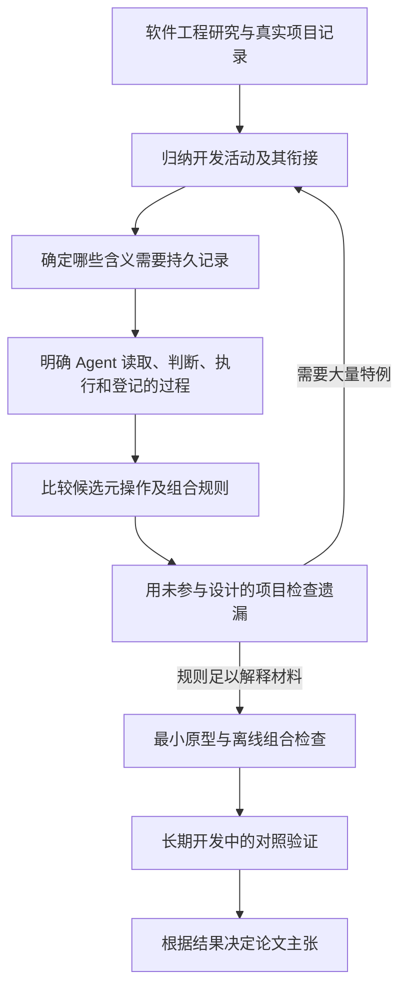

# 从真实开发活动寻找元操作：研究计划 v1.1

## 2026-10-16 用户决定：实验锚点与机制主线

当前实验 benchmark 锚定 SWE-Milestone；暂停其他 benchmark 的搜索、比较和选型，已有记录保留。固定数据、代码、测试与执行协议的具体版本在实验准备时核实，选定 benchmark 不等于已完成适配或批准付费运行。

研究主体继续是可组合的基本机制。工作发生时记录意图、判断、行动与反馈；历史重构和意图分析作为外围组件，通过相同核心操作补充记录。SWE-Milestone 用于实验，不决定工作库的对象数量、工作边界或依赖类型。元操作 v0.2 仍为候选。

下一项工作为 G4：比较版本生成、关系、选用与统一登记两种编码；明确对象与操作前后状态，检验同一套规则能否组合出修订、并发、暂停恢复、部分复用和理解纠正。沿连续过程逐步更新，记录每次新增的特殊规则；不以接口少或可存自由文本证明最小性。事实记录、解释是否采纳、当前工作安排须有可区分的含义。

**这一轮先弄清真实软件开发中，人和 Agent 反复在做哪些工作；再判断这些工作应该留下什么记录，最后检验能否由少量基本操作组合实现。**不再围绕 A/B/C 例子推演，也不拿已有三个接口作为资料分类框架。

v0.2 元操作候选继续保留，作为之后接受检验的假设。此计划替代 v1.0 的当前执行顺序；其来源核验、复杂任务、强对照、完整计费及独立验证要求继续适用。用户本轮要求整理资料并形成计划，不表示已经完成活动调研，也不自动启动原型或付费实验。

## 每一步交什么，怎样验收

执行从[接手入口](HANDOFF.md)开始；当前状态及下一项任务只在那里维护。下表把原来的五段研究路线拆成七个可交接检查点，详细检查和结果位置见[执行与验收说明](research-plan-v1.1-agent-notes.md#逐关交付与验收协议)。

| 检查点 | 预期成果 | 实际验收动作 | 不通过时 |
|---|---|---|---|
| G1：材料是否足够支持调查 | 来源清单、筛选理由、覆盖和缺口、探索与保留划分 | 把纳入材料打开核对；区分真实过程、规范和任务规格；检查核心缺口是否会使后续只能猜测 | 定向补搜或更换材料，不以凑满数量过关 |
| G2：活动分类是否有依据 | 活动地图、定义、边界及逐案例解释 | 从每类活动追到证据，再从每个探索过程反查遗漏；比较易混淆活动及反例 | 修订分类；只有规范支持的类别明确暂定 |
| G3：记录能否支持下一步工作 | 活动到记录及 Agent 工作的映射、普通文档对照 | 在真实过程的某个工作点，仅用拟保留记录及引用查找后续所需信息；再对照当时完整材料检查遗漏、误导和多余记录 | 调整记录与读取方式，不假装完成模型实验 |
| G4：组合是否成立 | 操作组合图、状态变化、保证边界及近邻比较 | 对同一过程逐步更新，再读回状态；检查不变量，删除或合并操作后重做相同检查 | 修订或替换候选，不能只补自由文本解释 |
| G5：能否用于新项目 | 冻结版本、保留材料结果、差异和维护成本 | 按预先记录的规则处理未参与设计的项目，逐项列出新增规则、歧义及遗漏 | 返回相应阶段；看过的材料不再算未见验证 |
| G6：机制是否可靠 | 经批准的最小原型及可重放测试记录 | 检查正常更新、并发、重复请求、中断恢复和证据定位，逐条对应规则 | 修复原型或规则；无批准先止于实施方案 |
| G7：是否帮助长程开发 | 冻结实验协议、原始运行及完整成本、结果解释 | 按统一条件比较实际成果、压缩后推进及维护代价；报告失败、缺失和不确定性 | 收缩结论或改进机制；不能按结果好坏补跑 |

**验收通过表示该阶段的工作和证据符合要求，不表示我们的方法获胜。**“普通文档已足够”“候选无法自然表达”都可以是合格研究结果。缺少关键证据、编造来源或违反材料隔离时不能通过；非关键限制可明确保留，后续不得越过它作更强结论。

每关结束由执行 Agent 完成可检查的证据核验，保存通过、返工或受阻及其理由，再更新接手入口。用户审阅研究方向和重大取舍，不替 Agent 检查普通链接、版本或分类遗漏。G6/G7 的具体实现和实验协议须在前序证据形成后冻结；本计划规定它们如何准入，不预先虚构模型、预算或样本量。

## 第一段：先认识开发活动，形成有出处的活动地图

调查同时使用三类证据：软件工程对实际开发活动的研究，公开项目中连续的工作记录，以及软件开发 Agent 的可核对执行轨迹。流程规范可以帮助发现漏项，但“应该这样做”不能替代“实际发生过”；基准中的任务说明也不能冒充开发过程。

先广搜，再按共同问题归组，挑选值得精读的来源。检索覆盖需求和设计、实现与重构、审阅和协作、测试与诊断、发布和迁移、维护与事故处理，以及跨任务中断与接续。这些只是防止遗漏的检索方向，最终分类允许合并、拆分或出现新的方向。论文的纳入理由须落到相近工作场景和可用证据，不靠标题关键词。

公开项目不只挑最终成功合并的 PR。需要找得到需求、讨论、修订和结果之间的联系，也保留撤回、部分完成、延期及后续修复。资料横跨不同项目类型与协作方式，避免只观察一个仓库或一种 Agent。私有聊天不作为研究样本。

我们观察的单位是**一段有目的、会改变后续工作的活动**。同样修改代码，可能是在实现需求、处理审阅、定位缺陷或偿还技术债；同一次需求调整，也可能跨越讨论、代码、测试和发布。文件、提交和工具调用用于定位活动，不能直接充当活动分类。

这一段交付一张开发活动地图：每类活动用普通话解释它解决什么、何时发生、改变什么、留下什么后果；典型连接附真实来源。标清哪些是直接观察，哪些是推断，哪些只能从规范中找到。暂不在这张图上标元操作。

**完成条件：**重要工作环节及跨环节变化都有材料或明确缺口；分类能区分相似活动，并说明区分的必要性。新增检索如果主要重复已有类别，可以暂停扩展；发现新类别就修订地图。“多个案例出现”不等于已经证明行业发生频率。

## 第二段：把活动转成可持续使用的工作记录

对每类活动追问：它结束以后，接下来的工作必须知道什么？原来的哪些内容仍然成立，哪些已被替代，哪些要保留为未决？已有 Issue、版本库、测试和文档是否已经保存了这些信息？

先复用已有记录及精确引用，避免重新抄一份源码或日志。只有影响接续、协作、取舍或验证的含义，才提出额外持久记录的理由。例如，工具已保存“测试失败”，工作记录仍可能需要解释它阻断哪项工作、是否已修复；是否需要保存这些解释，要由具体过程证明。

“投影到文档”不预设必须是一份 Markdown，也不预设必须是图数据库。首先表达共同含义，再决定它适合存在规格、决策记录、执行清单、状态摘要还是外部证据链接中。信息不够时明确未知，不为补齐结构编造动机。

这一段交付**活动到记录的映射**：读者能看到每类工作应留下什么，以及省略某项记录会在哪个后续环节造成困难。同时给出认真维护的普通工作文档表示，作为强对照。

**完成条件：**关键记录有实际用途和来源；已有工具记录与新增语义不重复维护；旧版本、未完成工作和不确定判断没有被整理成单一成功叙事。

## 第三段：明确 Agent 如何完成这些活动，再检验元操作

沿真实活动说明 Agent 何时需要读取材料、作出判断、调用工具、登记结果，以及何时必须查证或请相应主体决策。一次工具调用不等于一项完整活动，一次活动也不必强制变成一个 Change；粒度需要由后续使用和管理需求解释。

接着才打开现有元操作候选，把同一类活动分别用普通文档、候选操作和相关近邻的方法表达。比较的是完整过程：输入、更新、并发或中断、后续读取。不能只看最后能否写下一段话。

对每种表达记录三件事：已有规则能够直接支持什么，必须额外增加什么约定，还有什么无法自然表达。如果去掉某个原操作，其他组合是否还能同样清楚地完成工作？如果两个操作总是依赖同样规则，它们是否值得合并？如果某项语义只能反复塞进自由文本，是否缺了必要对象或规则？

这一段交付你希望看到的**组合图**：开发活动连接到持久记录及 Agent 工作过程，再连接到实际使用的基本操作。每条重要连接能够回到来源和一个具体更新过程；不会只用 A/B/C 说明所有能力。

**完成条件：**形成带正反例的语义模型，说明核心保证什么、调用者负责什么，以及哪些功能是高阶组合。此时只能声称在已检查材料上足够，不能宣称普遍最小或完备。

## 第四段：用未参与设计的材料检查能否推广

资料搜集阶段就将探索项目和保留项目分开。同一项目的关联 PR、后续修复和派生轨迹放在同一组，避免把设计时看过的工作换个断点当独立验证。

先冻结一版活动分类、语义定义和映射规则，再处理保留项目。统计遗漏活动、歧义、需要新增的概念与特殊规则，以及表示和更新的工作量。合理存在多种分类的地方记录分歧，不强行制造唯一答案。

若保留材料要求不断加特例，返回活动或语义层修订；已经看过的保留材料转为探索材料，之后另选新的保留材料。不能在原材料上修完就宣布泛化通过。

**完成条件：**跨项目适用范围和失败边界清楚，额外维护成本可以说明。普通文档足够时如实记录；是否据此调整论文方向，结合整个机制研究决定。

## 第五段：先检验机制，再检验长程任务收益

只有前面的映射和规则足够明确，才提出范围具体的最小原型。离线检查对应实际规则和反例：版本保留、关系修订、并发协调、重复请求、部分失败、历史恢复，以及视图能否定位证据。测试数量由规则决定，不预设写满多少条就合格。

随后再设计模型实验。先隔离“提取是否正确”“状态更新是否正确”“视图是否帮助行动”，再让 Agent 在真实开发任务中持续工作，经历多轮 Context 压缩及工作变化，检验最终成果和实际推进情况。压缩后仅能回答历史问题，不能证明能够继续开发。

对照包括认真维护的工作文档和清单、可公平适配的直接近邻，以及去掉某项机制的候选。对照拥有相同的可见历史、工具权限和资源边界；维护、读取、查证及失败重试都计入成本。测试与当前需求共同验证成果，避免由维护器自己评价自己。

任务选择由前四段的活动覆盖结果指导，不先让某个 benchmark 决定系统功能。真实历史用于观察实际活动；可恢复的开发环境用于测量继续执行，两种材料不能混为一谈。样本、模型、预算和评分在实际实验前另行冻结，本轮不安排付费调用。

## 如何控制范围与收敛

当前推荐先完成前两段，交付一份可读的活动地图和记录映射，再进入元操作组合。这是一个完整、有独立价值的研究单元，即使最终不用图数据库，也能成为设计依据。

最薄弱的前提是公开记录能提供足够的决策和中间过程。如果只能找到最终代码，能够分析产物变化，却不能推断为何切换路线、如何诊断或谁决定暂停。此时换有更完整记录的材料，并报告可观察范围；不拿编造过程填补缺口。受控构造只能作为明确标注的机制测试。

前期工作量采用分轮检查，数量不作为代表性证明：先广泛筛选来源和项目，再用少量连续过程形成分类；每轮加入不同性质的材料，检查是否出现新类别。关键环节没有证据时保持缺口，不为了准时结束宣布分类完整。具体执行和资料边界见[Agent 执行说明](research-plan-v1.1-agent-notes.md)。

## 资料与交付位置

[资料分类说明](../../reference/artifact-organization.md)记录本轮已完成的整理。原文、提取、快照和获取日志分开保存，分析结论写在项目文档中；没有实际产物时不预建空目录。人类入口只呈现结论、图和重要取舍，检索词、逐项证据、排除记录和校验结果留在 Agent 说明及资料清单。

下一份实质报告应回答：真实开发活动有哪些，如何衔接，需要留下什么，以及现有记录方式哪里足够、哪里有缺口。它不会再次以三个候选操作为目录来介绍材料。
