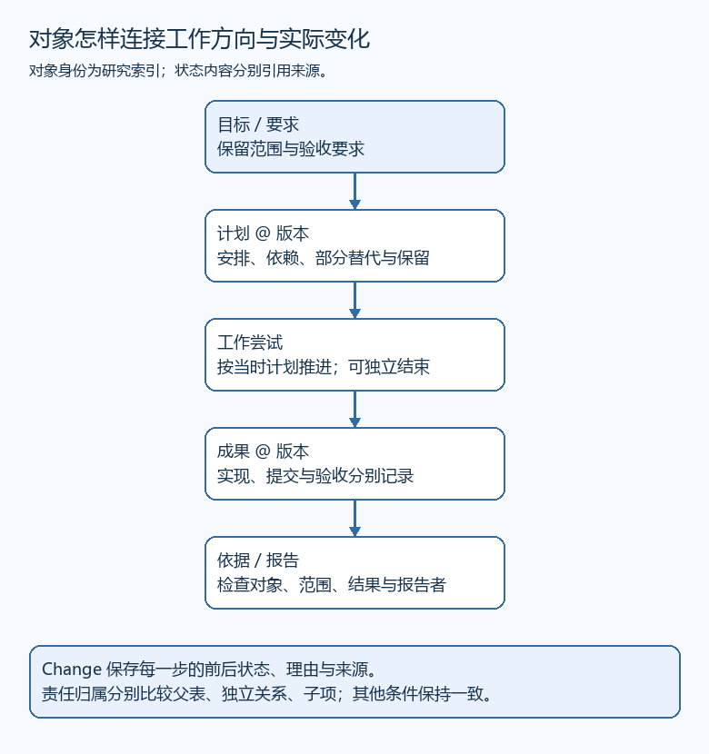

# T12 开发对象与连续变化比较

**本轮推荐五类逻辑角色：目标、计划、尝试、成果、依据；Change 记录一次变更的前后状态与出处。** 五类分别承担意图与验收、实施前或实施中的安排、一次有边界的推进、可继续更新的成果、带来源的判断，不把它们压成一个状态。这是当前实现选择，不声称五个顶层表最小或最优。比较真正支持的是：对象要有稳定引用，变化要能独立保存；顶层存放位置可以再选。

图中“调整安排”之后出现三路不同状态：已完成独立功能留在 presentation channel，未完成草稿留在 turnstep，分组基础已有实现而产品行为仍未完成。它们共享同一需求，却分别推进、分别验收。第二张图是关系示意：对象之间的语义联系，不限制只按线性过程工作。

## 四身份对照改变了什么

强内嵌方案修正后，Plan 不再只能复制：第二个尝试可以直接引用宿主 Attempt 历史中的精确旧版 section。Product 也不再必须换宿主：A2 可以继续推进 A 的原 slot，A 即使 ended 也不妨碍写入。Evidence 可以放在 Change 内，用稳定 statement locator 被引用；当前实现仍把依据建成可引用记录，Change 内定位是已比较的存放替代。合并 Goal 与 Attempt 的 Work 记录仍需 attempt key 与 status。此前“内嵌 B 不能复用”的结论撤销，因此它不能作为独立 Plan/Product 的必要性依据。

独立存放当前仍被推荐，理由更窄：减少宿主版本耦合，维护位置直接。内嵌省掉顶层 ID，却把版本保留、宿主删除和无关生命周期推进带到同一处；独立存放多一条更新路径，但让计划与尝试的生命周期分开。整份删除宿主数据只说明存放依赖，不是合法工作反例，也不能证明独立对象必需。

## 对象边界

Goal 保留原始范围与验收状态，Attempt 保留一次推进的边界和结局；结束尝试不等于完成目标。Plan 既可关联 Goal，也可关联 Attempt，计划因此能先于实施存在。Product 内部可单独推进的 part 有稳定定位与局部状态，整体进展由 part 派生，整体验收单独判断。Evidence 是带来源的报告或判断，不是认证真理；纠正只改具体命题与范围，旧报告保留，范围外未改内容继续有效。

## 计划改版后的接续

合成链按顺序检验：计划局部改版，原尝试显式采用新版，新成果引用新版，旧报告仍指旧版，最后收束并交代剩余责任。采用记录写在消费者上，指向计划宿主与精确 revision；旧成果不被新版本改写。`identity-v2` 的 C1/C2 两组都走完这条链；它是合成后续，不是 DSH 事件。历史锚点仍只到 T12.03 的安排与 T12.04 的成果状态。

## 其他过程补足了什么

T03 的计划阶段可先于 Attempt 存在，phase 1—5 各有状态，不需要为每个阶段补建 Attempt；T13 的旧解释可被有范围纠正，旧测量与旧报告不删除；T15 的交付依赖固定对象、revision、scope 与外部版本，端点移动只读为 `needs_recheck`，不自动判成不兼容。这三点把 Plan 归属、Evidence 纠正与关系版本写进规则。15 段的逐条覆盖都是静态语义回查，其中 T03/T13/T15 的上述规则另有可执行片段；五类加 Change 在 77 条事实中都能放下，没有证据迫使新增第六类。产品运行规则作为成果内容记录，不实现其 job、queue 或 Goal 授权。旧 16 段工作台不能冒充这条新链的执行结果。

## 操作怎样组合

操作按对象组织：目标用 `goal`/`accept_goal`；计划用 `plan`、`change_plan`、`adopt_plan`；尝试用 `begin`、`end`、`reopen`；成果用 `produce`、`advance_parts`/`advance_product`、`withdraw_parts`；依据用 `report`、`correct_interpretation`；责任用 `assign`、`transfer`、`share`、`unassign`、`unknown`；准确交付依赖用 `relate_exact`，文档型需求用 `relate`。底层 `apply` 只做前版检查和整批提交/回退，不替调用者判断语义。

两个组合说明联系。“局部回退后接续”只撤回列明 part，其他 part 与旧版保留；原尝试结束并交代未解决责任，新尝试继续推进同一成果。“纠正解释保留经历”先保存旧报告，再按 scope 纠正具体命题，旧报告与范围外解释仍可查。这些名称是当前可用组合，不是最终最小集合。

本轮对象加入 0、合并 0；改动集中在 Plan 归属、Product 局部状态、Evidence 纠正规则与关系版本。推荐适用于这批固定材料；下一阶段用真实 Agent 接续检验，重点看这些规则在连续小步中是否仍直接可用。

需审阅处集中在三点：独立存放的理由是否足以支撑当前选择；五类角色在真实接续中是否仍直接；T13/T15 的 Statement/ExternalArtifactVersion 条件性提升是否留作后续比较。

复现、逐组结果、测试与回执差异见[本轮组合记录](operation-composition-review.md#2026-10-30五类对象推荐与操作组合)，实现入口见[离线检验说明](../../../tools/work-operation-checks/README.md)。

本轮核对表：身份对照、15段回查与T12固定事实

### 四身份对照

| 组 | 只改的存放 | 可执行观察 | 对推荐的作用 |
|---|---|---|---|
| C1 Plan | 独立 Plan 记录 vs 宿主 Attempt 完整 revision 历史内嵌 | A2 直接引用 A 的精确旧版 section，不复制；B 中计划修改与无关生命周期都推进宿主 revision | 内嵌可复用；独立存放减少宿主版本耦合 |
| C2 Product | 独立 Product 记录 vs 宿主 Attempt 内的结果 slot | A2 推进 A 的原 slot，A 保持 ended，逻辑定位 `(attempt, slot)` 不变 | 内嵌可续写；独立存放减少宿主生命周期耦合 |
| C3 Evidence | 独立 Evidence 对象 vs Change 内稳定 statement locator | 共同链、合法/非法探针与删除探针未发现行为差异 | 可保留在 Change 内；不必先建独立对象 |
| C4 Goal/Attempt | 分开 vs 合并为一个 Work 记录 | 未发现行为差异；合并记录仍需 attempt key/status | 不据此证明必须分开 |

C1/C2 的成本只计数可执行结构：C1 B 保留 6 个宿主 revision、0 个 plan identity；C2 B 保留 2 个 slot、6 个 slot revision、0 个 product identity；单次变化最多触及 5 个记录。内嵌需要额外版本保留约定，独立对象需要 ID、版本与第二条更新路径；两者都不是免费。

### 15段静态回查

| 范围 | 结果 |
|---|---|
| T01—T11、T13—T16，77条事实 | 静态语义回查；五类加 Change 均可放置，没有段落证明必须新增第六个顶层类型；T03/T13/T15 有可执行边界 |
| T03 计划阶段 | phase 1—5 可无 Attempt；Plan 可关联 Goal 或 Attempt |
| T13 判断修正 | 旧解释与纠正证据均可引用；纠正限定 scope，旧报告保留 |
| T15 精确依赖 | 固定 object、revision、scope 与 external name/version/digest；端点移动读为 `needs_recheck` |
| T12 六条事实 | 不进入本轮15段逐条回查；对象比较与合成链见 `identity-v2` |
| 旧16段工作台 | 历史记录器执行结果；不能冒充本轮新链 |

### T12 固定事实

| 可见材料 | 变化 | 必须继续保留 |
|---|---|---|
| T12.01：原PR六类范围 | 登记迁移工作范围 | 精确目标/验收未完整披露，不由研究者补全 |
| T12.02：作者报告性能回退 | 整批尝试的结果及基准不足 | 需求范围、原PR参考、报告归属 |
| T12.03：分开推进 | 独立功能留channel，其余草稿在turnstep | 架构提案与实施结果各自存在 |
| T12.04：提交与草稿并存 | 记录独立成果、草稿与所在工作范围 | 每项进度与验收分别判断 |
| T12.05：分组基础 | 基础已有实现，产品分组仍未完成 | 基础成果不自动完成所有消费者行为 |
| T12.06：检查与验收 | 保存作者报告检查结果 | GUI与性能验收仍待完成 |

固定来源补充取自同一 S029 版本：完成、实施、暂存/提交、验收分别记录；迁移进度笔记不替代架构提案；Context 隐藏与触发通知的产品依赖只作为补充文字。来源原文和批次元数据在本地 `t12-object-study-2026-10-29` 批次；本轮身份对照见 [`identity-v2/review.md`](../../../../artifacts/agent-task-state/maintenance/t12-continuous-validation-2026-10-29/identity-v2/review.md)，15段回查见 [`coverage-v2/adjudication.md`](../../../../artifacts/agent-task-state/maintenance/t12-continuous-validation-2026-10-29/coverage-v2/adjudication.md)，边界执行见 [`boundary-v2/adjudication.md`](../../../../artifacts/agent-task-state/maintenance/t12-continuous-validation-2026-10-29/boundary-v2/adjudication.md)。

上一轮三责任布局与两计划存放方式的执行依据，保留在[组合研究的历史节](operation-composition-review.md#2026-10-29t12对象方案与可执行比较)。

