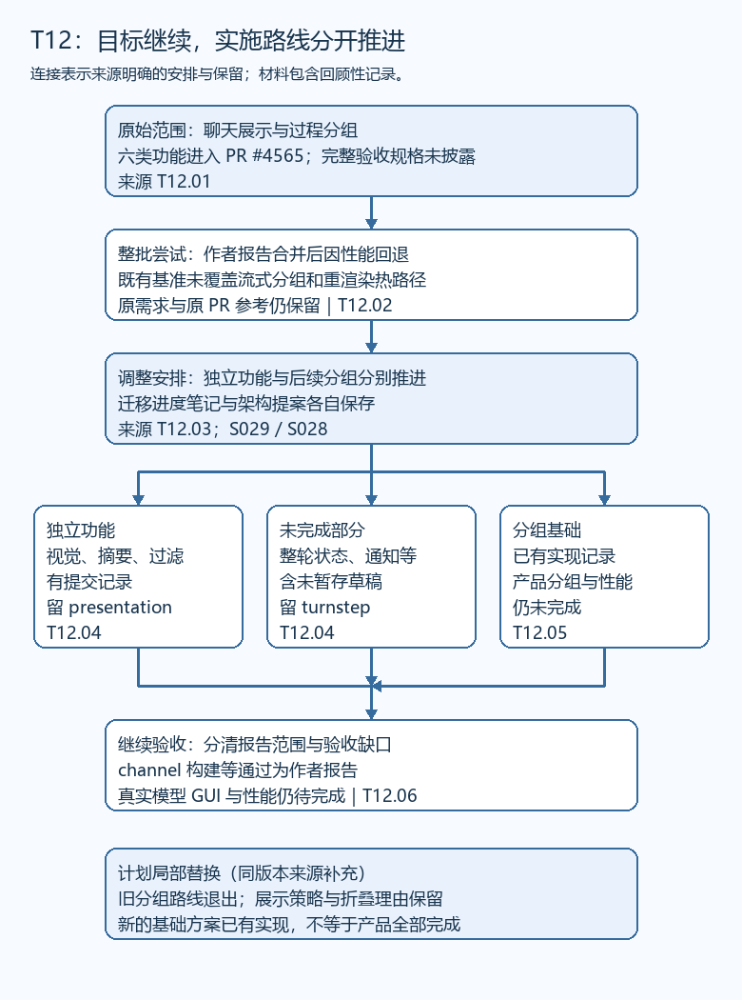

# T12 开发对象与连续变化比较

**本轮推荐五类可独立引用的工作对象：目标、计划、尝试、成果、依据。**一次Change连接它们的前后版本。三种责任布局都通过同一套连续变化检查；在T12单父范围内先采用父分配表，子项责任由它生成。计划独立成对象作为当前实现选择，带身份与版本的内嵌子记录也能保留旧引用；采用新版的语义尚未比较。

> **2026-10-29复核范围。** 本页保留上一轮结果，但实际执行比较只覆盖三种责任布局与两种Plan存放方式；Goal/Attempt/Product/Evidence的身份边界没有逐一比较，不能据此宣称五类对象已共同成立。已测故障包括：旧报告可用`revision=None`漂移、改Plan v2后原Attempt无采用路径且新Product仍挂v1、结束尝试后仍可分派责任、S029 Context隐藏依赖仅以补充文字存在、五对象预设实际只比较两个轴、`advance_product`接受任意结构且`accept_goal`可用Goal作Evidence。事实、故障与下一轮单变量协议见`artifacts/agent-task-state/maintenance/t12-continuous-validation-2026-10-29/fact-pack.json`、`protocol.md`、`stage-1-review.md`。本阶段不实现代码，不裁定最终身份边界。

图中最重要的分支在“调整安排”之后：独立成果、未完成草稿和分组基础分别推进；后续检查也有自己的范围。原始范围、作者报告回退、分项进展与验收见[固定底稿T12](dsh-process-truth-v1.md#t12)。图下方单独展示同源补充的计划局部替换，避免把它画成六事实之后才发生的事件。

## 对象及其变化

这张图表示工作方向到实际结果的联系：目标约束计划，尝试遵循具体计划版本并产生成果，依据说明结果如何被观察或报告。箭头是语义联系；一次变化可能同时涉及多个对象，并不要求按这条链一次做完。

| 对象 | 本例中的身份与作用 | 为什么分开 |
|---|---|---|
| 目标 | 保留原始功能范围与验收状态；身份由研究者建立 | 整批尝试回退后，需求仍然存在 |
| 计划 | channel/turnstep推进安排；架构方案 | 多项工作可引用同一版，旧路线可部分替换 |
| 尝试 | 整批、独立功能、turnstep、分组工作范围 | 一次尝试可结束，其他工作继续 |
| 成果 | 已提交功能、未暂存草稿、分组基础 | 迁移完成、实施、Git、验收分别记录，不随生产它的尝试消失 |
| 依据 | 性能回退报告、检查结果、未完成事项 | 精确指出报告对象、范围、性质与出处，不自动改主体状态 |

Change保存一次登记的操作、依据、主体归属、前后状态及实际变化位置。它可以包含多项原子效果；尝试的长期身份与这次状态转换分别保存。所有研究记录版本均不冒充上游发布版本。

## 实际比较得到什么

下表只覆盖责任布局与Plan存放；它不比较Product、Evidence或Goal/Attempt的身份选择。旧结果继续有效，但结论范围以本表列出的轴为限。

| 比较 | 执行结果 | 取舍 |
|---|---|---|
| 父表、关系、子项三种责任布局 | 相同合法序列得到一致归属；过期、抢占、未声明解除等均拒绝；真实六类功能的责任分配保持unknown（S029的item级状态是另一项已知事实） | T12先用父表：一个范围内维护位置直接；关系有额外身份/版本；子项转交要更新两侧 |
| 计划独立对象与内嵌版本记录 | 两者均能改后续步骤并保留旧实施引用；内嵌修改同时推进宿主记录版本。该比较只覆盖“改计划后旧成果仍指旧版”，没有覆盖“原尝试采用新版、新成果应指新版” | 保留Plan逻辑身份；当前选择独立存放，尚不能据此证明顶层存放必需；采用路径仍是缺口 |
| 计划局部替换 | 新分组路线替代旧段，展示策略与折叠理由保留，旧记录版可查 | 不能用整份文档的单一有效/失效标记替代段落范围 |
| 尝试收束与成果推进 | 结束尝试不完成目标；草稿可保持身份推进Git状态；已有证据不被覆盖 | 生命周期、成果进展与验收分别操作 |

责任的六步合成序列为：X给甲→只把Y给乙→明确转交X给乙→X由甲乙共同承担→明确解除X→X的归属记为未知。第二步保留甲的X；未知与已确认无人承担为不同状态。该序列检验机制，不声称DSH发生过这些转交。

检查还促成两项修正：关闭仍承担责任的尝试时，先转交或明确保留为未解决责任；成果必须有同一身份下的进展入口，不能只能新建成果。两者都有合法与拒绝路径，不能靠一律拒绝更新取得通过。

2026-10-29复核另列出六组已测故障：报告subject可漂移、改计划后无采用路径、结束后仍可分派责任、产品依赖不可查询、五对象比较范围不足、成果维度与验收证据缺类型约束。它们不是对旧结果的否定，而是说明旧结果只覆盖责任布局与Plan存放；详见固定批次中的`stage-1-review.md`。

## 当前可用操作与组合

以下是本例中有明确效果的工作操作；各自对应具体对象，底层统一检查前版、引用和整批失败回退。

| 操作 | 改变与保留 | 依据 |
|---|---|---|
| 记录目标、开启尝试 | 建立范围与尝试身份；不自动声明实现 | T12.01/03，研究者身份有标记 |
| 建立/调整计划 | 新版只改指定段，保留其他段和旧实施引用 | T12.03、S028部分替换 |
| 登记成果 | 关联生产工作及当时计划；迁移完成/实施/Git/验收各自保存 | T12.04/05及S029状态定义 |
| 推进成果 | 同身份产生后继，显式更新迁移审核完成、实施或Git进展；不自动验收 | 合成合法探针；不补写为DSH后续事实 |
| 收束尝试 | 只改变该尝试结局，明确剩余责任；目标和成果保持 | T12.02及连续探针 |
| 分配/转交/共同承担/解除责任 | 增量改变一项责任，其余保持；未知不等未分配 | 合成探针；真实T12责任映射未知 |
| 局部撤回成果 | 只退出列明部分，其他部分及旧版保留 | 合成探针；与旧实现保留性缺口对照 |
| 保存报告与显式验收 | 报告不自动验收；接受目标须单独记录主体、判据和决定 | T12.06；正向验收仅合成验证 |

本例的组合是：记录回退报告并收束整批尝试→建立分开推进计划→开启独立功能和turnstep工作→分别登记提交成果与草稿→保存基础实现及未完成事项→登记channel检查。每步都有独立记录，计划与报告不冒充实际实施。采用新版、新成果与精确版本检查是合成未来步骤，不是DSH事件；历史锚点只到T12.03的安排与T12.04的成果状态。

本轮新增的是责任布局与Plan存放方式的可执行比较；五类对象的联合边界仍是待检验预设，不是已完成结论。旧四入口继续作为历史记录器接口；旧八动作没有被直接升级为最终元操作。责任布局、Plan存放方式以及其余三个身份选择的备选仍保留，下一轮按一次只改一个选择的协议决定。

## 路径与共同事实

| 可见材料 | 变化 | 必须继续保留 |
|---|---|---|
| T12.01：原PR六类范围 | 登记迁移工作范围 | 精确目标/验收未完整披露，不由研究者补全 |
| T12.02：作者报告性能回退 | 整批尝试的结果及基准不足 | 需求范围、原PR参考、报告归属 |
| T12.03：分开推进 | 独立功能留channel，其余草稿在turnstep | 架构提案与实施结果各自存在 |
| T12.04：提交与草稿并存 | 记录独立成果、草稿与所在工作范围 | 每项进度与验收分别判断 |
| T12.05：分组基础 | 基础已有实现，产品分组仍未完成 | 基础成果不自动完成所有消费者行为 |
| T12.06：检查与验收 | 保存作者报告检查结果 | GUI与性能验收仍待完成 |

共同来源补充取自同一S029固定版本：完成、实施、暂存/提交、验收分别记录；迁移进度笔记不替代架构提案；Context隐藏与触发通知存在产品依赖，但当前只作为补充文字存在，尚未形成可查询关系（见`stage-1-review.md` F4）。补充用于展开原有事实，不修改底稿v1。来源原文和批次元数据在本地t12-object-study-2026-10-29批次。

## 复现与审阅依据

运行入口见[实验工具说明](../../../tools/work-operation-checks/README.md)。输入为t12_experiment_fixture.json，执行器t12_study.py，三布局实现t12_responsibility.py；新增代码不修改旧检查器和16段案例。输出包含逐步状态、三布局本地表示、计划位置比较及读回表示。来源补充保存在固定输入，原底稿v1保持原样。

模型草案、主Agent裁定、独立读回与执行回执见[组合研究中的本轮记录](operation-composition-review.md)。本轮结果支持继续在这条路径上检验，不支持宣称五类对象边界已经共同成立；下一轮按单变量协议逐一比较身份选择。跨父工作责任调整、真实用户修改目标及长程接续收益仍需要后续实际过程提供见证。
