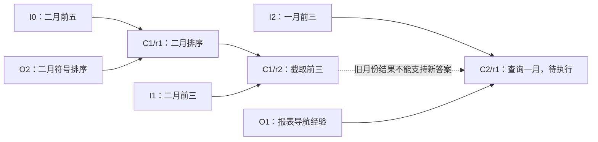

# InterruptBench task 0 可追溯手工状态示例

## 这是哪一种示例

任务与两次用户修订来自官方固定版本；下面的页面观察、Change、断点与 View 是本项目手工构造的表示实例，**不是作者发布的执行轨迹，也不是恢复实验结果**。本轮没有启动网站、浏览器 agent 或模型。

源版本：HenryPengZou/InterruptBench，commit `17da111e4858b93c0cab1d88f85e1735fbd1d423`，核对日期 2026-10-09。论文与发表口径见[来源清单](source-inventory.md#2026-10-09-首轮核验记录)。

| 来源 ID | 官方固定文件及字段 | 本例可据此确认什么 |
|---|---|---|
| S1 | [raw/2modification.json](https://github.com/HenryPengZou/InterruptBench/blob/17da111e4858b93c0cab1d88f85e1735fbd1d423/Eval/interrupt_config/raw/2modification.json)，task_id=0 | 初始二月前五；第一条修改为前三；第二条修改月份为一月 |
| S2 | [task 0 config](https://github.com/HenryPengZou/InterruptBench/blob/17da111e4858b93c0cab1d88f85e1735fbd1d423/Eval/config_files/wa/test_webarena_lite_transformed_2modification/0.json) | shopping_admin、需登录、起始 /admin、true_intent 一月前三、原生 must_include 评分 |
| S3 | [run.py](https://github.com/HenryPengZou/InterruptBench/blob/17da111e4858b93c0cab1d88f85e1735fbd1d423/Eval/run.py)，L374–440、L995–1090 | 固定动作数或百分比中断；回放已有动作前缀；然后注入更新。需真实轨迹文件 |
| S4 | [MULTI_INTERRUPT.md](https://github.com/HenryPengZou/InterruptBench/blob/17da111e4858b93c0cab1d88f85e1735fbd1d423/Eval/interrupt_config/MULTI_INTERRUPT.md) | 多轮是 chained run + replay；不等同于提供完整断点 snapshot |
| S5 | [evaluators.py](https://github.com/HenryPengZou/InterruptBench/blob/17da111e4858b93c0cab1d88f85e1735fbd1d423/Eval/evaluation_harness/evaluators.py)，L154–196、L255–273 | must_include 检查包含关系，未单独检查答案数量和过期证据使用 |

S1 文件 SHA256：`bc715fdb975ffd3fc6165e832eae55add02ed5154ec4e71f62c6cb0e3b9d24e5`。
S2 文件 SHA256：`6b01766e985e69d18e6f8f8c6f12fd4825bd9e30904af136381e3276ddb31139`。
第三方文件仅保存于工作树忽略目录 `artifacts/research-evidence/change-graph-neighbors-2026-10-09/`；固定官方链接与哈希用于重取，不提交第三方副本或个人对话。

## 意图怎样变化

| 版本 | 有效要求 | 被替换的字段 | 来源 |
|---|---|---|---|
| I0 | 2023 年二月销量前五商品 | 无 | S1.transformed_initial_intent |
| I1 | 2023 年二月销量前三商品 | 数量 5 → 3，月份继续二月 | S1.updates[0]，task_id=0 |
| I2 | 2023 年一月销量前三商品 | 月份二月 → 一月，数量继续 3 | S1.updates[1]，task_id=0 |

意图版本更新来自用户消息；Agent 改 Plan 不能自行恢复 I0。不能仅复制最后一条“月份改一月”而漏掉此前“数量改三”。

## 手工构造的尝试与证据

以下 O1/O2 的事实是作者构造，用于检查表示能力；没有伪造真实工具日志。O2 只给符号 F1…F5，不声称这些是二月真实商品。

| ID | 内容 | 来源/有效范围 | I2 下状态 |
|---|---|---|---|
| O1 | 已进入商品销售报表入口；导航路径已知 | authored-hypothetical；假定页面/权限未变化 | 可保留为导航经验；恢复后页面需观察确认 |
| O2 | 已获取二月同一销量口径的完整前五排序 F1…F5 | authored-hypothetical；月份=2023-02，口径未变、记录完整 | 不能证明一月排名；保留审计但不作当前答案证据 |
| C1/r1 | 为 I0 查二月前五，得到 O2 | 依赖 I0.period 与销量口径 | 曾满足旧意图，不应标成“工具失败” |
| C1/r2 | I1 只改数量，截取同一排序前三 | 依赖 O2 与 I1.count；假定排序完整且无口径变化 | 二月答案被 I2 替换；原截取规则仍可复用 |
| C2/r1 | 为 I2 查一月排名 | 新取证义务；没有 O-Jan | 计划中，不能标完成 |



此图是依赖与演化示意。数量修改作为 C1 的 Revision、月份修改作为 C2 是本例的人工划分；尚未验证这种粒度规则可泛化。旧尝试既不是删除，也不是因新目标出现就判定执行错误。

## I2 断点的 Canonical Task State

```json
{
  "state_version": "S2-authored",
  "current_intention": {"id": "I2", "period": "2023-01", "count": 3},
  "environment": {"live_snapshot": null, "current_page": "unknown"},
  "accepted_progress": ["O1: report navigation known, live page unverified"],
  "evidence": {
    "O2": {"period": "2023-02", "status": "not_applicable_to_current_answer"},
    "O-Jan": {"status": "missing"}
  },
  "active_change": "C2/r1",
  "open_obligations": ["query Jan ranking", "confirm evidence period", "return three products"],
  "completion": "not_verified",
  "provenance": "source task and updates real; observations and checkpoint handcrafted"
}
```

环境状态与语义状态分别记录。知道“曾进入报表”不能推出重启浏览器后仍在该页面；这里只恢复认知表示，没有恢复浏览器或网站环境。

## 两种 View

**Human View：** 目标已修订为一月前三。此前二月排序已不适用于当前答案，查到报表的导航经验可以保留。一月结果尚未获取，任务未完成。当前应确认页面并查询一月，无需从登录流程开始重做所有探索。

**Agent View（当前行动：决定下一次取证）：**

> 当前有效目标 I2：2023-01，销量前三商品。I1 已确认数量=3，I2 只改月份。O2 是二月排序，不能用于当前答案；O1 仅说明导航经验，未确认恢复后的页面。先观察页面及月份筛选，再获取一月排序并核对口径。缺少 O-Jan，不能声明完成。必要时按 O1 取回导航细节。

二者引用同一状态版本，不把“计划查一月”呈现成“查完一月”。Agent View 不含 S2 的隐藏评分答案；正式接入需保证 reference_answers 仅在 evaluator 侧读取。

## 这个实例实际检验了什么

静态一致性检查：I0→I1→I2 正确更新两字段；I1 可复用同月完整排序，I2 不可拿二月结果回答一月；导航不随月份一并失效；缺少当前证据仍为未验证。

还发现评分缺口：S2 的原生 must_include 会检查三个指定商品名的包含关系；若答案含这三个再加其他商品，也可能通过。本例不复制隐藏答案到 View。正式协议须分别报告原生分数与附加的当前意图满足检查，并保留原生 scorer；不能把补充检查冒充作者原评分。

**对研究的负面校准：本例仅需一张状态表和字段依赖规则就能表达，不能证明 Change Graph 或动态选择优于简单方案。** 两条意图更新本身不足以造成 Context 压力，也没有真实重复探索。需要更长的真实前缀才能检验候选方法。

下一步真实实例升级需要：轨迹与固定前缀、原始 observations、可验证环境恢复、在中断前可见的信息边界、独立评分；不要求先建整个图数据库。上述缺口未补齐前，本例只能作为设计与协议校准材料。
