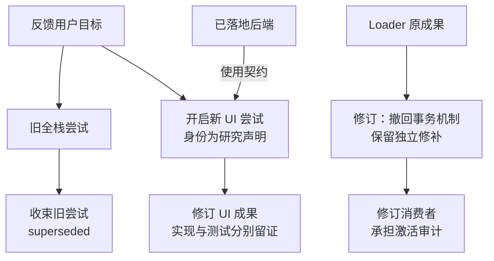

# 工作操作怎样逐轮收敛

**第一轮判断：保留“开启、修订、收束”作为工作接口候选。它们分别表达独立尝试进入跟踪、同一成果发生变化、指定尝试停止推进。**

反馈开发关闭了旧全栈分支，沿用已落地后端重写 UI；Loader 则撤回事务机制，保留独立修补并适配消费者。前者要保持目标继续与旧尝试结束的区别，后者要保持局部成果变化与整个工作结束的区别。[反馈原事实](dsh-process-truth-v1.md#t14)、[Loader 原事实](dsh-process-truth-v1.md#t01)。

上半图沿目标看两次尝试，横向的后端连接表示使用契约。下半图只有成果变化，没有据此关闭整个 Loader 工作。源码血缘与目标接续分别记录。

认真维护的文档和“整体版本内保留子记录”也能恢复这些事实。删除 `open / close` 后，需要在 `revise` 内补回身份声明、终止状态、处置理由和后继引用。**因此当前保留这两个入口的理由是让规则集中、可检查；是否值得独立实现，要比较这些替代规则的维护代价。**

本轮候选总数仍为 30：新增 0、删除 0；`open / revise / close` 明确了作用，`fork` 保留待补证。完整清单和替代规则见[分轮证据](work-operation-rounds-v0.1-evidence.md)。下一轮检查 `split` 能否由开启子工作、登记责任、修订父项剩余责任组成。

**第二轮把 split 转为组合动作。**T12 的子功能可以分别完成，但父目标还欠产品行为、GUI 和性能验收。组合为 `open 子工作 → bind 分配责任 → revise 父项残余`，同时保留父判据和未知分区。

T02 的新定义与旧运行修订分别生效，T08 的不同调用者各有通知承诺，因此 select 保留为带范围的采用接口。有效决定日志可以替代它，采用状态、前后值和冲突规则仍须保留。下一轮用同一规则回查 16 段，并逐项比较其他候选的组合代价。
