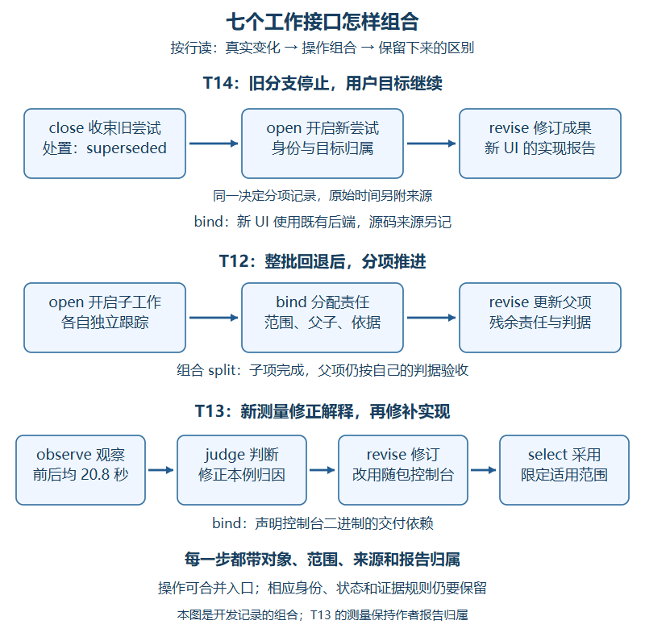

# 从三十项候选收敛到工作操作骨架

**这轮形成了七个工作接口的骨架：开启、修订、收束、观察、判断、采用、绑定。十一项优先由它们组合，十二项继续补证。**最有价值的变化是把“工作是否继续”“成果怎样改变”“我们知道了什么”“当前采用什么”分开，各自有明确规则。

反馈开发中，旧全栈尝试被关闭，用户目标继续，新 UI 使用已经落地的后端，因此需要保存旧尝试处置、新尝试身份和后端依赖。Loader 则局部撤回事务机制、保留修补并适配消费者，用成果修订描述即可。两者决定了 open、close 与 revise 的分工。[反馈](dsh-process-truth-v1.md#t14)、[Loader](dsh-process-truth-v1.md#t01)。

图按行阅读。第一行把同一决定中的旧尝试处置与新尝试分别记录；第二行将 split 展开为子工作、责任分配和父项残余；第三行保留“新测量 → 解释修正 → 实现改变 → 范围内采用”的链。绑定说明后端或交付依赖，源码来源和原始时间分别查证。[放大图](figures/dsh-work-operation-rounds.svg)。

**合并动作时，省下入口也要保住原含义。**T12 的分组基础已实现，产品分组、GUI 和性能仍未验收，split 的组合因此要保存父项残余和验收判据。T02 的定义更新后，旧运行修订仍被持有，select 的范围因此要区分新绑定、已有持有者和重启解析。[拆分](dsh-process-truth-v1.md#t12)、[版本共存](dsh-process-truth-v1.md#t02)。

| 当前去向 | 候选操作 | 这轮变化 |
|---|---|---|
| 核心候选 7 项 | open、revise、close、observe、judge、select、bind | 固定职责，各有删减后的替代规则 |
| 组合动作 11 项 | split、review、decide、verify、revert、adapt、repair、replace、retire、integrate、release | 优先从独立核心入口转为带条件的组合设计 |
| 待补证 12 项 | propose、fork、implement、land、accept、migrate、constrain、followup、execute、authorize、suspend、resume | 保留；具体缺口逐项登记 |

新增名称 0，删除名称 0。implement、land 的机械展开被撤下：实施、合入和记录结果需要分别描述。迁移契约、proposed 和待办状态也各自保存，具体行动有依据后再记录。[完整清单及组合](work-operation-candidates-v0.2.md)。

全量读回覆盖 16 段，仍暴露出丢失调用者差异、混淆验收和误写撤回等问题。认真维护的普通文档同样能够保存这些含义；显式接口值得继续检验的地方，是能否集中约束更新并减少维护错误。

**下一步先把 T14 做成完整转换表，再决定原型。**它需要把每个操作的对象、前版、变化、保留和拒绝条件填到具体值。当前发现的障碍已经很明确：一串操作名称能够提示组成，却不足以规定一次更新怎样发生。逐轮结果、错误和查证入口见[检验明细](work-operation-rounds-v0.1-evidence.md)。
