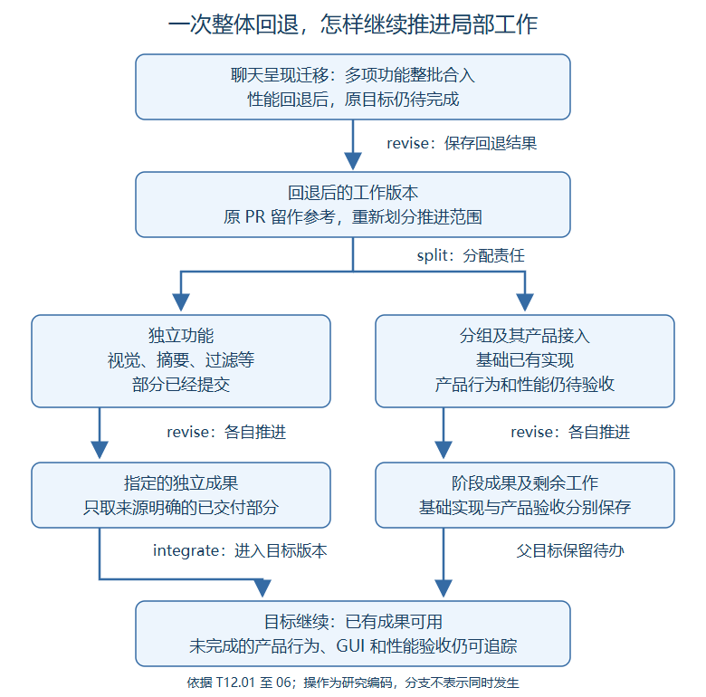

# 工作操作语言首轮推演：拆分、修订、整合与收束

**这一轮把操作的对象落到了“可以独立推进和取舍的一项工作”。**聊天折叠返工给出拆分的依据；旧反馈方案给出结束一条尝试、继续原目标的依据；Loader 撤回说明整合后的结果必须明确留下什么。它们分别改变工作的边界、推进状态和内容，值得采用不同的操作契约。

“记录、引用、选用”继续承担历史保存与一致性要求。当前要设计的工作语言需要进一步说明：做完一个操作，什么发生变化，什么继续保留，接下来能对什么继续操作。本页是第一轮候选推演，尚未冻结最小操作集。

## 从聊天返工看，工作怎样继续生长

选聊天返工，是因为它同时包含整体回退、重新划分工作和局部交付。原 PR 包含多项视觉与结构变化，合并后因性能回退。随后独立功能和分组相关工作分开推进，部分功能已提交，分组基础已有实现，产品行为与性能验收仍未完成。[T12.01 至 T12.06](dsh-process-truth-v1.md#t12)。

[放大图](figures/dsh-work-operations.svg)。实线箭头分别标明责任拆分、同项修订和成果进入目标；图中的操作是研究者对来源的编码。材料只给出部分先后，平行分支的具体执行时序保持未知。

这张图最值得看的，是拆分后的两条线怎样回到同一个目标：独立功能可以先进入交付，分组工作继续推进，原目标仍保留未满足的验收。**如果把这一步只叫 fork，就容易把两条线理解成竞争方案；这里需要表达的是责任分工。**独立功能与分组的二分是本轮讲解粒度，原始清单中更细的项目及状态继续保留。

另一个变化发生在整合处。产物进入目标工作后，目标必须得到一个新的组合结果。它可以保留旧内容、取入部分新成果，也可能引入适配义务。只把“当前选择”指向来源，无法直接说明这个组合结果是什么。

## 先用六个动词把变化说清楚

这里的“工作单元”有明确目标和范围，可以单独继续、暂停或结束；它可以是一项功能，也可以是该功能的一次实现尝试。两者的关系必须写清：子工作承担父工作的部分责任，替代尝试则围绕同一个目标探索。每个单元有自己的身份和版本，成果及观察可被精确引用。

| 候选操作 | 允许发生的变化 | 必须延续的东西 | 本轮依据与位置 |
|---|---|---|---|
| **开启 open** | 为一项独立推进的工作建立身份、目标、范围及起点 | 被引用的起点保持原样 | T14 新 UI 适配可声明为新工作；具体立项事件属于研究编码 |
| **修订 revise** | 同一工作形成后继版本，明确改动和保留范围 | 身份、旧版本和旧证据继续可查 | T01 撤回后的消费者适配；T11 根据评审改变方案 |
| **分叉 fork** | 从固定工作版本另开一条替代路线，两路可以分别推进 | 原路线继续存在；共同起点可查 | 本批没有充分明确的工作分叉实例，保留为待检验候选 |
| **拆分 split** | 将一项工作的责任明确分配给子工作，留下尚未分配的部分 | 原目标及其验收要求；拆分前版本 | T12 分项推进；T03 分阶段计划支持子项独立状态，但不足以重建首次拆分事件 |
| **整合 integrate** | 指定来源及取用范围，形成目标工作的新版本 | 来源版本及未被取用部分；目标未受影响部分 | T12 独立成果进入交付；T01 局部撤回要求目标结果保留独立修补 |
| **收束 close** | 明确结束这项工作的继续推进，登记处置理由与后续去向 | 版本、成果、证据和来源关系 | T14 旧分支以 superseded 关闭；不能由此关闭整个反馈目标 |

这六个操作的共同约束是可追溯，变化规则各不相同。open、fork、split 都可能产生新身份，但分别表示开启一项工作、另试一路和分配责任。能否共用底层实现可以后定，公开规则必须能区分三种含义。

上一轮对话中的 adopt 被分成两个问题：**integrate 负责形成取入成果后的目标版本；采用该版本则要另有明确决定或已发生的合入报告。**本候选的 integrate 只保证登记一个候选组合，不自动改写真实代码、批准交付或改变正式采用。已有 select 可作为范围内采用的配套操作；这部分并未被六个动词消除。

观察也需要一个明确入口。候选 `observe` 向指定工作版本附加测量或执行报告，保留环境、结果、范围和报告者。Windows 终端的两次 20.8 秒测量属于观察，新归因属于判断修订。[T13](dsh-process-truth-v1.md#t13)。因此当前候选实际还依赖观察与采用两个配套契约；这里只列六个工作变化动词，不能据此声称系统只有六个操作。

## 三段过程怎样一步步表示

**Loader 检验局部修改是否准确。**从事务式 Loader 版本出发，revise 形成撤回后的新版本，明确移除的五个提交和保留修补。observe 登记机械中间态暴露的消费者不兼容；再次 revise 适配消费者；observe 记录有范围的作者验证。消费者以后仍须检查激活是一项持续责任。这个序列无需把修补从来源重新导入，因此不强行添加 integrate。[前轮逐时点核查](operation-composition-review.md#先看-loader-撤回中发生了什么)。

可读回的结果是：旧事务保证退出，独立成果仍在，中间曾失败，后续已有消费者适配。撤回可先作为 revise 的一种受约束用法：输入需要撤销的变化、排除范围和实际结果版本。能否自动算出这个结果尚待验证；普通版本回退不足以表达选择性撤回。

**聊天返工检验拆分后的责任。**原目标保持；revise 记录合入后的回退结果；split 将独立功能与分组工作分开跟踪，并将产品验收留在原目标的责任清单。子工作分别 revise，已有交付事实支持的成果通过 integrate 描述其进入目标版本；分组基础的 implemented 记录和未完成验收分别附在实际对象上。这里的“整合”是对已报告成果进入目标的表示，具体源码映射仍待补齐，不能把整条分组线写成已交付。[T12](dsh-process-truth-v1.md#t12)。

可读回的结果是：回退整批迁移没有废弃所有功能，子项可以具有不同完成程度。若删掉 split，则 open 子项的组合必须额外保存每项承担的责任和父项残余清单。这个替代可能成立，但责任分配协议仍然存在。

**反馈功能检验收束后怎样继续。**用户目标仍是提供反馈功能；后端已落地而 Web 入口未完。来源明确记录旧分支因接口、重复后端及目录变化而 superseded 关闭，因此可以 close 旧尝试；open 新 UI 适配工作，引用现行后端契约；revise 形成适配后的 UI；observe 保存作者报告的 E2E 结果。旧分支是历史参考，来源没有证明代码被复用，所以此处不登记从旧分支 integrate。[T14.01 至 T14.04](dsh-process-truth-v1.md#t14)。

可读回的结果是：旧尝试已经结束，用户目标仍有后继工作，既有后端继续有效。close 的处置可以是完成、放弃或被替代，但它统一只改变该单元的推进状态；是否满足目标必须有单独的验收依据。暂停需要能继续同一工作，暂不塞入不可继续修订的 close。

## 现在可以作出的取舍

**保留 split 与 fork 的语义差别，暂缓删除 fork。**Qoder 建议将 fork 并入 open，但给出的主要反例只能证明聊天返工是拆分，不能证明所有工作都不需要分叉。下一轮应使用已有分支资料查找一个共同起点、独立推进、后续取舍明确的片段，查证目标限定在这三个条件。

**用 integrate 明确成果组合，select 继续负责采用。**只有来源、目标和最终结果同时确定，才能知道取入了什么；程序可核对引用与基版本，兼容性和局部边界由调用者及证据提供。T01 展示保留原有成果，T14 展示依赖现有后端，它们本身都不足以证明“跨尝试取用代码”已发生。

**close 只收束所指工作，observe 保存独立反馈。**这样能够保留“结束旧方案、继续原目标”和“新判断出现、旧测量继续可查”。暂停、恢复和验收的完整转换规则尚未形成，六个动词目前不能覆盖全部控制行为。

接下来最值得做的是把 split 和 integrate 各展开到能逐项核对的契约：用 T12 检查拆分前后的责任是否遗漏，用 T01 检查撤回结果的保留范围，用已有分支资料检验 fork。每项都交付前状态、输入、后状态和拒绝条件，再尝试删除或合并；离线检查器继续等待这些操作契约稳定。

执行者展开：前后条件、三路审阅与证据边界

### 第一版可检查契约

以下是研究接口，不是已实现程序。工作内容的编辑与成果执行由外部工具完成，这里保存声明、版本与结果；历史编码必须带来源归属与资料可见时间。

| 操作 | 必要输入与前置 | 后置与失败处理 |
|---|---|---|
| open | 新身份、目标版本、责任范围、起点引用及声明者 | 返回初始工作版本；身份重复或引用缺失时不接纳 |
| revise | 工作身份、expected 版本、明确的变更范围及后继内容 | 同身份产生后继版本，旧版保留；前提过时或工作已收束时保留候选但不推进当前工作 |
| fork | 精确共同起点、新身份、独立推进目的及继承内容 | 原工作不变，返回可独立修订的工作；继承哪些计划和观察显式声明，运行授权不由来源自动赋予 |
| split | 父工作 expected 版本、子项责任映射、残余责任 | 子项拥有独立身份，父项新版本保存分工与残余；缺少已知责任归属时保留为未分配，不自动算完成；允许有依据的重叠责任 |
| integrate | 目标 expected 版本、来源精确版本、取用范围、已处理冲突和候选结果 | 产生目标候选版本与来源映射；来源继续可查；兼容性未查时结果携带未决义务，不能标成已验证；采用另行登记 |
| close | 指定工作及 expected 版本、处置、理由、残余事项的去向 | 当前工作停止修订，历史和成果仍可取用；未知后继可记未知，父目标不会自动完成；再开工的身份政策待检验 |
| observe（配套） | 被观察的精确对象、方法/环境、结果、报告者、证据及时间 | 追加观察，保持旧测量和被测版本；后来的解释通过新判断关联它 |
| select（配套） | 采用范围、原选择、目标版本、决定及主体 | 该范围的采用改变；调用者声明的授权边界需核对，外部实施与验收另有证据 |

调用者提供目标和责任边界、共同起点、取用范围、兼容性判断及决定理由。程序检查身份、引用、expected 和已声明的规则；责任清单是否覆盖全部实际需求、源码语义是否兼容仍需人工或 Agent 分析。工作“当前版本”和正式“采用版本”的差别在 prototype 前需要固定投影规则。

### 三路 Qoder 的实际产出与主 Agent 处置

2026-10-21 使用新建 STDIO MCP 连接，读取并发上限 3 及新增论文允许目录；现有客户端连接是否刷新未作声称。三个只读任务同一时段运行，输出由主 Agent 对照固定底稿与 Loader 补读独立复核。它们都可读前轮组合审查，因此不是盲化标注者。

| 分工 | 有用产出 | 复核后未采用或修正 |
|---|---|---|
| A：独立提炼对象与操作 | 区分工作目标、尝试和产物；观察与解释分别保留 | 将运行时会话 fork 作为工作 fork 依据，层次混淆；将消费者持续责任写成未完成事项；Loader 原验收被研究者补定，证据不足 |
| B：检验五动词 | 区分 fork 与 split；发现当前样本缺少清晰工作分叉；T14 没有代码复用证据 | 由缺少分叉实例直接建议删除 fork，论据不足；adopt 退回指针更新，未回答成果组合；序列使用 revert/split/retain 却未完全展开，不能声称四操作已覆盖 |
| C：反例审查 | 观察、实现、采用、验收需要分别表达；强调停止一项工作不等于删除其成果 | 多数反例来自 DSH 产品运行规则；“revise 必然覆盖旧观察/身份”的批评不成立，可采用不可变后继；最终四轴又回到宽泛记录能力，未作为工作语言采纳 |

三路都没有交付可机械执行的完整转换规约；长表格与“不能推出”句式偏多。本轮证明它们能提供并行的分析与反例素材，独立验收仍不可省。建议继续用 Qoder 处理边界明确的对照和反例，规范定义由主 Agent 综合；没有测量它比单路更快或更准确。

### 本轮证据与下一轮完成标准

输入是截至 2026-10-15 的固定 16 段底稿及已有 Loader 补读，原始底稿和前批表示未改。三路 task_id、完整提示与结果保存在主仓库 `artifacts/agent-task-state/maintenance/dsh-work-operations-2026-10-21/`；模型记录均为 dfmodel，工具报告三个任务的 cost 和 credits 均为 0。只读任务输出是分析材料，不能计为新增工程事实。

本轮详细推演 T01、T12、T14；其余过程提供反例线索，不声称新语言已完整覆盖全部 16 段。尚待完成：真实工作 fork 见证、split 责任映射、integrate 源码级取用映射，以及暂停/恢复/验收与两个“当前版本”的规则。每个新增操作须有前后变化见证；合并必须保留原转换规则，并计算剩下的额外约定。

