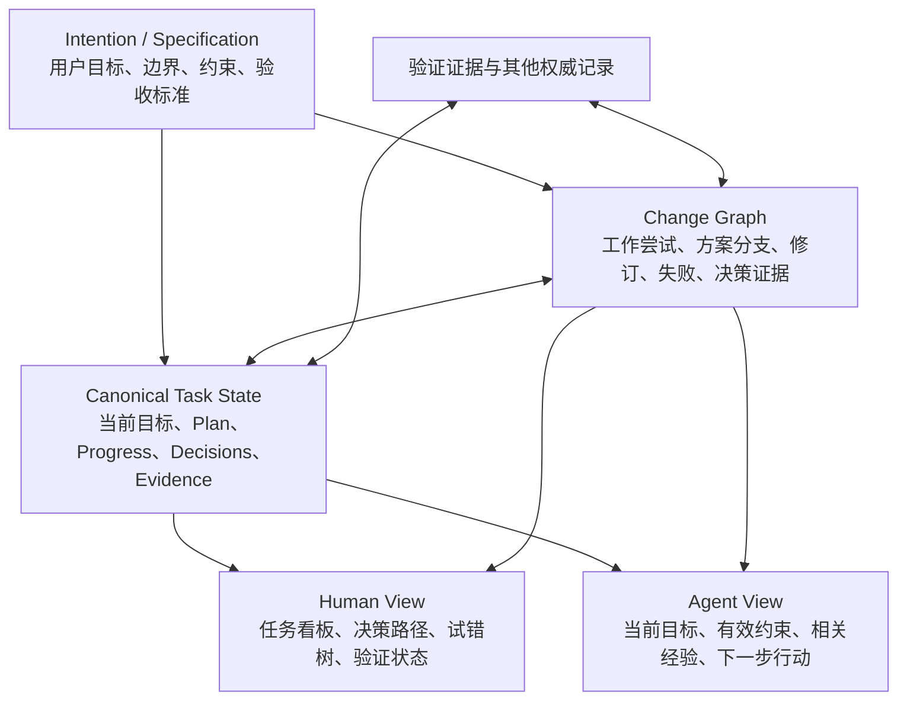

# 基于 Change Graph 的 Agent 任务状态管理：阶段性总结与设计假设

现行意图与贡献边界见 [Intention Brief](../../intention/intention.md)。下文保留 2026-10-09 的设计假设，以及后续写入的 T12 对象方案；「将任务状态从 LLM Context 中独立出来」是当时的讨论起点，不是已确认的论文新意。

## 定位与来源

本文保存用户于 **2026-10-09** 提供的《阶段性总结：基于 Change Graph 的 Agent 任务状态管理》，作为下一轮讨论的共同起点。来源为用户在当前聊天中直接粘贴的总结；前序讨论入口为[《解读 Pi Durable》](chatgpt-conversation://6ac72b94-86a0-83ea-a042-4f273d6f2109)。本次仅整理表格、架构表达与来源边界，不新增研究结论。

本版责任状态：用户提供讨论结论，助手整理存档；**设计假设，尚未经过实例或实验验证**。本文留在现行设计里，不表示规格已批准、方法有效或实现可执行。

前序对话接口本次可读到五轮用户发言及选中文本，助手回复仍为引用占位符，没有附件。以下以用户直接提供的总结为本版内容依据，不声称已完整读取原对话、原始论文或代码。

本文是本项目的设计假设。它与工具反馈管理课题的联系见第七节；本文不替换该项目的规格、任务图或运行授权，入口仍是[研究目录](../../../../工具反馈管理/docs/research/cache-aware-tool-observation-management/README.md)和[研究立项 Gate](../../../../工具反馈管理/docs/research/cache-aware-tool-observation-management/research-topic-gate.md)。

## 一、核心思想与五个共识

**将任务状态从 LLM Context 中独立出来，把有意义的工作尝试作为一等公民，通过版本化的 Change Graph 管理任务演化，再为人类和 Agent 动态生成工作视图。**

### 1. Task State 是工作的主体，Context 是临时视图

讨论出发点是：依赖聊天记录维持任务状态，会使长期工作不断需要压缩、总结和交接。拟维护独立、持久化的任务状态数据库，使工作现状不依赖某个 Agent 实例或某段 Context 的存续。

目标是让 Agent 中断或 Context 清空以后，任务的有效目标、当前方案、进度与证据仍然存在，并能够支持继续工作。这是待验证的能力主张。

### 2. Intention 是最高层约束，Plan 是可演化的实现路径

系统应持续保留当前有效的用户意图、边界、约束和验收标准。Plan 可以修改甚至推翻，但每次重要修改都需要解释修改原因，以及新方案是否仍满足用户意图。

拟解决的典型问题是：代码测试全部通过，但实现结果偏离用户真正需要的效果。工程验证与意图满足必须分别表达。

### 3. Change 是一次有意义的工作尝试

一个 Change 应具有明确的目标、假设、执行过程和结果。它可能产生多次代码修改，也可能完全不涉及代码；不能机械地把每次文件修改都认定为一个 Change。

同一个 Change 可以持续修订；不同方案可以形成分支；失败尝试也需要保留，使后续 Agent 有机会避免重复走弯路。讨论借鉴了 Jujutsu（JJ）的 Change 与 Revision 思路，但这里的工作尝试是本研究拟定义的语义对象，不能直接等同于 JJ 的代码变更对象。

### 4. Change Graph 记录演化，Task State 表达现状

| 对象 | 拟承担的职责 |
|---|---|
| Change Graph | 记录为什么走到这里：工作尝试、方案分支、修订、失败、决策及证据关系。 |
| Canonical Task State | 表达当前有效的目标、方案、进度、约束与未解决问题。 |

希望能够依据 Change Graph 和其他权威记录重建或校验 Task State。哪些记录具有权威性、冲突如何处理、什么内容可以重建，均尚未定义。

### 5. Human View 与 Agent View 来自同一份状态

人类需要直观地理解当前工作和决策路径；Agent 需要在有限 Context 中获得支持当前行动的信息。两者应读取同一套状态与证据，采用不同展示方式。

这意味着视图应保持状态口径一致，但不要求展示相同内容或使用相同格式。

## 记录方案与验证边界

上文保留了 2026-10-09 的设计假设，其中 Change 指一次工作尝试。后续 T12 研究把尝试与变化拆开。下表是离线记录研究采用的职责划分。

| 对象 | 职责 |
|---|---|
| 目标 | 保存工作意图、边界和验收要求。一次尝试结束后，目标仍可继续。 |
| 计划 | 保存实施安排及其版本。尝试显式采用计划版本，旧成果保留原来的版本引用。 |
| 尝试 | 表达一次有边界的推进，保留其采用的计划和进展。 |
| 成果 | 保存可继续更新的产出，并区分整体进展与局部推进或撤回。 |
| 依据 | 保存带来源和适用范围的判断，允许限定范围纠正，同时保留旧记录。 |
| Change | 保存每次变化的前后状态与出处。关系把变化连接到有关对象、版本和范围。 |

这套划分来自 [T12 对象研究](../../../experiments/t12-objects/t12-object-study.md)。2026-11-01 的 180 项回归覆盖该轮离线记录与查询规则，补充材料还包含固定案例与合成接续。五类是否最小、物理存储布局和真实任务中的接续效果仍开放。早期[工作操作 v0.5](../../../experiments/operation-composition/work-operation-candidates-v0.5.md)保留为记录器接口与组合规则的历史依据。[架构 v0.4](design-v0.4.md)说明两种视图的设计职责。

## 二、概念架构

图中的箭头表达概念关系，不是已确定的数据写入顺序或数据库协议。实际运行中，Change Graph、Task State 和验证证据需要通过版本与事务保持一致；单向更新不足以保证这一点。具体一致性机制仍待架构设计。

例如，方案 A 已废止、方案 B 当前采用、方案 C 探索中，可以同时保留在演化图里；当前状态需要清晰表达采用哪一个方案、依据是什么、其他分支处于什么状态。

## 三、与现有技术和研究的关系

下表记录**用户总结中的借鉴定位**，用于后续查证与对照。它不证明外部系统确实具备这些能力，也不证明现有工作尚未解决本问题。

| 技术或研究 | 本轮拟吸收的思想 | 本次核对状态 |
|---|---|---|
| Cordis | 插件架构、生命周期管理、动态组合能力。 | 原文与版本待核实。 |
| Pi Durable | 持久化执行、Checkpoint、任务恢复。 | 原文与版本待核实。 |
| Jujutsu（JJ） | Change 一等公民、稳定身份、Revision 与演化历史。 | 官方语义及与研究对象的差异待核实。 |
| Context as a Tool / pi-context | 有限 Context 下的动态上下文管理。 | 分别确认论文与工程项目身份，不能默认两者等同。 |
| InfiAgent / MAGE | 由状态重建 Context、管理分支与有效历史。 | 论文身份、机制与证据范围待核实。 |
| SDD + 三空间开发 | 用户意图、规格约束、实施过程与反馈闭环。 | 本轮设计来源；其作用不是替代研究验证。 |

研究关注点是：如何表示一项持续演化的工作，并让人类和 Agent 共享对这项工作的理解。上述思想之间是否存在尚未充分统一的研究空间，目前是候选判断，需通过直接近邻对照确认。

**文献证据边界：** 本版不新增发表 venue、年份、接收状态、实验数字或效果排名。前序对话中出现的 ContinuityBench 与“第六篇”尚缺完整出处，不能恢复成具体论文结论；RQ 编号也不能跨版本直接对应。后续确认来源后，正式发表状态、官方证据与核对日期统一登记到本项目[来源清单](source-inventory.md)，再引用到本文。

## 四、暂定研究主题与问题

中文暂定：**基于 Change Graph 的持久化任务状态管理与动态工作视图生成。**

英文暂定：**Change-Graph-Based Task State Management and Dynamic Working Views for LLM Agents**。

| 研究问题 | 主要内容 | 当前角色 |
|---|---|---|
| RQ1：状态表示 | 如何合理定义 Change、Revision、Intention、Evidence 及其关系？ | 必要的基础设计。 |
| RQ2：动态视图 | 如何依据当前任务与 Token 预算，从完整状态生成 Agent 工作视图？ | 当前最值得投入的主要方法研究方向。 |
| RQ3：有效性验证 | 该视图是否能减少重复探索、意图偏离和 Context 成本，并提高任务完成质量？ | 实验验证；效果尚未证明。 |

上述 RQ 编号仅属于本版总结。跨 Context、跨模型接手可以作为验证项目状态独立性的测试，研究目标仍包含任务质量、意图一致性和视图生成。

## 五、尚未确定的三个问题

1. **Change 粒度：** 怎样判断一次试错值得成为独立 Change？什么时候只是现有 Change 的一次 Revision？
2. **状态可信度：** Agent 声称完成、测试实际通过、用户确认满意，是不同等级和作用范围的证据，不能直接视为同一种状态。
3. **视图生成策略：** 如何决定当前 Agent 应看到哪些历史失败、哪些约束必须持续保留、哪些细节可以通过工具按需读取？

这些问题保留为后续架构设计重点，当前没有固定 Change 划分规则、证据状态机或上下文选择算法。

## 六、核心设计假设与验收方向

> 建立一套可靠的任务状态系统，让 Agent 不需要依赖聊天记忆也能持续工作。

Change Graph 保存工作的演化与试错过程，Canonical Task State 表示当前有效现状，Human View 和 Agent View 分别服务于人的理解与模型的行动。

一个重要验收方向是：**即使彻底丢弃聊天记录，一个新的人类开发者或 Agent，只要读取任务状态与必要证据，就应该能够理解项目现状，并合理地继续工作。**

这不是唯一质量指标，也不是当前已通过的验收标准。它用于检验“状态独立于 Context”的设计假设；准确性、意图一致性、维护负担与任务完成质量仍需单独判断。

## 七、与当前课题的衔接及下一步

视图生成策略可以衔接此前的长工具反馈、Context Management 和 KV Cache 研究：完整状态中保存的内容，未必全部进入当前 Agent View；哪些信息保留、缩短或按需读取，会影响任务质量与 Context 成本。缓存收益及其测量方式需要另外核实，本版没有收益结论或冻结价格。

下一步建议是选择一项真实的软件开发任务，**手工构建 Change Graph 与 Task State，分别生成 Human View 和 Agent View**。通过一个完整实例检查表示是否足够、是否过于繁琐，再考虑数据库结构和自动化实现。

这一建议仍待讨论，不代表现在已授权选择并执行任务。下一道 gate 是用户审阅本版设计假设及手工实例范围；实例之后再判断是否值得形成独立研究问题和正式规格。

## 存档记录

- 日期：2026-10-09。
- 内容版本：阶段性总结首版；历史修订由 Git 追踪。
- 归属：`Agent任务状态管理/docs/specification/change-graph-task-state/design-hypothesis.md`，候选方向讨论记录的唯一维护文档。
- 保存基线：`codex/experiment-readiness-sdd` 的 `7ee0d3377a7800077128d5107da05d25d32e1e10`；独立存档分支为 `codex/change-graph-research-notes`。
- 来源：用户直接提供的总结；原对话仅部分可读，未核验外部原文。
- 授权范围：整理与存档；无代码实现、真实任务执行、模型调用或付费实验。
- 技能操作留痕使用本项目文档与 Git；全局技能日志位于本工作区允许写入范围之外，本轮不写入。
