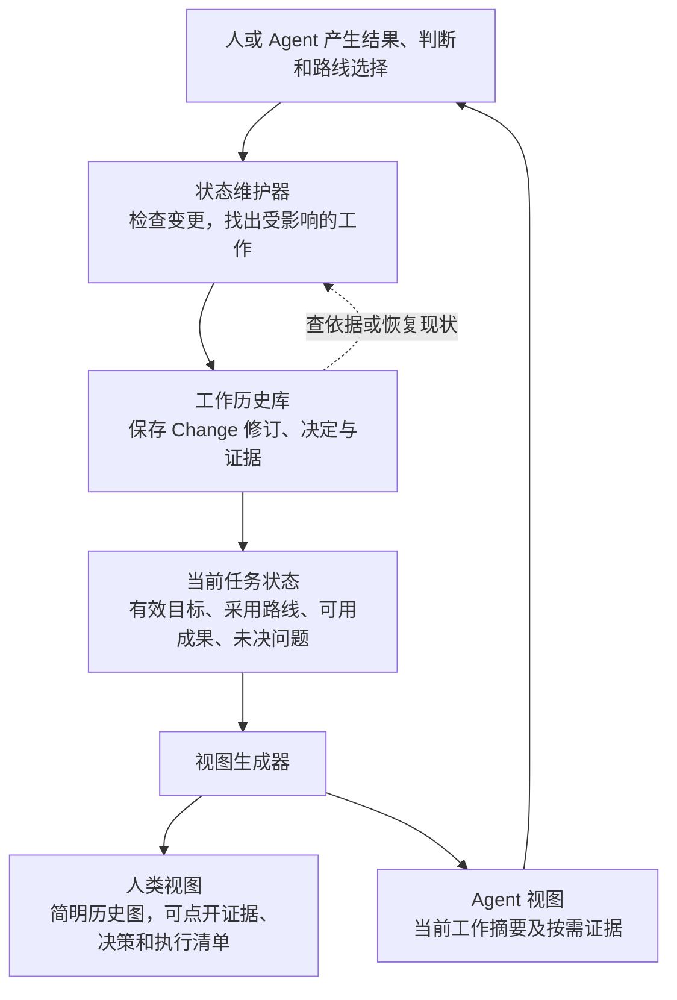
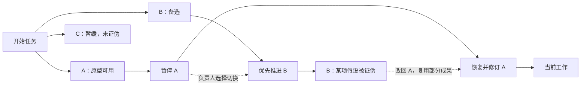

# 长程复杂任务状态管理：架构设计 v0.4

本文保留旧任务历史方案供候选机制分析；本轮研究定位见[现行研究意图](../../intention/intention.md)，设计地位见[规格入口](../specification.md)。本文中的结构、优先级和阶段要求不自动成为本轮约束。
我们要做一个让人和 Agent 都能持续理解、推进复杂任务的系统。工作可以经历并行研究、原型验证、需求变化、暂停和返工；聊天压缩后，仍然清楚为什么采用当前路线、哪些成果能继续用、哪些问题没有解决。

设计采用四个配合的部分：**工作历史库保存演化，状态维护器处理变化，当前任务状态表达现状，视图生成器提供适合当前读者的信息。**日常推进主要依靠工作摘要，必要时沿证据链取回细节。

两种视图的设计职责见本文。后续 T12 研究对目标、计划、尝试、成果、依据和 Change 的划分，见[记录方案与验证边界](design-hypothesis.md#记录方案与验证边界)。

## 为什么需要这套架构

长程工作的困难不只是历史太长。一个方案可能已经做出原型，却暂时不值得继续；一个测试结果可能真实，但只适用于旧需求；一次失败也可能留下能被别的方案复用的成果。只保留“现在做 B”的进度摘要，会丢掉这些区别；把全部历史塞回 Context，又会挤占当前工作的注意力。

系统因此同时保留两种理解：**当前怎么推进，以及为什么走到这里。**历史完整留在外部，当前工作只读取有用的部分。路线切换时找回暂停位置；条件更新时检查受影响的结论；压缩之后按当前状态重新组织工作摘要。

## 四个部分如何配合

**工作历史库围绕 Change（有连续身份的一项工作尝试）组织内容。**“探索 A 路线”从假设、原型发展到测试与实现，可以一直是同一个 Change。持续修改形成 Revision（这项工作的一个修订版本）；可独立取舍的另一条路线建立新的 Change。历史保存成果、判断、选择理由及其证据，也保存从其他方向复用了什么。选择 B 只改变当前采用的路线，A 不会因此消失。

**状态维护器决定一次变化怎样影响现状。**Agent 提出结果或建议，它先检查依据版本和写入条件，再保存被接受的变化。需求更新后，沿已记录的依赖找到需要重新判断的结论，把复核加入工作安排。程序负责保持记录一致；工程判断仍需要 Agent 或人依据证据作出，不能靠格式检查认定正确。

**当前任务状态提供共同的工作基准。**它表达现在有效的目标、当前采用哪些工作版本、已经可用的成果、还欠哪些问题，以及下一步。它引用历史中的具体修订和证据，不再维护另一套脱离历史的说法。状态文件丢失时，可以从历史中已接受的变化恢复。

**视图生成器根据用途选择信息。**给人呈现整体方向、关键取舍、进展与风险；给 Agent 提供当前行动需要的目标、约束、工作摘要和证据入口。两者依据同一个任务状态版本，展示内容可以不同。调整展示或摘要方式时，重新生成视图即可。

## Human View：看图理解，点开核查

默认入口是一张简明的工作历史图，显示主要路线、关键切换和当前位置。Change 的多次修订先折叠，按需展开；工具调用、测试日志和具体执行步骤留在详情中。图由工作历史中的版本和关系生成，不再手工维护另一份图的真相。

暂停、未优先、证伪和完成分别表达。连线说明分叉、接续、替代或成果复用；时间先后不能自动画成因果。关键切换只显示一句理由，详细记录点开再看。

图上的每个关键判断和动作都有可核查入口：

| 点击哪里 | 应看到什么 |
|---|---|
| “证伪”或验证结果 | 被检验的具体判断、适用前提、证据与原始结果入口、相关实现及测试版本、谁作出判定。只否定被证据覆盖的判断，不扩大成整条路线失败。 |
| “暂停 A”“切换 B”等决策 | 谁提出、谁作出或批准决定、什么时候、为什么、依据哪条指令或判断，以及影响了哪些工作。提出者、决策者和执行者可以不同。 |
| 某个 Change 的“执行清单” | 对应版本的任务分解、完成及未完成步骤、阻塞与待验收项，并能打开规格、计划、产物和验证记录。 |

证据查看展示保存的实际依据，不能临时生成一段解释冒充原记录。缺失证据或主体不明时，详情明确标出；不能让一个确定的图标签掩盖未确认状态。

执行清单通过工作节点打开，不挤进总览图。采用 SDD（文档驱动开发）时，清单接到对应规格、issue、plan 和验收记录；一份 plan 可以覆盖多个 Change，一个 Change 也可以关联多项工作，不强行规定一对一。完成步骤、验证通过和用户验收分别表达。

历史节点的默认详情对应当时版本，当前清单可以另外切换查看。暂停后保留旧清单，恢复后依据现状修订，避免用今天的计划解释过去的决策。返回总览时保留已选节点和展开位置，核查一个细节不必重新寻找整条路线。

## 路线切换时，工作怎样延续

A、B、C 并行研究，各自形成成果。比较后先推进 A，历史保存选择理由，B/C 作为备选保留。没有被选中，不意味着技术上被否定。

负责人决定改做 B，状态维护器更新当前安排，A 留下暂停位置、已有成果和遗留问题。B 从自己的已有工作继续，既不清空 A，也不把“领导优先 B”解释为“B 的技术优势已经得到证明”。

B 的原型暴露问题后，保存失败条件、证据与仍可用的部分。转回 A 时，先读 A 的摘要，再对照现在的需求与环境检查变化影响。没有受影响的成果继续使用；依赖旧条件的结论重新判断；B 里可用的部分也可以被 A 继承。

已有成果可以带着明确的技术债继续发展。是否已经可用、是否满足全部验收、还欠什么问题分别表达，避免把小而可用的原型写成“已经彻底完成”，或因局部缺陷把整项工作抹掉。

## 前提改变与 Context 压缩怎样处理

每个重要结论引用具体版本的前提。比如 A 的性能判断依赖旧吞吐目标；吞吐目标提高后，该判断进入待复核状态。系统先找到受影响的部分，再由 Agent 补做必要的判断或测试，不要求所有工作重来。旧测试仍是历史事实，但不自动证明新条件下也通过。

依赖变化意味着结论需要检查，不等于结论一定错误。必要前提与一般支持证据也有区别：一个支持证据失效，另一个可能仍然足够。这是状态维护器必须处理的语义，否则自动更新会误伤成果。

准备压缩 Context 时，先把本轮新决定、成果、未完成事项写回状态，再生成恢复摘要。下一段 Context 先读摘要，获得当前目标、采用路线、重要理由、未决问题和下一步；其他方向的细节留在各自 Change 中，摘要提示哪些工作被暂停、何时值得重新考虑。

只有遇到证据变化、观察矛盾、摘要缺少行动细节，或者确实要操作具体文件时，才定向读取有关证据。关键信息装不下时，收窄本轮工作并分步取回，不能悄悄删掉约束。摘要的作用是减少日常阅读量，来源链负责需要时能够查证。

## 这版设计需要怎样检验

目前这是一份架构草案，系统尚未实现。最脆弱的环节是摘要和依赖是否被正确维护：遗漏关键关系会漏查，过度关联会制造多余返工。多存历史不能自动解决这些错误。

下一步应在真实长程复杂开发任务中检验，多次压缩 Context，并观察路线切换、恢复和条件更新后的行动。判断系统是否有价值，要看能否继续正确推进、减少重复探索、保住暂缓工作和遗留问题，同时计入维护与取证负担。可溯源的普通工作摘要应作为对照；小测试只能检查局部规则。

恢复历史时只重建状态，不重新执行部署或其他外部动作。过去的证据若没有保存，系统必须暴露缺口。这两点影响可靠恢复的实际边界。

---

本版在 v0.3 的架构上加入历史图、证据与决策查证、执行清单入口。[前版](../../../history/design/design-v0.3.md)保留；来源、技术约束和接手安排集中在[Agent 接手说明](design-v0.4-agent-notes.md)。这些是设计行为，当前尚无可操作界面。
