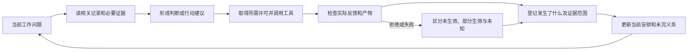

# 从开发活动到工作记录和 Agent 行动：首轮映射

状态：已归档

**需要持久保存的是会影响后续工作的含义及其依据，不能把每次工具输出都升级成一项工作。**首轮六个有明确材料边界的走查表明，认真维护的普通工作文档已经能够支持当前的问题查证；我们还没有证据证明图或某个元操作能让接手更快。

本报告使用[活动地图](software-development-activity-map.md)的十二类活动，先说明已有工具记录什么、需要补记什么、Agent 怎样继续，再进入元操作检验。它不预设数据库对象数量或字段方案。

## 两次投影

| 活动 | 已有载体 | 为后续工作保留的含义 | Agent 的工作 |
|---|---|---|---|
| 弄清目标与边界 | Issue、规格、公开决定 | 当前条件、明确排除项、谁有权决定及尚未确认处 | 对照当前要求，澄清有影响的缺口，记录决定入口 |
| 理解系统与影响 | 代码、搜索结果、设计材料 | 与当前问题相关的定位和解释；解释和事实区分 | 检索、读取、联系多处信息，必要时问知识持有人 |
| 形成调整方案 | 提案、讨论、补丁草案 | 为什么这样处理、依赖条件、仍未知的代价 | 提出候选、比较依据，不把建议写成已实行 |
| 准备工作条件 | 安装日志、环境配置、快照 | 后续执行依赖的环境/数据版本和准备结果 | 建立条件，区分环境失败和代码问题 |
| 复现诊断 | 复现脚本、观察、调试日志 | 输入、现象、假设及已排除范围 | 尝试、观察、修正解释，保留可复查入口 |
| 修改实现与重构 | 请求、工具结果、版本差异 | 尝试是否生效，实际产物版本，分离交错工作的理由 | 调用编辑/执行工具，核对实际结果，登记而非凭意图认定成功 |
| 验证结果 | 测试、复现和验收输出 | 测的是哪个版本、什么条件、覆盖与未覆盖 | 运行适当检查，把局部结果和整体完成分开 |
| 审阅与授权 | 评论、审批、hold、回复 | 意见是谁提出、被怎样处理、授权针对哪里 | 解释意见、修改或说明取舍，检查当前版本的推进条件 |
| 安排与接续 | 清单、分配、等待和阶段决定 | 当前做什么、等待什么、如何重获推进条件 | 更新安排并保留未完成工作；恢复时只查有影响的变化 |
| 交付与兼容 | 提交、PR、发布、迁移记录 | 到了哪个交付阶段，谁受到影响，还欠哪些步骤 | 提交/发布须有相应权限与实际反馈，不能以登记替代执行 |
| 恢复与缓解 | 事故记录、恢复产物、缓解说明 | 已恢复的能力、仍有损失、临时措施及风险范围 | 优先恢复所需能力并检查结果，不把临时措施当永久修复 |
| 后续义务 | 改进 Issue、follow-up、已知问题 | 来自哪个决定/成果、负责人或待分配、关闭依据 | 创建或更新清单，实际验证关闭条件后才结束 |

不是每项活动都要额外创建文档。如果原工具已保留精确版本与可检索记录，工作记录可以只给入口和必要解释。一次搜索的完整列表、重复目录清单、安装下载细节通常留在原始轨迹；只有后续确实依赖的结果进入工作视图。

## 从真实片段检查“该记什么”

本轮为五种过程选择六个工作点，依据当时已发布或指定前缀的材料构造问题，再用拟保留记录及引用查证。之后核对完整的该窗口材料，并删除一项记录看会丢掉什么。分析者已读过完整材料，因此这是同一人的表示走查，不能算盲测或模型效果。

| 工作点 | 需要回答的问题 | 删除检查暴露的后果 |
|---|---|---|
| Python 接受说明发布后 | 接受方向是否意味着可立即默认用于生产？ | 只留 accepted 会放大许可；保留阶段和条件，或明确回查原决定 |
| Kubernetes PR 合并后 | 哪些后续调整和更大重构仍需推进？ | 只留 merged 会掩盖明确义务；完整评审仍能找回，取回成本本轮未计时 |
| curl 公告发布后 | 上游修复与某个下游的部署是否是同一状态？ | 只留 fixed 会混淆发布和实际部署；适用条件与本地验收须分别保留 |
| GitLab 复盘发布后 | 恢复资源从何而来，服务恢复后还有什么损失和改进？ | 只留 restored 会遗漏损失与义务；去掉日期还会把历史状态误作当前 |
| Agent 编辑被拒绝后 | 代码是否真的改变，下一步需处理什么？ | 删除未应用标记会把尝试当成果；删除重复目录清单则不影响这些问题 |
| Agent 提交补丁后 | 哪次编辑生效、实际验证覆盖到哪里？ | 删除验证范围会把单例输出正确扩大为全面验收；提交状态也不能证明合并或发布 |

这里的“丢失”首先指工作视图不能直接支持问题，并不意味着原材料被永久删除。只要引用可用，按需查证仍是合理方案。我们必须之后测量更新、取回和理解成本，才能判断哪些信息值得持续保留。

## Agent 的执行与记录如何闭合

工具报告失败不总意味着没有副作用；本例编辑明确拒绝应用，才可以保留“代码未变”的判断。对于外部合并、发布、迁移或恢复，数据库中的决定和现实执行也不是同一回事。先记录意图，再核对实际结果，允许部分生效和待查，避免事后把所有失败强行改写成原子回滚。

把“工具动作”和“完整活动”分开，也有助于处理交错工作：Ko 的观察片段中，开发者发现同一工作区混有两项修改，需要分离它们。这提示工作身份、产物版本和一次活动的边界不应简单设成一一对应。

## 当前能得到什么，仍不能得到什么

G3 首轮表示走查通过：十二类活动均已对应载体、后续用途和 Agent 工作；六个工作点保留时间/信息边界和未知，并做了删除检查。普通文档对照使用相同的主体、条件、证据和未决信息，当前能够支持同样查证。因此，暂不能把这些走查作为结构化机制优于文档的证据。

走查没有执行原项目、没有额外模型试验，耗时与查证成本未测，缺失不记为零。GitLab 使用复盘发布后的工作点，不能据它重建事故发生当时每个人知道什么。Agent 示例没有多次压缩，不能据此声称解决长程接续。

下一步 G4 应检验候选操作能否自然区分本轮发现的实际变化，尤其是建议未应用、不同交付阶段、带未完义务的交付、同一产物跨工作复用，以及真实执行与库内登记的差别。不能因为普通文档能写清，就跳过组合机制检验；也不能因为候选能编码，就认定它有收益。

细节和强文档对照在主工作区 `artifacts/agent-task-state/analysis/2026-10-15-G3-attempt-01/`，输入固定到活动地图提交 `f92101c`。
