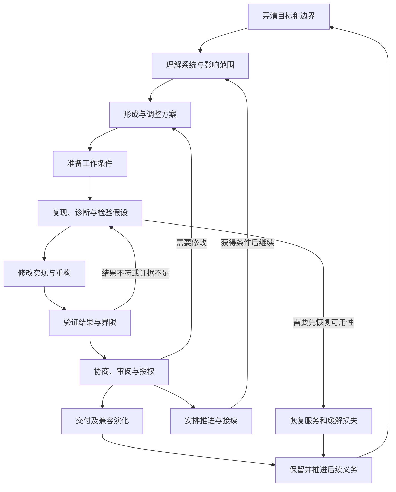

# 软件开发活动地图 v0.1：从真实过程归纳工作的变化

状态：已归档

**软件开发中的工作不能按“读文件、改代码、跑测试”直接分成几类。**同一个工具动作可以服务不同目的；一项工作也会同时改变代码、认识、决定和后续义务。首批材料支持先按“当前要解决什么、产生了什么后果”归纳活动，再研究它们如何组合。

这是一版探索地图，不是行业活动频率统计，也不是已经找到的最小语义模型。材料来自七篇实证论文、四个不同项目的过程及一份官方 Agent 示例，具体范围见[材料筛选](activity-source-review.md)。发表身份与原文入口在[来源清单](../../docs/specification/change-graph-task-state/source-inventory.md#2026-10-15开发活动调查来源)。

## 当前归纳出的十二类活动

| 开发者在做什么 | 这项工作改变什么 | 具体依据与边界 |
|---|---|---|
| 弄清目标和适用边界 | 要支持什么、不覆盖什么、哪些条件仍需满足 | Python 接受方向但保留条件；Kubernetes 曾明确某个 init 用例不在当前提案范围。排除用例不等于证明它没有价值 |
| 理解系统与影响范围 | 找到有关代码、行为、依赖和掌握知识的人 | Sillito/Ko 的观察，Agent 定位序列化代码；查到文件只是理解过程的一步 |
| 形成和调整方案 | 选择处理方式、说明依据、改变设计边界 | Kubernetes 结束顺序方案，curl 改为错误返回；有方案不等于已执行或兼容性已证实 |
| 准备工作条件 | 环境、依赖、数据、权限或资源变得可用 | Agent 安装依赖，GitLab 准备 staging 快照；准备失败和被研究的代码缺陷要区分 |
| 复现、诊断和检验假设 | 得到可重复现象，缩小原因范围或否定解释 | Agent 的毫秒输入输出差异，GitLab 复制恢复诊断；症状消失不自动证明根因完整解决 |
| 修改实现与重构 | 产物实际变化，或形成尚未被接受的修改建议 | Agent 语法拒绝与随后接受的编辑；Ko 的混合修改；重构研究中的多种动机。提出修改和应用修改必须区分 |
| 验证结果及其界限 | 某个版本在特定检查下得到结果 | Agent 单例输出从 344 变 345；没有完整回归证据，不能写成全面验证通过 |
| 协商、审阅和授权 | 理解、建议、许可或阻止某项推进 | Kubernetes 的 approve、lgtm 和 hold；代码审阅研究。意见有价值不等于它自动成为必须执行的命令 |
| 安排推进与接续 | 当前做什么、等待谁、何时继续、怎样分离交错工作 | Python 分阶段推出、Kubernetes 等待审阅、Ko 的信息阻塞与混合修改。等待不等于失败，恢复不等于全项目回滚 |
| 交付及兼容演化 | 产物进入提交、合并、发布、迁移等具体阶段 | Agent submitted、Kubernetes merged、curl 发布、Python 分阶段兼容。阶段须明确，不能全叫“完成” |
| 恢复服务和缓解损失 | 先恢复可用性或减少风险，保留尚未解决的原因和损失 | GitLab 恢复；curl 的配置缓解建议。一个是实际恢复过程，一个是官方建议，不能混成两次实际执行 |
| 保留并推进后续义务 | 把已知问题、延期建议和更大改造继续留下 | Kubernetes 合并仍留后续调整与重构，GitLab 服务恢复后另列改进清单。当前只观察到提出义务，未核验全部后续完成 |

这些类别可以重叠。例如一次 review 同时澄清设计、授予合入许可并留下后续工作；不强迫它只能归入一个格子。类别之间也不是项目管理阶段的固定流水线。

## 活动怎样衔接

图中的箭头表示材料中可见、可以发生的衔接，不是每项任务都必须经过的路径，也没有把循环次数当成长程复杂度证明。协作、信息查找和安排可以穿插在多个位置。

## 三处真实过程改变了我们对“工作状态”的理解

**修改建议可能根本没有生效。**SWE-agent 示例的一次编辑被语法检查拒绝，下一次修正缩进后才应用。如果保存的工作历史只写“改过这一行”，接手者会误认已经存在一个代码版本。应区分意图、尝试、工具结果和实际生效的变化。

**合并仍可能留下明确义务。**Kubernetes PR 120620 中，术语调整被留到 follow-up，更大的重构也被指出仍需完成。批准、hold、解除 hold 和合并又是不同事件。不能用一个 done 覆盖这些含义，也不能推断所有 follow-up 已解决。[实际 PR 讨论](https://github.com/kubernetes/kubernetes/pull/120620)。

**同一产物可以在另一种工作中获得新用途。**GitLab 为负载实验准备的快照后来成为恢复资源。保存“这是某项实验的文件”不足以说明后来怎样复用；但恢复成功也不意味着没有数据损失或后续改进。[一手复盘](https://about.gitlab.com/blog/postmortem-of-database-outage-of-january-31/)。

这些是从材料得到的设计约束候选，还没有因此证明需要哪种元操作。

## 已做的分类检查

逐类检查了支持证据，并对所选过程反查遗漏：Python 的接受条件和阶段；Kubernetes 的边界、alpha 问题、hold/审批和后续义务；curl 的条件、补丁、缓解和发布；GitLab 的准备、诊断、恢复和改进；Agent 示例的全部 14 步。编码保留 27 个证据单元；其中包括论文综合结果，不能当成 27 个独立任务。

易混淆对已明确：提出/应用修改，局部验证/全面验证，接受方向/默认启用，等待/证伪，合并/后续完成，缓解/根因修复。公开材料不足以判断的动机和完成情况保留未知。

本轮 G2 探索版通过：可以进入记录与 Agent 工作映射。尚未证明分类完整；商业需求协商、完整跨版本迁移及多轮 Context 压缩轨迹仍是缺口。分析者此前已接触元操作候选，因此不声称盲化归纳或独立标注者一致性。当前没有以三个候选接口为活动标签。

详细编码在主工作区 `artifacts/agent-task-state/analysis/2026-10-15-G2-attempt-01/activity-observations-v2.json`，方法和修订说明在同目录；v1 的补丁日期误标已根据原始 patch 更正，未覆盖原文件。
