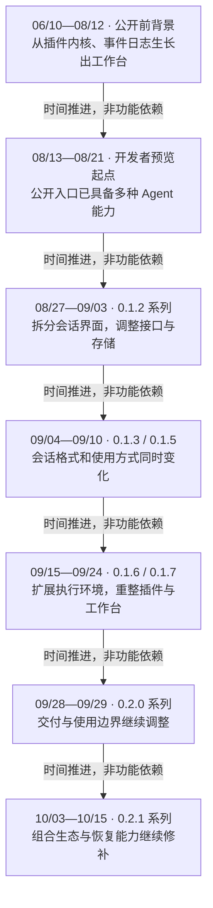

# DSH 全项目演化研究：从开发者预览到当前版本

状态：已归档

2026-10-18 新增[深度演化分析](dsh-development-analysis.md)，进一步解释本页八条工作线之间的联系、历史反复及设计取舍。本文保留为全景和版本导航。

**先把整个工程看清，再分析基本机制。**本轮将研究对象从 Session 局部扩到 DSH 全项目。已建立全部可识别版本的目录、代码祖先图、全项目设计记录快照与八条演化主线；本文解释它如何一路生长。详细版本和证据见[研究底稿](dsh-project-history-evidence.md)，可点击流程图见[全项目演化图](dsh-project-history.html)。

研究截止固定为 `86a402200d95fecef4529d969836f1fe13c6cb0d`（2026-10-15 的 alpha.4，采集日2026-10-16）。已获取 22,346 个可达提交的元数据、2,172 个主线提交；29个现存标签、28条完整发布正文；从发布提交另恢复11个版本号，合计40个版本点。40版设计文件目录及3,954份不同正文已保存。**全量获取与索引不等于逐条精读或逐提交验证。**本轮阅读全部发布中文条目，跨主线阅读关键决定、替代方案和约束；没有执行 upstream 或声称恢复全部私下讨论。

## 起点：开源时已经是一个生长过的系统

Git 最早可达提交在6月10日。0.0.1-rc.1 的 README 明确标为 internal testing；0.1.0-rc.6 的 README 已是 developer preview，并给出公开仓库和 npm 入口。GitHub 仓库 created_at 为8月13日，但没有取得 private→public 事件，因此准确公开时刻仍未知。npm 当前保留33版，最早包发布时间为北京时间8月11日；包公开可获取不能证明Git仓库当时已公开。现存最早 Release 是8月17日 rc.7，不能把它当成首次开发或首次公开。6—8月背景单列，帮助理解开源时已有的 Goals、子代理、工作流、压缩、沙箱与会话恢复。

## 先看全程

**06/10—08/12：从插件内核、事件日志生长出工作台。**Git 可达历史从 6 月开始；早期 0.0.1 README 标为内测。这些内容在后来公开仓库可见，不能倒推当时已经公开。

**08/13—08/21：公开入口已具备多种 Agent 能力。**0.1.0-rc.6 README 已使用公开仓库地址和开发者预览说明；现存最早 Release 是 rc.7。准确转为 public 的时刻未取得事件证据。

**08/27—09/03：拆分会话界面，调整接口与存储。**跨平台 SDK 与 ACP、多模态、Remote、长会话共同推进；恢复 ignorable、移除 SQLite 持久化，修补升级问题。

**09/04—09/10：会话格式和使用方式同时变化。**锁与 V2 后出现性能回退；随后改善长会话并进入 V3；Sidebar、文件交付、显式 Agent/Inbox 与动态系统提示并行。

**09/15—09/24：扩展执行环境，重整插件与工作台。**SSH、受限 PTC、桌面与 Office、插件安装和声明式预设；V4、后台任务、账号入口形成交错迁移。

**09/28—09/29：交付与使用边界继续调整。**桌面命令管理、权限诊断、工具结果未知处理、自动化可选化与消息来源、异步问答。

**10/03—10/15：组合生态与恢复能力继续修补。**兼容层、Worktrees、插件状态与索引、SDK resume、子代理/Team 简化；当前截止 alpha.4。

## 八条工作线怎样交错推进

下表和图中的阶段顺序只表示先后可见的状态；没有用发布时间推导因果。每条工作线均可从其来源回查。

### 插件与配置：运行中扩展如何成为可安装、可更新的能力

**起点**：插件化与 Profile 组合已存在；创造模式可操作运行时。 → **撤回一项保证**：事务回滚被撤销；解析失败和激活失败有不同结果。 → **更换实现路线**：创造模式不再维护第二套动态生成生命周期，改走插件安装。 → **统一持久配置**：预设和设置进入普通插件配置；运行中的 Agent 可保留旧修订。 → **持续补齐**：插件热替换修复、可替换与需重启分开；自定义索引与 engines.dsh。

设计依据：[Current-profile plugin management shares CLI transactions](https://github.com/deepseek-ai/deepseek-harness/blob/86a402200d95fecef4529d969836f1fe13c6cb0d/.agents/notes/implemented/architecture/2026-09-14-current-profile-plugin-management.md)、[Creator mode installs persistent plugin bundles](https://github.com/deepseek-ai/deepseek-harness/blob/86a402200d95fecef4529d969836f1fe13c6cb0d/.agents/notes/implemented/architecture/2026-09-16-creator-persistent-plugin-management.md)、[Declarative Agent presets and retained revisions](https://github.com/deepseek-ai/deepseek-harness/blob/86a402200d95fecef4529d969836f1fe13c6cb0d/.agents/notes/implemented/architecture/2026-09-18-declarative-agent-presets.md)、[Plugin market index format](https://github.com/deepseek-ai/deepseek-harness/blob/86a402200d95fecef4529d969836f1fe13c6cb0d/.agents/notes/implemented/feature/2026-10-02-plugin-market-index-format.md)、[Keep Loader mutations non-transactional](https://github.com/deepseek-ai/deepseek-harness/blob/86a402200d95fecef4529d969836f1fe13c6cb0d/.agents/notes/implemented/simplification/2026-09-09-nontransactional-loader.md)。

### 会话与上下文：旧工作如何在格式与读取方式变化后继续可用

**起点**：日志、恢复、分叉、压缩和查询已存在；SQLite 曾被优化。 → **缩减实现**：移除权威 SQLite 后端；按需事件读取替代公开数组。 → **V2 / V3**：锁、流式记录与系统提示进入迁移链；旧文件保留而新格式不可降级读取。 → **V4**：工具角色与跨事件检查、批量迁移、附件及历史兼容继续演进。 → **后续恢复**：极简压缩、SDK resume 与存储卸载末尾记录问题获得发布层更新。

设计依据：[Released Session formats migrate through stateful streaming stages](https://github.com/deepseek-ai/deepseek-harness/blob/86a402200d95fecef4529d969836f1fe13c6cb0d/.agents/notes/implemented/architecture/2026-08-31-released-session-format-migrations.md)、[The system prompt is surface node 0](https://github.com/deepseek-ai/deepseek-harness/blob/86a402200d95fecef4529d969836f1fe13c6cb0d/.agents/notes/implemented/architecture/2026-09-02-system-prompt-as-surface-node.md)、[Mandatory native V4 relationship validation](https://github.com/deepseek-ai/deepseek-harness/blob/86a402200d95fecef4529d969836f1fe13c6cb0d/.agents/notes/implemented/architecture/2026-09-17-native-v4-read-validation.md)、[Logical session and storage rebuild](https://github.com/deepseek-ai/deepseek-harness/blob/86a402200d95fecef4529d969836f1fe13c6cb0d/.agents/notes/proposed/architecture/2026-09-06-logical-session-storage-rebuild.md)、[Keep cleanup dependencies usable until consumers finish](https://github.com/deepseek-ai/deepseek-harness/blob/86a402200d95fecef4529d969836f1fe13c6cb0d/.agents/notes/proposed/architecture/2026-10-09-cordis-cleanup-dependency-lifetimes.md)。

### Agent 协作与长期任务：一次委派怎样变成可持续、可接续的工作

**初始能力**：Goals、计划、子代理与工作流已有组合；外部代理进入任务面板。 → **持续协作**：双向 send_message，后续输入可排队、编辑、Steer 与停止。 → **工作台管理**：后台任务、只读 Team 看板、归档影响提示和按成员名协作。 → **收敛生命周期**：统一 activation 与通知，Team 不再维护第二套 outbox 重试账本。 → **接续修补**：等待子任务不消耗目标轮次、独立子代理预设、意外退出明确停止。

设计依据：[Goal-owned durable events](https://github.com/deepseek-ai/deepseek-harness/blob/86a402200d95fecef4529d969836f1fe13c6cb0d/.agents/notes/implemented/architecture/2026-07-31-goal-owned-durable-events.md)、[Model-facing same-session goal tools](https://github.com/deepseek-ai/deepseek-harness/blob/86a402200d95fecef4529d969836f1fe13c6cb0d/.agents/notes/implemented/feature/2026-07-19-model-facing-goal-tools.md)、[Durable Agent Teams over continuable children](https://github.com/deepseek-ai/deepseek-harness/blob/86a402200d95fecef4529d969836f1fe13c6cb0d/.agents/notes/implemented/feature/2026-08-05-agent-teams.md)、[Unified subagent activations](https://github.com/deepseek-ai/deepseek-harness/blob/86a402200d95fecef4529d969836f1fe13c6cb0d/.agents/notes/implemented/simplification/2026-09-17-unified-subagent-activations.md)、[Team messages use the target inbox](https://github.com/deepseek-ai/deepseek-harness/blob/86a402200d95fecef4529d969836f1fe13c6cb0d/.agents/notes/implemented/simplification/2026-09-26-team-direct-inbox.md)。

### 执行世界与权限：工具、进程、沙箱和远程环境怎样共享规则

**跨平台基础**：持久 Shell、Windows PowerShell 和沙箱已存在；修补隔离绕过。 → **远端扩展**：SSH 替换一部分执行后端，移除 E2B；Node PTC 从 Worker 转为受限进程。 → **后台与退出**：长命令转后台，输出与取消、进程清理继续修补。 → **结果不确定**：工具已执行但结果未知时先检查副作用；Windows 权限诊断可恢复。 → **新执行载体**：SSH 可执行 helper、Worktrees、工作目录、持久 PTC 内存和权限变化。

设计依据：[POSIX SSH execution providers](https://github.com/deepseek-ai/deepseek-harness/blob/86a402200d95fecef4529d969836f1fe13c6cb0d/.agents/notes/implemented/architecture/2026-09-11-posix-ssh-runtime.md)、[Sandboxed Node execution for PTC](https://github.com/deepseek-ai/deepseek-harness/blob/86a402200d95fecef4529d969836f1fe13c6cb0d/.agents/notes/implemented/architecture/2026-09-11-sandboxed-node-ptc-runtime.md)、[Reuse the PTC Node sandbox for workflows](https://github.com/deepseek-ai/deepseek-harness/blob/86a402200d95fecef4529d969836f1fe13c6cb0d/.agents/notes/implemented/architecture/2026-09-13-workflow-ptc-sandbox-reuse.md)、[Retained PTC processes follow file policy](https://github.com/deepseek-ai/deepseek-harness/blob/86a402200d95fecef4529d969836f1fe13c6cb0d/.agents/notes/implemented/architecture/2026-10-08-persistent-ptc-sandbox.md)、[Windows sandbox rung: raw ACL restricted tokens over mxc and AppContainer](https://github.com/deepseek-ai/deepseek-harness/blob/86a402200d95fecef4529d969836f1fe13c6cb0d/.agents/notes/implemented/feature/2026-08-08-windows-acl-restricted-token-sandbox.md)。

### 人类工作台与文档：从聊天呈现走向查看、审阅和交付成果

**可用聊天**：设置、多模态、工具输出与长历史分页持续修补。 → **Sidebar**：替换 Detail；文件交付与 Markdown、代码、PDF、图片预览。 → **工作台扩展**：终端、Office、浏览器、子代理、计划和代码差异进入侧栏。 → **减少认知负担**：过程分组、展示详略、用户账号入口、快捷键和背景任务提示。 → **继续打磨**：Office 按需指引、滚动与字体修补、原始日志定位、插件功能预览。

设计依据：[Web client architecture — the client cordis plugin tree, the slot system, and the React-free object layer](https://github.com/deepseek-ai/deepseek-harness/blob/86a402200d95fecef4529d969836f1fe13c6cb0d/.agents/notes/archived/architecture/2026-07-19-gui-web-client-architecture.md)、[Independent LibreOffice kit ownership](https://github.com/deepseek-ai/deepseek-harness/blob/86a402200d95fecef4529d969836f1fe13c6cb0d/.agents/notes/implemented/architecture/2026-09-14-independent-libreoffice-kit.md)、[Bounded shared Office conversion](https://github.com/deepseek-ai/deepseek-harness/blob/86a402200d95fecef4529d969836f1fe13c6cb0d/.agents/notes/implemented/architecture/2026-09-15-bounded-office-conversion.md)、[Progressive Office skills with ordinary shell execution](https://github.com/deepseek-ai/deepseek-harness/blob/86a402200d95fecef4529d969836f1fe13c6cb0d/.agents/notes/implemented/architecture/2026-09-27-progressive-office-skills.md)、[Built-in plugin feature previews](https://github.com/deepseek-ai/deepseek-harness/blob/86a402200d95fecef4529d969836f1fe13c6cb0d/.agents/notes/implemented/feature/2026-10-14-built-in-plugin-feature-previews.md)。

### 模型、消息与多模态：模型接入变化会反过来影响历史与 UI

**图像输入**：原生图片、文件上传与预处理，外部代理和模型选择。 → **动态提示**：系统提示可动态更新；图像与附件占用纳入上下文管理。 → **协议迁移**：默认 Messages，随后移除官方适配器 Chat Completions 路径；旧通知需修复。 → **账号与能力**：账号/API Key 分路；模型声明支持时可动态增工具。 → **能力更新**：动态工具/提示路由、模型迁移、UI 推理等级、历史消息兼容。

设计依据：[Routed model context and compaction policy](https://github.com/deepseek-ai/deepseek-harness/blob/86a402200d95fecef4529d969836f1fe13c6cb0d/.agents/notes/implemented/architecture/2026-07-20-routed-model-context-and-compaction-policy.md)、[DeepSeek LLM API request extensions for session logs and plugin packages](https://github.com/deepseek-ai/deepseek-harness/blob/86a402200d95fecef4529d969836f1fe13c6cb0d/.agents/notes/implemented/architecture/2026-08-21-deepseek-llm-api-request-extensions.md)、[First-class tool-role messages](https://github.com/deepseek-ai/deepseek-harness/blob/86a402200d95fecef4529d969836f1fe13c6cb0d/.agents/notes/implemented/architecture/2026-09-15-first-class-tool-role-messages.md)。

### 自动化与用户控制：持久任务、可用入口与行动权限各自变化

**已有调度**：定时计划、目标暂停和恢复入口。 → **加强人类控制**：暂停不能由模型自行恢复；Host 任务存储逐步独立于加载会话。 → **任务产品化**：提醒、运行记录、默认关闭；工具按预设提供，历史有保留上限。 → **入口反复取舍**：0.2.0 可选包，随后明确用户定时消息来源。 → **重新组合**：0.2.1 回到 Web 内置，按模式暴露工具，已有任务保留。

设计依据：[Host-owned scheduled messages](https://github.com/deepseek-ai/deepseek-harness/blob/86a402200d95fecef4529d969836f1fe13c6cb0d/.agents/notes/implemented/architecture/2026-09-16-host-schedule-storage.md)、[Schedule deletes task rows and bounds delivery history](https://github.com/deepseek-ai/deepseek-harness/blob/86a402200d95fecef4529d969836f1fe13c6cb0d/.agents/notes/implemented/architecture/2026-09-22-schedule-hard-delete-and-bounded-history.md)、[Preset-scoped Schedule tools](https://github.com/deepseek-ai/deepseek-harness/blob/86a402200d95fecef4529d969836f1fe13c6cb0d/.agents/notes/implemented/architecture/2026-09-24-preset-scoped-schedule-tools.md)、[Delivered reminders are framed as scheduled messages from the user](https://github.com/deepseek-ai/deepseek-harness/blob/86a402200d95fecef4529d969836f1fe13c6cb0d/.agents/notes/implemented/architecture/2026-09-24-scheduled-message-framing.md)。

### 交付、平台与工程约束：发布能力自身也经历复用、移除和修补

**开发者发行**：npm、源码、SDK 运行时与原生依赖、跨平台支持逐步补齐。 → **平台负担**：原生编译问题推动预构建，格式迁移带来性能验证。 → **桌面与引擎**：独立 LibreOffice Kit、随桌面运行时、签名和真实安装检查。 → **默认值与边界**：桌面命令安装、自动化与 Inspector 可选化。 → **机制继续精简**：移除 invariant 插件不等于移除存储检查；Office SDK 依赖改按需下载。

设计依据：[Source-owned session immutability](https://github.com/deepseek-ai/deepseek-harness/blob/86a402200d95fecef4529d969836f1fe13c6cb0d/.agents/notes/implemented/architecture/2026-06-11-dev-invariants-over-deep-readonly.md)、[Independent LibreOffice kit ownership](https://github.com/deepseek-ai/deepseek-harness/blob/86a402200d95fecef4529d969836f1fe13c6cb0d/.agents/notes/implemented/architecture/2026-09-14-independent-libreoffice-kit.md)、[Desktop primary runtime](https://github.com/deepseek-ai/deepseek-harness/blob/86a402200d95fecef4529d969836f1fe13c6cb0d/.agents/notes/implemented/feature/2026-09-14-desktop-primary-runtime.md)、[Prohibit new assertions to unknown](https://github.com/deepseek-ai/deepseek-harness/blob/86a402200d95fecef4529d969836f1fe13c6cb0d/.agents/notes/implemented/process/2026-09-19-no-unknown-casts.md)。

## 记录最详细、值得连起来研究的取舍

**插件更新曾追求事务回滚，后来有选择地撤回。**非事务 Loader 决定明确要求撤销 #932 的五个提交，同时保留后续独立行为及两个必要兼容修补。它解释了为什么不能直接反转一个更大的 merge diff：那会删除无关能力。这是整合、部分保留与撤回的真实过程，不能简单标成“回滚成功”。

**创造模式从直接操作运行时，转为复用插件安装体系。**更换的是模型修改能力的路径；历史调用卡片、已有运行时消费者仍被保留。后续修补安装来源、兼容、热更新和需重启情况，说明一次路线调整会跨多个版本继续完成。

**Team 不是整体被替换，而是逐项简化。**最初的 roster、mailbox、task 分别承担产品责任；后续共享 activation 生命周期，再移除独立 outbox、自动重试和去重。历史 mailbox 仍解码，但不再投递旧待发内容。保留历史可读性和保留旧行为是两件事。

**自动化的存储、工具、启用方式与消息含义分别变化。**它经历 Host 存储、按模式提供工具、默认关闭、可选包和重回内置；“内置”不能推出“所有模式都可用”或“旧任务已被删除”。这条线可以用来检验我们的表示是否把不同决定挤成一个状态。

**会话格式迁移与架构迁移不是同一进度。**发布记录清楚显示 V2→V3→V4；LogicalSession 的多阶段提案却仍有 draft 和未完成阶段。设计文档在主分支，不能据此声称提案实现已经全部合入。

**新的全局材料修正了 Session 局部报告。**10月9日生命周期审查仍是 proposed，部分后果只是源码推导；10月14日 alpha.3 发布说明已宣布修复存储插件卸载时丢失尾部记录。这支持“该修复已宣布发布”，不支持“整个生命周期审查全部解决”。后续需核对实际修复提交和覆盖。

## 版本为什么不能只按编号排成一条线

0.1.5-rc.3 是一个真实分支：从 rc.2 分出，之后与 0.1.7 开发线汇合；它没有现存 Release 正文。附图中的分叉来自 Git 祖先关系。带日期的 0.1.6 构建也保留为版本点。没有证据的 0.1.0-rc.4、0.1.4 不补造；目录只列当前可达历史实际识别到的40个版本。Release 的候选版正文有汇总重述，不能将重复描述统计为功能再次实现。

## 这份全景接下来怎样使用

当前先固定工程全景，不从 Session 或任何单线直接宣布元操作。下一轮从八条线选取不同变化，按历史版本的当时材料逐步更新；同时检查部分撤回、继承约束、延期、可选化、重新组合、证据纠正与未知副作用。需要新机制的地方逐项记录，再在同一工程其他主线反查；不能仅因一个局部能编码就冻结。SWE-Milestone 保持唯一实验 benchmark。

## 覆盖与诚实边界

已覆盖全部40个已识别版本、全部现存Release正文、当前npm包目录33版、全部当前设计文件目录，以及40版本中3954份不同设计正文。完整提交元数据及文档变更路径历史已保存。npm的 latest/next 均指向0.2.0-rc.2，alpha指向0.2.1-alpha.4；最新代码、最新预览与默认安装渠道不能混同。主线阅读重点覆盖八类工程工作，但不是对1266个当前主题逐篇精读。当前设计文件会更新，文件名日期不是其全部内容首次成立的时间；研究中使用对应版本正文。归档是状态变化，不自动证明方案失败。PR/Issue详情尚未全量获取，公共接口404和网页检索429保留为限制；不能虚构审阅者、投票或因果。测试和CI的说法按作者记录或发布说明归属，没有独立重跑。npm未保留的历史、删除分支及私下工作不在“全量”范围。
